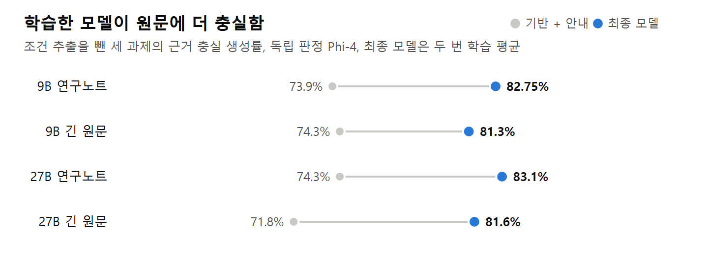
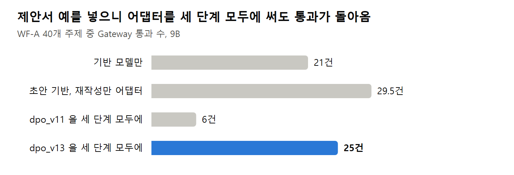

# 연구노트 2026-11-09 ~ 11-27

2026-11-09 ~ 11-27, PR #7 ~ #58
11-09 에 시작해서 11-27 까지 한 파일에 이어 적은 실험 기록임. 지금 결론은 바로 아래에 모았고, §1 부터는 시간순 원래 기록(정정 이력 포함)임.

그림 1. 평가 지시 2,294건(연구노트) / 1,603건(긴 원문) 전수, 조건 추출 뺀 세 과제, 독립 판정 Phi-4

## 지금 결론 (11-27 기준)

- 1차년도 모델은 9B dpo_v11, 27B dpo27_v7 로 둠. 기반 + 안내 대비 연구노트 +8.8 ~ +9.4%p, 긴 원문 +6.9 ~ +10.0%p. 두 번씩 학습해서 재현됨 (§59, §60)
- 4-bit(NF4) 보존율 98.2% 이상, 27B 가 16.1GiB (§60)
- 플라이휠은 한 바퀴만 효과 있음. 연구노트분만 더하면 +4.6%p, 전체를 더하면 +3.6%p. 두 바퀴째는 흔들림과 구분 안 됨 (§59, §61)
- 단락 과제로만 학습한 어댑터로 제안서 초안까지 쓰면 형식과 인용이 무너짐. 초안은 기반 모델, 재작성만 어댑터로 두니 9B 통과가 늘었음(40개 주제, §65). 제안서 예를 넣고 다시 학습하면 세 단계 모두에 써도 형식이 남음(§65, 반복 중)
- 판정 모델이 통과시킨 문장은 사람 검수에서도 맞았음. 맞는 문장 약 10% 는 떨어뜨림 (§64)
- 조건 추출 지표는 값이 원문에 있는지만 봄. 올바른 실험 조건인지는 못 잼 (§64)
- 판정 인코더는 v3 그대로 (§63)
- 아직 모르는 것: 성능지표 2종(보고서 정확도, 도메인 질의) 미측정, 제안서 예 학습의 반복 결과(v49), 사람 사이 일치도

## 1. 목적

GPU 투입 전에 "지금까지의 결론이 맞는가"를 먼저 점검했음. 그 결과 판정 지표 자체와
최신 학습셋에 결함이 있었음. 이후 공개 데이터만으로 GPU 실측을 했음
(고객 연구노트는 이용 권한 미확인이라 GPU 서버에 올리지 않았음).

## 2. 환경: 문서 가정과 실제가 달랐음

| 항목 | 문서 가정 | 실제 |
|---|---|---|
| GPU | H100 80GB × 2 | H200 141GB × 2 (NIPA 고성능 컴퓨팅 지원사업) |
| 플랫폼 | AI Train / AI Serv | Backend.AI 컨테이너 세션 |
| 이미지 | 자유 | NGC PyTorch 3종. torch 는 pip constraint 로 고정 |
| 회수 |  | GPU util 6시간 평균 1% 미만이면 세션 회수 |
| 계정 | 전용 | 레드윗 다른 과제와 공유 |

`docs/H100_PLAN.md` 상단에 실측 환경을 병기했음. 작업 폴더는 NAS `research-data-analysis`(연구데이터 분석 관리).

## 3. 결함 ① 근거/주장 학습셋 v1: 표면 특징으로 라벨이 샘

`data/nli/claim_evidence.jsonl`(15,267건)을 감사했음.

| 측정 | 값 |
|---|---|
| contradict 근거의 숫자/단위 띄어쓰기 | 100% (entail 12%): `perturb()` 가 항상 `"{값} {단위}"` 로 썼음 |
| neutral 의 주장/근거 내용어 중첩 0 | 97% (entail/contradict 0%): 무작위 문서에서 골랐음 |
| 의미를 안 보는 표면 규칙의 3분류 정확도 | 94.9% (우연 33%) |
| 주장과 공유 수치가 없는데 contradict | 82%: 바꾼 수치가 주장과 무관하면 모순이 아님 |

09-02 §34 에서 품질 확인 예로 든 쌍("50~60%로 감소" vs "79% 이하")도 실제로는 양립함.

### v2 수정

1. 교란 시 원문 띄어쓰기 보존
2. 주장과 같은 값을 공유하는 수치만 교란, 부등호(이하/이상/미만/초과)에 묶인 수치는 제외
3. neutral 을 어휘가 겹치는 다른 문서의 근거에서 선택(주장 수치는 공유하지 않는 것)
4. 누설 게이트: 표면 특징 상한 정확도가 60% 를 넘으면 "학습 금지"를 출력

### v2 결과: 게이트가 막았음

| | v1 | v2 |
|---|---|---|
| 건수(문서 1/8) | 15,267 | 2,856 |
| 표면 상한 정확도 | 94.9% | 87.6% (막힘) |
| 공유 수치 특징을 뺀 상한 |  | 54.6% |

띄어쓰기/중첩 누설은 사라졌음. 남은 누설은 "근거에 주장의 수치가 그대로 있으면 entail" 하나임.
그런데 이것은 누설이 아니라 라벨 정의 그 자체임. 규칙으로 만든 라벨은 규칙으로 맞힐 수 있음.

판단: 사람 라벨 없는 자동 추출로는 NLI 가 규칙 이상을 배울 수 없음. 유형 C(수치 변조)는
학습 없이 게이트웨이의 규칙(주장/근거 수치 일치 검사)으로 직접 잡는 편이 나음.
이 셋은 학습에 쓰지 않음. `ARCHITECTURE.md` 의 "자동추출" 방침은 NLI 학습에 한해 성립하지 않음.

## 4. 결함 ② 한국어 실데이터 AUC 0.704: 판정할 수 없는 평가였음

`kr_protocols` 평가셋의 근거(`grounding_of`)는 과제 서술(brief_summary + description)뿐임.
정답 값이 근거에 있는 비율:

| 필드 | 근거에 정답 값 있음 | 정답/오답의 근거 중첩 동률(판정 불가) |
|---|---|---|
| primary_outcome | 0% | 17% |
| enrollment | 26% | 74% |
| eligibility | 0% | 8% |
| institution | 9% | 59% |

어떤 NLI 도 원리적으로 판정할 수 없음. 0.704 는 주제어 겹침을 잰 값임.
그래서 트랜스포머 NLI 를 붙이면 오히려 내려간다(근거가 없으면 "판단 불가"가 맞는 동작):

| NLI (zero-shot) | 원 평가 AUC | 레코드 포함 AUC | 분리도(레코드 포함) |
|---|---|---|---|
| 통계 v0.5 | 0.704 | 0.868 | +0.047 |
| DeBERTa-v3-large (EN) | 0.522 | 0.900 | +0.203 |
| mDeBERTa-v3-base (다국어) | 0.544 | 0.907 | +0.196 |
| bge-m3-zeroshot-v2.0 (다국어) | 0.630 | 0.969 | +0.197 |

`--full-record` 는 근거에 해당 과제의 결과변수/등록례수/선정기준/수행기관 레코드를 덧붙임
(인용된 출처 = 과제 레코드 전체라는 실제 상황과 같음). bge-m3 는 θ=0.70 에서
P 90.1% / R 97.8% / PASS 89.2%.

주의: 정답 값이 근거에 문자 그대로 있는 쉬운 조건임. LLM 출력은 바꿔 쓰므로
패러프레이즈 평가 전에는 KPI 근거로 쓰지 않음.

## 5. GPU 실측 ① 영어 외부 평가 (SciFact dev, zero-shot)

정상 통과 ≥80% 제약 하 최고 F1:

| NLI | F1 |
|---|---|
| 통계 v0.5 | 24.0% |
| DeBERTa-v3-large | 31.4% |
| mDeBERTa-v3-base | 28.6% |
| bge-m3-zeroshot | 25.8% |

## 6. GPU 실측 ② 파인튜닝: 가설 기각

가설: 기존 M1(2분류)은 MNLI 헤드를 버려 neutral 을 잃으므로 오귀속을 못 잡는다 →
3분류(헤드 유지 + NEI 학습)가 나음. DeBERTa-v3-large, SciFact train, 3 epoch, H200 1장(약 2분).

| | SciFact dev F1 | KR 원 평가 AUC | KR 레코드 포함 AUC |
|---|---|---|---|
| zero-shot | 31.4% | 0.522 | 0.900 |
| 2분류 FT (구 M1) | 92.9% | 0.606 | 0.898 |
| 3분류 FT (+NEI) | 91.0% | 0.545 | 0.781 |

- 가설 기각. 3분류가 두 평가 모두 열위임. 기본값을 2분류로 유지함.
- SciFact F1 31 → 93% 는 같은 분포(SciFact train→dev, SUPPORT vs CONTRADICT)의 성능임.
  한국어 귀속 과제(레코드 포함)는 zero-shot 0.900 → FT 0.898 로 움직이지 않았음.
  영어 바이오 NLI 학습은 우리 과제로 전이되지 않음. 도메인 라벨 데이터가 필요함.

## 7. 정정 사항

| # | 항목 | 이전 | 정정 |
|---|---|---|---|
| 19 | 베이스 모델 라이선스 (2026-05) | "EXAONE/Qwen/Gemma 모두 Apache 2.0" | EXAONE 3.5 = EXAONE AI Model License(비상업), Gemma 2 = Gemma Terms of Use. Apache 2.0 은 Qwen2.5 뿐. 상용 온프레미스 BM 과 충돌 |
| 20 | 한국어 AUC 0.704 의 해석 (README, 08-26) | "표본 부족이 아니라 모델 한계" | 평가 설계 결함: 근거에 정답이 없음. 레코드 포함 시 통계 0.868 / 트랜스포머 0.90~0.97 |
| 21 | 근거/주장 학습셋 v1 (09-02 §31~36) | "10건 모두 실제로 뒷받침, 학습 가능" | 표면 누설 94.9%. 철회. v2 도 규칙과 순환 → 학습 금지 |
| 22 | 분류기 v4 홀드아웃 84.7% (09-02 §25) | "과적합 없음" | §23 의 fragment 진단(114건)이 360건 전체를 봤다 = 홀드아웃 포함. v4 홀드아웃 수치는 철회. 마지막 유효 홀드아웃은 v3 77.9% |
| 23 | 정답 라벨의 성격 (09-02 전반) | 연구 내용 "59.4% 확정" | gold 는 모델 2차 판정이고 08-31 에 계획한 사람 검수 500건은 수행되지 않았음. ±5.1 은 표본오차만임. "확정" 철회 |
| 24 | GPU 환경 (H100_PLAN) | H100 × 2, AI Train/Serv | H200 × 2, Backend.AI |

## 8. 남은 일 (우선순위)

1. 사람 라벨 한국어 평가셋 200~300쌍: 모든 결론이 여기에 막혀 있음. 자동 생성은 순환임.
2. 레코드 포함 평가의 패러프레이즈 판: LLM 이 바꿔 쓴 주장으로 재측정해야 KPI 근거가 됨.
3. 유형 C 를 학습이 아니라 규칙(주장/근거 수치 일치)으로 게이트웨이에 넣음.
4. 고객 데이터 학습 이용 권한/반출 범위 법무 확인 (`OCR_HARVEST.md` 체크리스트가 미해결 상태로 남아 있음).
5. 베이스 모델 교체 검토: 상용이면 Qwen2.5(Apache 2.0) 또는 EXAONE 상용 라이선스 별도 계약.

## 9. 한 줄

지표가 틀렸고, 학습셋은 규칙을 다시 배우는 순환이었음. 판정 가능한 평가로 바꾸자
트랜스포머 NLI 는 zero-shot 으로도 작동했다(AUC 0.90~0.97). 병목은 모델이 아니라 사람 라벨임.

# [추가] 베이스 모델 교체, 한국어 연구노트 평가셋, 한국어 NLI 학습

사용자 지시: ① 고객 연구노트 사용 허용 ② 한국어 평가셋 라벨은 Claude 가 작성 ③ EXAONE 대신 최신 모델.

## 10. 베이스 모델: Qwen3.8-27B

HF API 로 2026-11 기준 공개 모델/라이선스를 확인했다(cardData).

| 후보 | 공개 | 라이선스 | 판단 |
|---|---|---|---|
| Qwen/Qwen3.8-27B | 2026-08 | Apache 2.0 | 채택. H200 bf16 그대로, 4-bit ≈15GB → RTX 4090 온프레미스 가능 |
| Qwen/Qwen3.5-9B | 2026-02 | Apache 2.0 | 경량판 |
| EXAONE 4.5-33B / K-EXAONE-236B | 2026 | other | 제외(사용자 지시 + 라이선스) |
| kanana-2, HyperCLOVA X SEED | 2025~26 | other | 제외 |

`BASE_MODELS` 에서 EXAONE 을 지웠음. Qwen3.8-27B 는 `Qwen3_5ForConditionalGeneration`(비전 통합,
하이브리드 선형 어텐션)으로 로드되며 transformers 5.3 이 필요하다(NGC 25.03 의 4.55 로는 안 됨 →
NAS venv). 모델 52GB 는 스크래치(49GB)에 안 들어가 컨테이너 루트(`/tmp`, 2.7TB)에 받음.

## 11. 평가셋 v1 실패: 같은 문서 근거는 주장을 뒷받침하지 않음

학습셋과 겹치지 않는 문서(해시 %8 == 3) 400개에서 (주장, 같은 문서 근거) / (주장, 다른 문서 근거)
800쌍을 뽑아 360쌍을 의미로 판정했다(Claude 서브에이전트 3, 규칙/모델 미사용).

| | 판정 가능 | 뒷받침 | 모순 | 판단불가 |
|---|---|---|---|---|
| 같은 문서 근거 | 160 | 1 (0.6%) | 0 | 159 |
| 다른 문서 근거 | 146 | 0 | 0 | 146 |

같은 문서의 근거 문장은 대개 다른 단계(조건/캡션/계획/다른 측정)를 말함.
→ 정정 25: 08-31 정정 15("문서 내 근거로 SourceMatch 학습 가능")를 재정정함. 문서 단위 동거율(11.7%)은
쌍 단위 뒷받침률(0.6%)과 전혀 다름. 학습셋 v1/v2 가 "같은 문서 = entail" 로 만든 라벨은 거의 전부 틀렸음.

## 12. 평가셋 v2: 원문 단락 → 보고서 문장 (제품 상황)

게이트웨이가 실제로 보는 것은 "LLM 이 원문을 옮겨 쓴 문장"임. 그래서 단위를 바꿨음.

- premise = 연구노트 원문 단락(수치 결과 문장 ±2문장), 문서 해시 %8 == 5, 목적/계획/커밋/잘린 문장 제외
- hypothesis 4종을 Claude 가 작성/판정: faithful(뒷받침), paraphrase(뒷받침, 어휘 교체) /
  altered(모순, 수치 또는 방향 최소 수정), unsupported(판단불가, 원문에 없는 주장 1개 덧붙임)
- 150 단락 중 배치 1/3 의 97 단락, 388행 채택. 배치 2(50 단락)는 안전 필터로 생성이 두 번 중단돼 제외
- 표면 누설 상한 58.2% (다수 클래스 50%): 어휘/수치 겹침으로 풀리지 않음
- 라벨러는 Claude 임. 사람 검수가 아님. 가설 문장도 LLM 이 썼음 → LLM 판정기에 유리할 수 있음

### 결과 (H200, 정상 통과 ≥ 90% 운영점)

| 백엔드 | AUC | 위반탐지 P | R | F1 | 덧붙인 주장 평균점수 |
|---|---|---|---|---|---|
| 통계 v0.5 | 0.394 |  | 0% | 0% | 0.373 |
| SciFact FT 2분류 | 0.934 | 90.2% | 75.8% | 82.4% | 0.972 |
| SciFact FT 3분류 | 0.968 | 94.1% | 82.5% | 87.9% | 0.877 |
| bge-m3-zeroshot | 0.985 | 92.9% | 94.8% | 93.9% | 0.049 |
| DeBERTa-v3-large zero-shot | 0.993 | 94.5% | 97.4% | 95.9% | 0.030 |
| KLUE-NLI FT (mDeBERTa-base) | 0.993 | 95.5% | 97.4% | 96.4% | 0.023 |
| Qwen3.8-27B 판정기 | 0.998 | 99.5% | 99.5% | 99.5% | 0.001 |

- 통계 v0.5 는 무작위보다 나쁘다(AUC 0.394). 바꿔 쓴 문장을 낮게, 단어를 공유하는 수정/덧붙임을 높게 봄.
- SciFact 2분류 FT 는 덧붙인 주장을 통과시킨다(0.972). 06절의 "3분류 가설 기각"은 평가셋에 따라 뒤집혔음: 
  제품 상황에 가장 가까운 이 평가를 따라 기본값을 3분류로 바꿨음. 다만 SciFact 학습 자체가 zero-shot 보다 못함.
- KLUE-NLI(원어민 한국어, CC BY-SA 4.0) 3 epoch FT: KLUE dev 정확도 87.9%, 이 평가 F1 96.4% (zero-shot mDeBERTa AUC 0.983 → 0.993).
- 사업계획서 KPI "규정위반 탐지 정밀도 90%+" 를 이 평가에서는 인코더/LLM 모두 넘음.
  단, Claude 작성/판정, 97 단락이라 KPI 근거로 단정하지 않음. 사람 검수 표본(최소 100행)으로 라벨 일치도를 먼저 재야 함.

### 운영 구성 제안

| 단계 | 백엔드 | 이유 |
|---|---|---|
| 1차(전수, 실시간) | KLUE FT mDeBERTa-base (280M) | F1 96.4%, H200 에서 수천 쌍/초 |
| 2차(애매 구간/고위험) | Qwen3.8-27B 판정기 | P 99.5%, 1차 점수 0.05~0.9 구간만 |

## 13. 데이터 보호: 비식별화가 민감정보를 못 거름

평가셋 작성 중 특정 아동의 청력/언어 평가, 임상 부작용, 실명 담당자가 담긴 단락이 나왔음.
현 비식별화는 이름/식별번호 패턴만 지움. 개인정보보호법상 민감정보(건강) 가 담긴 문서는
문서 단위로 걸러야 한다(의료/임상/개인 평가 표지). 학습 투입 전 필수.

## 14. 정정

| # | 항목 | 이전 | 정정 |
|---|---|---|---|
| 25 | 문서 내 근거로 SourceMatch (08-31 정정 15) | 가능: 근거+주장 문서 11.7% | 쌍 단위 뒷받침 0.6%(1/160). 재정정 |
| 26 | 3분류 FT 기각 (06절) | 2분류 우위 | 평가셋 의존. 한국어 연구노트 평가에서 3분류 우위 → 기본 3분류 |
| 27 | 베이스 모델 | EXAONE 3.5 7.8B | Qwen3.8-27B (Apache 2.0), 경량 Qwen3.5-9B |

## 15. 다음

1. 사람 검수 100행: Claude 라벨과의 일치도(κ)를 재야 이 평가가 KPI 근거가 됨
2. 더 어려운 가설: 단위 혼동(µg↔g), 부등호(이상↔초과), 헤지("판단됨" → 단정): 지금 셋은 모델 간 변별이 약함
3. 민감정보 문서 필터 → 그 뒤에 연구노트로 학습셋 구축(이번엔 의미 라벨 기반)
4. KorNLI/VitaminC 추가 FT 로 KLUE FT 와 비교 (`docs/DATASETS.md` ⑦)

# [추가] 다음 작업: 어려운 평가셋, 단위 규칙, 캐스케이드, 민감정보

## 16. 어려운 가설 셋 (같은 단락, 88단락 189행, Claude 작성/판정)

| kind | label | 무엇을 시험하나 |
|---|---|---|
| round_entail (86) | entail | 반올림/단위 환산(1,000 mg→1 g)/분수→% 같은 정당한 근사 |
| unit_swap (36) | contradict | 값은 같고 단위만 바뀜(µg→mg, min→hr) |
| bound_flip (27) | contradict | 이상↔이하, 최대↔최소 |
| hedge_drop (20) | neutral | 원문은 "판단됨/보임"인데 "확인되었다"로 단정 |
| hedge_keep (20) | entail | 같은 헤지 유지 |

표면 누설 상한 56.6%. 라벨러 주의: 실험 조건(용량/시간)의 단위 바꿈은 엄밀한 NLI 로는 neutral 일 수 있으나
"기록을 잘못 옮김"이므로 contradict 로 뒀음.

### 결과 (정상통과 ≥ 90% 운영점 위반탐지)

| 백엔드 | 기본셋 F1 | 어려운 셋 AUC | 어려운 셋 F1 | 단위바꿈 점수 | 단정화 점수 | 정당 근사 점수 |
|---|---|---|---|---|---|---|
| 통계 v0.5 | 0% | 0.493 | 14.0% | 0.22 | 0.22 | 0.22 |
| bge-m3 zs | 94.1% | 0.712 | 47.5% | 0.32 | 0.66 | 0.52 |
| DeBERTa-large zs | 95.9% | 0.772 | 42.4% | 0.41 | 0.65 | 0.65 |
| KLUE FT | 96.2% | 0.700 | 0% | 0.27 | 0.74 | 0.44 |
| KLUE+KorNLI FT | 94.8% | 0.722 | 54.0% | 0.38 | 0.72 | 0.57 |
| SciFact FT 3분류 | 87.3% | 0.725 | 54.0% | 0.85 | 1.00 | 0.90 |
| Qwen3.8-27B | 99.5% | 0.957 | 90.6% | 0.02 | 0.23 | 0.63 |

- 인코더는 단위 바꿈을 통과시키고, 단정화를 받아들이고, 정당한 근사를 거부함. 마지막 것이 오탐이 돼 통과율 제약에서 F1 이 무너짐.
- KLUE FT 는 기본셋 최고(96.2%)지만 어려운 셋 최악: 쉬운 평가로 고른 1차 판정기(12절 제안)는 틀렸다(정정 28).
- KorNLI 10만 추가는 효과 없음(KLUE dev 87.9 → 87.3%).
- Qwen 의 남은 약점은 정당한 근사(0.63): 환산/반올림을 반박으로 보는 경향.

## 17. 단위 바꿈 규칙 (`vcr/hallucination.py: unit_swaps`)

`_type_c` 는 "같은 단위/다른 값"만 봄. "같은 값/같은 차원의 다른 단위"를 잡는 규칙을 추가했음.
단위 바꿈 36건 중 19건 적중, 나머지 517행 오탐 0. 놓친 17건은 m/min/IU/mL/mg/kg/day 같은 복합 단위.
값 1 은 제외("1초당→1분당" 같은 비율 분모가 오탐 원인이었음).

## 18. 캐스케이드: 규칙 → 인코더 → 애매 구간만 Qwen

행별 점수로 시뮬레이션(`scripts/cascade_sim.py`). 기본셋+어려운 셋 553행, 정상통과 ≥ 90%.

| 구성 | Qwen 호출 | P | R | F1 | 2-fold 홀드아웃 F1 |
|---|---|---|---|---|---|
| 인코더(DeBERTa) 단독 + 규칙 | 0% | 91.7% | 83.4% | 87.4% | 86.3% |
| 규칙 + DeBERTa + Qwen(애매 구간) | 9% | 91.9% | 90.2% | 91.0% | 90.4% |
| 〃 | 26% | 95.0% | 92.8% | 93.9% | 93.2% |
| 규칙 + Qwen 단독 | 97% | 99.2% | 94.7% | 96.9% | 96.6% |

- 1차 인코더는 DeBERTa-large 가 맞음. KLUE FT 는 점수가 극단적이라(과신) 애매 구간이 생기지 않아 60% 를 넘겨야 Qwen 이 붙음.
- 정밀도 90%+ 를 Qwen 호출 9% 로 지킴. 비용이 허락하면 Qwen 단독이 최선.

## 19. 민감정보 필터: 전수 4.01%

`sensitive.py` 를 게이트에 연결(문서 단위). 라벨러 심사로 걸러진 건강 단락 3/3 적중, 통과 단락 88개 오탐 0.
전수: 976,236 문서 중 39,187 (4.01%): 학습에서 제외. 행 사유: 개인+건강 99,306 / 이상반응 21,232.
실명(직함 뒤 이름)은 비식별화가 놓쳤음: 별도 과제.

## 20. 사람 검수 시트

`scripts/review_sheet.py make` → `data/labeling/review_100.csv`(kind 균등 100행, 정답 키 분리).
검수 후 `score` 로 κ 산출. κ ≥ 0.8 이전에는 위 수치 모두 "Claude 라벨 기준"임.

## 21. 정정

| # | 항목 | 이전 | 정정 |
|---|---|---|---|
| 28 | 1차 판정기 (12절) | KLUE FT (기본셋 F1 96.4) | 어려운 셋 F1 0%: DeBERTa-large + 단위 규칙, Qwen 9~26% |

# [추가] 검증 엔진 연결, Qwen 프롬프트 v2, 비식별화 실명 누락

## 22. 05 단계 문장 게이팅: VCR 의 공백

VCR 의 SourceMatch 는 인용이 달린 문장만 근거와 대조함. 연구노트를 보고서로 옮긴 문장처럼
인용 없이 원문에 기대는 문장은 검증 대상이 아니었음. `ComplianceGateway(sentence_threshold=...)` 로
응답의 모든 문장을 근거와 대조하고, 뒷받침 안 된 문장이 있으면 재생성/차단함. 판정 근거(문장/점수)는
감사 해시에 포함됨. 기본값(None)은 기존 동작.

- `nli/cascade.py: CascadeNLI`: 단위 규칙 → DeBERTa-large → 애매 구간(0.005~0.8)만 Qwen, 임계값 0.1
- VCR 유형 C 에 `unit_swaps` 반영(값 같고 단위만 바뀌면 Halluc=1.0)
- 평가 CLI: `--nli cascade`

## 23. Qwen 판정 프롬프트 v2

v1 은 정당한 근사를 반박으로 봤다(0.63). v2 는 근사/환산 허용, 단위 크기 변경/부등호/추정→확정을 명시했음.

| | 기본셋 F1 | 어려운 셋 AUC | 어려운 셋 F1 | 근사 | 단정화 | 단위바꿈 |
|---|---|---|---|---|---|---|
| v1 | 99.5% | 0.957 | 90.6% | 0.63 | 0.23 | 0.02 |
| v2 | 99.7% | 0.996 | 97.0% | 0.75 | 0.002 | 0.01 |

주의: v2 는 이 평가셋에서 관찰한 실패 유형을 보고 썼다(시험에 맞춘 효과가 섞여 있음).
프롬프트 설계에 쓰지 않은 새 평가셋으로 재확인해야 함.

캐스케이드(DeBERTa 1차 + Qwen v2, 2-fold 홀드아웃): Qwen 9% → F1 90.6%(어려운 셋 73.8%),
27% → 94.5%(83.5%), 46% → 96.7%(89.3%), 단독 → 98.9%(97.6%). 1차 인코더가 어려운 사례에서
확신하며 틀림: 근사를 강하게 거부하고 단정을 강하게 받아들임. 실제 `CascadeNLI` 로 돌린 어려운 셋 F1 81.5%.
→ 다음 작업: Qwen v2 판정을 1차 인코더에 증류.

## 24. 비식별화: 직함 앞뒤 실명이 새고 있었음

기존 규칙은 "연구자: 김민준" 처럼 라벨+콜론 뒤만 지웠음. "장혜식 교수님", "변리사 홍길동",
"책임연구원 이수진" 같은 실명이 그대로 남았음. 성씨 + 직함 규칙(직함인명/인명직함)을 추가하고,
기관명(한국○○연구원)/직함 자체(원장님)/일반어(참여 연구원)를 제외했음.

- 표본 2만 행에서 실명 치환 838건 → 전수 환산 약 24만 건이 비식별화를 빠져나가고 있었음
- 상위 100 치환 토큰 중 이름형(3글자) 80%, 상위 50 은 거의 전부 실명
- 단위 사례 18/18 일치. 남은 오탐은 일부 일반어 과치환(텍스트 손상): 실명 누출보다 나음

기존 산출물(학습셋 v1/v2, 평가 후보)은 새 규칙 이전에 만들어졌음. 모두 `data/`(gitignore) 안이며
학습에 쓰기 전 재비식별화가 필요함.

# [추가] Qwen 판정 → 1차 인코더 증류

## 25. 증류: 문장은 LLM 이 쓰고, 라벨은 별도 판정 패스가

자동 학습셋 v1/v2 는 규칙으로 만든 라벨이라 규칙과 순환했다(§3). 이번엔 생성과 판정을 분리했음.

1. 단락 1,492개(해시 %8 == 1: 평가셋 %8 == 5 와 문서 불중복, 평가 단락과 같은 텍스트 8개 추가 제거,
   민감 문서 제외, 새 실명 규칙으로 비식별화)
2. Qwen3.8-27B 가 단락마다 8종 문장 생성(faithful/paraphrase/approx/altered_number/altered_direction/
   unit_swap/hedge_drop/unsupported) → 10,386 문장
3. Qwen v2 판정기가 채점, 생성 의도와 판정이 일치(≥0.8 / ≤0.2)하는 것만 채택 → 8,978 (폐기 1,408)
4. DeBERTa-large(MNLI 헤드 유지, 3분류) 3 epoch: H200 4분

### 학생 모델

| 1차 인코더 | 기본셋 F1 | 어려운 셋 AUC | 단위바꿈 | 단정화 | 정당 근사 |
|---|---|---|---|---|---|
| DeBERTa-large zs | 95.9% | 0.772 | 0.41 | 0.65 | 0.65 |
| 증류 학생 | 98.4% | 0.923 | 0.06 | 0.05 | 0.65 |
| (교사) Qwen v2 | 99.7% | 0.996 | 0.01 | 0.002 | 0.75 |

단위 바꿈/단정화는 교사 수준으로 옮겨졌음. 정당한 근사는 여전히 거부한다(교사도 0.75 로 약했고,
학습셋의 approx 는 교사가 받아들인 것만 남았음).

### 근사 라우팅 (`vcr/hallucination.py: approx_numbers`)

근거에 그대로는 없지만 환산/반올림하면 10% 안쪽인 수치 → 인코더를 건너뛰고 LLM 으로.
어려운 셋 정당 근사 30/86 을 보내고, 다른 유형은 하나도 보내지 않음. 분수→%, "10배"→1/10, ℃→K 는 못 잡음.

### 캐스케이드 (2-fold 홀드아웃, 정상통과 ≥ 90%)

| 구성 | LLM 호출 | F1 | 어려운 셋 F1 / PASS |
|---|---|---|---|
| DeBERTa zs + 라우팅 + Qwen v2 | 9% | 90.3% | 76.3% / 89.6% |
| 증류 학생 + Qwen v2 | 3% | 93.8% | 85.6% / 77.4% |
| 증류 학생 + 라우팅 + Qwen v2 | 8% | 95.4% (P 93.8%) | 89.9% / 85.8% |
| Qwen v2 단독 | 97% | 98.9% | 97.6% |

실제 `CascadeNLI.default()` 끝단 측정: 기본셋 F1 98.6%(LLM 2%), 어려운 셋 F1 89.9%/P 84.2%(LLM 23%).
어려운 셋 정밀도 84.2% 는 KPI 90% 미달: 남은 오탐은 정당한 근사(분수/배율 표현).

### 한계

- 교사(Qwen v2 프롬프트)가 이 평가셋의 실패 유형을 보고 설계됐다 → 학생도 같은 편향을 물려받음.
- 평가 가설과 학습 가설을 모두 LLM 이 썼다(문체 유사). 사람이 쓴 보고서 문장으로 재확인 필요.
- 모든 수치는 Claude 라벨 기준: 사람 검수(κ) 전.

## 26. 다음

1. 사람 검수 100행 → κ
2. 근사 라우팅 확장(분수/배율/온도 단위) 또는 approx 학습 예시 보강 → 어려운 셋 정밀도 90%
3. 프롬프트/증류 설계에 쓰지 않은 새 평가셋(가능하면 사람이 쓴 실제 보고서 문장)으로 재확인

# [추가] 라우팅 확장: 어려운 셋 정밀도 KPI 통과

## 27. 남은 오탐 분석 → "근거에 없는 숫자"면 LLM 으로

§25 구성의 오탐 17건 중 15건이 정당한 근사/환산이었음. 근사 판별(`approx_numbers`)이 못 잡은 이유:
쉼표 숫자(5,000 nM)/µL/µM 표기 파싱 실패, mm(길이)/mM(농도) 소문자 충돌, 그리고 수치 추론 표현
(4분의 1, 2.5만 명, 1분 40초, 3배/16배, 시간당 6회). 규칙을 넓히기보다 단순화했다:

문장에 근거와 같은 숫자가 아닌 숫자가 하나라도 있으면 LLM 이 판정함(`novel_numbers`).

수치 변조(위반)도 LLM 으로 가지만 Qwen v2 는 변조를 잘 잡는다(altered 평균 0.001). `approx_numbers` 는 삭제.

| 구성 | LLM 호출 | 전체 F1 | 어려운 셋 P | 어려운 셋 F1 | 기본셋 F1 |
|---|---|---|---|---|---|
| 근사 라우팅(§25) | 8% | 95.4% | 84.2% | 89.9% | 98.6% |
| 새 숫자 라우팅 | 24% | 97.6% (P 97.0%) | 93.0% | 94.7% | 98.9% |

2-fold 홀드아웃 F1 97.2%. 임계값 (lo, hi, θ) = (0.005, 0.98, 0.01).
어려운 셋 정밀도가 KPI 90% 를 넘었음. 대가는 LLM 호출 3배: H200 에서 Qwen3.8-27B 판정은 배치 기준 문장당 수십 ms 수준.

남은 미탐 6건: 학생이 확신하며 통과시킨 덧붙임/단정화 3건, Wh→kWh/%p→% 단위 바꿈 2건(단위 목록 밖), 조건 맞바꿈 1건.

이번 수치는 저장된 행별 점수(학생/Qwen v2)에 라이브러리의 `novel_numbers`/`unit_swaps` 를 그대로 적용해 계산했음.
§25 에서 같은 방식의 시뮬레이션과 실제 `CascadeNLI` 끝단 측정이 일치했으므로 GPU 재측정은 생략했음.

## 28. 전반 점검 + Codex 교차검증

Codex(별도 워커)에 코드/문서 전체 점검을 맡기고, 지적 10건을 하나씩 재현해 판정했음. 8건은 재현됐고, 1건은 부분 동의(#6), 1건은 기록 정정(#10)임.

| # | 지적 | 판정 | 조치 |
|---|---|---|---|
| 1 | 응답 문장 분할 누락(짧은/긴 문장) | 이미 수정 | 전 문장 검사 + 근거 800자 창(문장 1개 겹침) |
| 2 | 데이터 빌더가 선택 행만 민감 검사 | 재현 | 3개 빌더 모두 문서 단위 제외. 기존 산출물 소급: 증류 단락 1,492→1,303(189문서), 평가셋 364→320행, 어려운 셋 189→166행, 검수 시트 재생성(이전 시트 16행이 해당) |
| 3 | 대상 표지 없는 병력("…은 당뇨 진단 후 투약") 누락 | 재현 | `CLINICAL` 규칙(질환명+임상 동사, 동물/세포/진단기기 맥락 제외). 10만 행 중 8건 추가 |
| 4 | 복성 4음절/조사 붙은 이름 누락 | 재현 | 규칙 확장 + 가명("인명_XXXX")이 다시 이름으로 잡혀 반복 치환되던 버그도 발견/수정. 2만 행 재측정 오탐 단어 14개 제외 |
| 5 | `cascade_sim` 홀드아웃 한 방향만 | 재현 | 양방향 평균 + 배포 기본값 줄 추가 |
| 6 | `surface_leak` 표본 내 적합 | 부분 동의 | 상한이므로 낮으면 보수적 증거: docstring 명시 |
| 7 | README (D) 가 근거 일부만 쓰는 평가 | 재현 | `real_eval --full-record` CLI 추가(함수 인자로만 있었음) |
| 8 | LLM 판정 근거 2,000자 절단 | 재현 | 8,000자. 절단은 오탐(위반 과임) 쪽 오류 |
| 9 | `--labels 2` + KLUE/증류 → KeyError | 재현 | 명시적 ValueError |
| 10 | §22/§25 서술이 현재 코드와 어긋남 | 기록 | 이 절로 정정: §25 의 `approx_numbers` 는 §27 에서 `novel_numbers` 로 대체됨 |

직접 점검에서 추가로 고친 것: 단위 대소문자 뭉개기(mm↔mM), `5 sec`↔`5 초` 오판, 나이 패턴의 세트/세기 오탐, 27B 기준 배치 크기, Qwen3.5+ 비전 통합 모델 로더 폴백, 후보 추출의 자기 짝짓기.

민감 문서 제외 후 재측정(저장된 행별 점수, 배포 기본값 0.005/0.98/0.01):
전체 F1 97.8→97.9%, 정상통과 97.2%, LLM 호출 24%, 어려운 셋 정밀도 93.1→93.5%. 지표는 사실상 그대로임.

남은 일(GPU 필요): 증류 학생은 제외 전 단락(189개 문서 포함)으로 만든 문장으로 학습됐음. 단락 자체는 행 단위 검사를 통과했지만, 문서 단위 원칙에 맞게 1,303개 단락으로 재생성/재학습해야 함. 원본은 `data/_pre_docfilter/` 에 보관했다(gitignore).

# [2026-11-10] 1차년도 남은 항목 착수: 규정 온톨로지, 에이전트 v1, 접근통제, 토크나이저 판단

## 29. 규정 온톨로지 v1 (`compliance_gateway/ontology/`)

원문 대조: 21 CFR Part 11, Part 58(GLP)은 Cornell LII, 국가연구개발사업 연구노트 지침은 과기정통부 고시 제2020-104호(시행 2021-01-01, 규정집 수록본).
OECD GLP 원칙(EU 2004/10/EC)은 원문 접근이 막혀(eCFR/EUR-Lex/OECD 모두 자동 접근 차단) 이번 차수에서 뺐음: FDA GLP 로 대체.
처음 받은 연구노트 지침은 2011년 훈령(2013 폐지)이었음. 현행 고시와 조문 번호/보존기간 기산점(작성일 → 과제 종료일)이 다름.

조항 103개를 L2 객체/L3 ALCOA+/L4 점검으로 모델링. 조항을 record(본문 점검 가능)/system(시스템 기능)/org(조직 절차)로 나눴음.
org 조항에 자동 점검을 붙이면 커버리지가 부풀려지므로 테스트로 금지했음.

| 규정 | 조항 | 자동점검 대상 | 레포 구현 | GOONO 플랫폼 포함(미검증) |
|---|---|---|---|---|
| Part 11 | 32 | 24 | 50.0% | 83.3% |
| Part 58 | 42 | 29 | 89.7% | 100% |
| 연구노트 지침 | 29 | 12 | 83.3% | 91.7% |
| 전체 | 103 | 65 | 73.8% | 92.3% |

(`python -m compliance_gateway.ontology` 출력. Part 11 이 낮은 것은 전자서명/인증 요건 대부분이 플랫폼 기능이어서임)

미구현: 11.10(a) 시스템 밸리데이션(CSV), 11.10(h) 입력 장치 점검, 11.30 개방형 암호화, 11.200(b) 생체서명, 지침 8⑥2 서면 여백 사선(이미지 필요).

한계: 점검 대부분이 키워드 있음/없음이다(예: 58.185(a) 14개 항목). 내용의 정오는 게이트웨이(NLI/수치)가 봄.
"레포 구현"은 점검 함수가 연결/테스트됐다는 뜻이지 실데이터 정밀도를 잰 것이 아님.

게이트웨이 연동: `GenerationRequest.doc_type`(labnote|report)을 주면 Post-Gen 규정 점검 → 지적이 있으면 재생성, 감사 해시에 포함.
Pre-Gen 은 `constraints_for(doc_type)` 를 시스템 프롬프트로 넣는다(서명은 사람이 채울 자리만 남기게 함).

## 30. 감사추적, 접근통제

- `integrity/audit.py` 해시 체인: 시스템 시각, 변경/삭제 사유 필수, 서명 의미 필수, 서명은 서명한 내용 해시에만 붙음(11.70),
  단계 순서 강제(없는 기록 수정/서명 불가: 11.10(f)), 이전 값 보존(11.10(e)), 거부 시도 기록(11.300(d)). 머리 해시를 GOONO 시점인증에 앵커링하는 것은 미연동.
- `integrity/access.py` RBAC+ABAC: 역할(기록자/확인자/관리부서/열람자/에이전트) × 과제 소속 × 기록 상태 × 민감도 × 실행 위치.
  에이전트는 서명/삭제 불가, 민감 기록은 외부 API 불가, 기록자/확인자 분리. 조항 근거를 붙인 시나리오 34건 전부 일치.
  KPI '접근통제 정확도 99%'의 v1 측정은 자체 작성 명세 대비 일치율임: 침투 시험/실사용 로그 검증이 아님.

## 31. R&D 에이전트 v1 (서브에이전트 구현, 검토 후 병합)

`agent/dag.py`(graphlib 위상정렬 + 스레드 풀, 조건/재시도/사람 승인), `memory.py`(L1 세션 / L2 비식별/민감 차단 JSONL),
`router.py`(민감/개인정보 → 온프레미스), `wf_a.py`(목표 → OpenAlex 탐색 → 갭 분석 → 제안 초안 → 게이트웨이 → 연구자 승인).
LangGraph 는 의존성만 늘어 v1 에서 쓰지 않았음.

자동화율 정의 수정: 처음 정의(auto / 시도 단계)는 필수 연구자 승인 1단계만으로 6단계 중 5 = 83% 가 상한이라 KPI 85% 를 구조적으로 못 넘음.
규정상 필수 승인 게이트(`Node.gate`)는 분모에서 빼고, 게이트웨이 차단 후 사람 검토(에스컬레이션)는 자동화 실패로 셈.
실제 LLM 으로 돌린 자동화율은 아직 없다(GPU 세션 필요).

## 32. 토크나이저 확장 판단 (`scripts/tokenizer_fertility.py`)

연구노트 1,840행(177만 자, 비식별화 후):

| 토크나이저 | 어휘 | 토큰(Qwen3.8 대비) | 한글 음절당 | 어절당 |
|---|---|---|---|---|
| Qwen3.8-27B | 248K | 1.00 | 0.79 | 2.14 |
| A.X-4.0-Light(Qwen2.5 + 한국어 확장) | 102K | 0.83 | 0.56 | 1.52 |
| Qwen2.5-7B | 152K | 1.11 | 0.91 | 2.47 |

한국어 특화 확장이 얻은 이득이 전체 토큰 17% 임. Qwen3.8 은 이미 Qwen2.5 대비 10% 줄었음.
확장은 임베딩 재학습/추가 사전학습이 필요하므로 1차년도는 확장하지 않음. 2차년도 온프레미스 추론 비용이 문제 되면 재검토.

## 33. 비식별화 성능 결함

이메일 규칙 `[\w.+-]+@` 가 한글도 `\w` 로 받아, 띄어쓰기 없는 긴 한글에서 O(n²)(5만 자 78초). 라우터가 사용자 입력에 돌리므로 서비스 거부 위험.
로컬 파트를 ASCII/64자/토큰 경계로 제한 → 0.01초. 회귀 테스트 추가.

## 34. 다음 (GPU 필요: AI Nexus 재로그인 대기)

1. 증류 학생 재학습: NAS `distill/train.jsonl` 에서 민감 문서 189개 행 제거 후 `nli_finetune --data` → 평가셋 재채점 → 캐스케이드 재측정
2. R&D Instruction 1차: `scripts/build_instructions.py gen/gate`: 게이트웨이 통과분만 SFT 데이터로
3. SFT LoRA 시험 학습(Qwen3.5-9B): 로더/LoRA 대상 모듈(비전 타워 제외) 실측
4. WF-A 실제 LLM 실행 → 자동화율 첫 측정

## 35. [GPU 2026-11-10] 민감 문서 제외 학생 재학습, 외부 한국어 평가셋

학생 v3: NAS 증류 학습셋 8,978행에서 민감 문서 189개의 1,119행을 빼고(7,859행) 같은 설정으로 재학습. 이전 학생은 `nli_distill_v1` 로 보관.

외부 평가셋 `kr_abs_eval`: 다른 세션이 시험 수집한 KoreaScience 국문 초록 27건 중 24건으로 94쌍(지지 41/모순 36/판단불가 17).
연구노트가 아닌 학술 초록이고, 프롬프트/증류/라우팅 설계에 쓰지 않았다(§26-3 "새 평가셋"). 가설/라벨은 Claude 작성/판정(사람 검수 아님).
1건(CFKO199411922096365)은 다른 논문 본문이 이어 붙은 깨진 초록이라 뺐음. 'GLP' 검색 30건 대부분은 GLP-1/영지 다당류/생강 약어로
Good Laboratory Practice 가 아니었음: 수집 쪽에 검색어 보정이 필요함.

배포 기본값(0.005/0.98/0.01), 저장 점수 기준:

| 평가셋 | 학생 v1 F1 | 학생 v3 F1 | v3 LLM 호출 |
|---|---|---|---|
| 연구노트 단락(320) | 99.1% | 99.1% | 20% |
| 어려운 셋(166) | 95.4% | 94.0% (P 92.2%) | 31% |
| 외부 초록(94) | 93.1% (R 88.7%) | 95.2% (R 94.3%) | 31% |
| 전체(580) |  | 97.1% | 25% |

인코더 단독 AUC: 단락 0.995, 어려운 셋 0.897, 외부 0.970. Qwen v2 단독은 외부셋 AUC 1.000: 내가 쓴 가설이 LLM 에게 너무 분명했을 수 있다(사람 검수 필요).

외부셋 오류 5건은 모두 인코더가 확신한 구간(e ≥ 0.98 또는 < 0.005)이고 Qwen 은 다 맞혔다:
- 비교 방향 뒤집기("A가 B보다 높다" ↔ 반대) 3건 놓침
- 긴 초록 끝부분 문장 2건 오탐: kr_nli 평가는 근거 전체를 넣어 인코더 512토큰에서 잘림. 게이트웨이는 800자 창으로 나눠 넣으므로 실사용 성능은 이보다 나을 수 있다(다음 GPU 세션에 창 단위 재채점으로 확인).

비교 표현("보다/에 비해/대비") 문장을 LLM 으로 보내면 외부셋 F1 95.2 → 97.2% 지만 전체 LLM 호출 25 → 38%, 단락/어려운 셋 이득 0. 같은 셋으로 고른 규칙이라 채택하지 않았음.

창 방식 재채점(게이트웨이처럼 근거를 800자 창으로 나눠 최대값): 외부셋 F1 95.2 → 96.2%, 정상통과 95.1 → 97.6%. 인코더 입력 잘림이 오탐 원인 중 하나였음: 
`kr_nli` 평가는 근거 전체를 넣으므로 긴 근거에서 실사용보다 낮게 잼. 내부 평가셋(단락/어려운 셋)은 학생 v3 기준 P 96.6%, F1 97.5%, LLM 24%.

## 36. [GPU 2026-11-10] R&D Instruction 1차, LoRA 첫 학습, WF-A 실측

Instruction: 민감 문서 제외 단락 1,303개 × 4종 과제를 Qwen3.8-27B 가 생성(4,681건, 52분) → 모든 응답 문장을 CascadeNLI(학생 v3 + Qwen v2)로 원문 대조.
통과 4,229건(90.3%), 근거 없는 문장 445, 개인정보 4, 민감 3 폐기. 과제별 통과율: 보고서 문단 85%(덧붙임이 가장 잦음), 요약 91%, 조건 추출 92%, 질의응답 95%.
질의응답은 생성 자체가 773건뿐(모델이 자주 생략). 응답 길이 중앙값 114자: 짧음. 1차년도 목표 5만 건의 8.5%.

LoRA 첫 학습(Qwen3.5-9B, 60스텝): 손실 2.20 → 1.45, 토큰 정확도 57 → 69%, 2분 30초, 어댑터 131MB.
- LoRA 는 언어 모델 128개 모듈(gate/up/down 각 32, q/k/v/o 각 8)에만 붙고 비전 타워에는 0: §28 의 미검증 항목 해소.
- Qwen3.5 는 하이브리드 어텐션(4층 중 3층이 선형 어텐션)이라 q/k/v/o 는 8개 층에만 있음. 선형 어텐션 투영(in_proj/out_proj)을 대상에 넣을지는 본 학습 전에 정할 것.
- 환경 문제 3개: trl 설치가 pyarrow 26(numpy 2 필요)을 끌어옴 → venv 에 pyarrow<20 고정 / trl 1.17 융합 LM 헤드의 addmm(out_dtype) 를 NGC torch 가 거부 → 폴백 경로로(`sft.py`) /
  선형 어텐션 역전파 커널이 Hopper 에서 Triton ≥ 3.7.1 또는 tilelang 요구 → venv 에 tilelang 설치.

WF-A 실측(Qwen3.8-27B, 제약/바이오/데이터 무결성 10개 주제): 게이트웨이 첫 시도 통과 7, 3회 재생성 후 차단 3(VCR 0.48~0.58, 기준 0.60).
자동화율(필수 최종 승인 제외) 94.3%. 주제당 평균 6.7분(`causal_conv1d` 미설치로 느린 경로).
- 재생성이 한 번도 통과로 이어지지 않았음: 통과는 모두 첫 시도, 실패는 3회 모두 실패. 재생성 피드백이 효과가 없다는 뜻이라 개선 대상.
- 최종 승인은 '승인'으로 가정했음. 게이트웨이 통과는 인용 근거 일치(VCR) 기준이지 제안서 품질 평가가 아님.
- OpenAlex 무료 한도는 IP 단위라 공용 GPU 서버 IP 는 소진돼 있었다(429, 자정 UTC 초기화). 검색은 로컬에서 미리 해 캐시로 넘겼음: 운영하려면 OpenAlex API 키 필요.

## 37. [2026-11-12] 인수인계: 다른 PC 에서 이어서

레포에 없는 것(gitignore: 기밀/대용량): `data/` 전부(연구노트 OCR 원문 `ocr_goono_ocr_texts.csv`, 단락/평가셋/점수/라벨, 검수 시트 `review_100.csv`),
체크포인트. 같은 내용이 AI Nexus NAS `research-data-analysis/` 에 있다(`data/`, `repo/data/instr/`, `checkpoints/`, `logs/`, `scores/`).
새 PC 에서는 NAS 에서 내려받거나 원문 CSV 로 다시 만든다(빌더 스크립트는 모두 레포에 있음).

진행 중이던 GPU 작업(v4, 2026-11-10 14:12 시작): 결과는 NAS `logs_v4.txt` 와 `logs/`:
1. WF-A 재측정(재생성 피드백 개선판) → `logs/wf_a_v2.jsonl`, 출처 정확률 `logs/cite_v2.txt`.
   확인된 부분: 이전에 차단됐던 ADC 주제가 재생성 1회 후 통과(VCR 0.60): 피드백 개선이 듣음.
2. SFT 본 학습(Qwen3.5-9B, 2에폭, 선형 어텐션 LoRA 포함) → `checkpoints/sft_v1`, 로그 `logs/sft_v1.txt`
3. 기반 vs LoRA 근거 충실 생성률 → `logs/eval_base.txt`, `logs/eval_sft_v1.txt`
4. Instruction 대량 생성(6,419 단락 × 2 표본) → `repo/data/instr/gen2.jsonl`, 게이트 `sft2.jsonl`, DPO 쌍 `dpo.jsonl`
결과 수치는 아직 연구노트에 옮기지 못했다(세션이 회수돼 SSH 거부). 다음 세션에서 `logs_v4.txt` 를 읽어 §36 다음에 기록할 것.

환경 메모: causal-conv1d 는 설치는 됐지만 transformers 가 로드하지 못해 느린 경로로 돈다(원인 미확인).
OpenAlex 는 공용 서버 IP 한도 소진: `OPENALEX_API_KEY` 로 키를 주거나 검색 캐시 사용.

남은 일: 사람 검수(`review_100.csv`, 외부셋 `kr_abs_eval`), ScienceON/NTIS 키 신청, v4 결과 기록과 대시보드 반영 /
DPO 정렬 학습(선호쌍 생성 후), GOONO 시점인증 앵커링.

## 38. [2026-11-12] v4 결과 점검: 평가가 비어 있었고, 몇 가지 결론은 근거가 약함

NAS `logs_v4.txt`/`logs/`/`repo/data/instr/` 를 내려받아 로컬에서 분석했다(GPU 없이). v4 는 2026-11-10 19:47 에 끝까지 돌았음.

v4 수치

| 단계 | 결과 |
|---|---|
| WF-A 재측정(10주제) | 통과 7, 차단 3, 자동화율 94.3%, 출처 정확률 95.7%(112/117) |
| SFT 본 학습(Qwen3.5-9B, 2에폭 530스텝) | 30분, 학습 손실 평균 0.919(끝 0.41, 토큰 정확도 90%), LoRA 200모듈(선형 어텐션 72 포함) |
| 기반 vs LoRA 평가 | 실패: 평가 지시 0건, `ZeroDivisionError` |
| Instruction 2차(6,419단락 × 2표본) | 생성 46,093 → 통과 40,777(88.5%), 근거 없음 5,237, 개인정보 58, 민감 21, 선호쌍 2,315 |

결함 ① 평가셋 0건: sft_v1 은 홀드아웃 없이 학습됐음.
`eval_sft.py split` 은 `int(doc, 16) % 10 == 0` 으로 평가 문서를 골랐음. 1차 단락 1,303개의 문서 ID 는 전부 홀수라(2차는 짝수 4,822, 홀수 1,597)
이 조건이 한 번도 참이 아니었음. 로그의 "학습 4229, 평가 지시 0(문서 0)"이 그 흔적임: 분할이 비어도 멈추지 않고 학습까지 갔음.
단위 테스트는 `0a`/`0b` 두 문서로만 확인해서 못 잡았음. 따라서 sft_v1 은 1차 4,229건 전부를 봤고, 1차 단락으로는 평가할 수 없음.
(1차 단락의 ID 가 왜 전부 홀수인지는 확인하지 못했음: 단락 추출 단계의 선택 규칙으로 추정.)

결함 ② 문서 단위 분할로는 누출을 못 막음. 2차 5,854개 단락 중 398개가 963개 문서에 공유된다(같은 원문이 다른 문서 ID 로 중복).
문서만 보고 나누면 같은 단락이 학습/평가 양쪽에 들어감.

수정 (`scripts/eval_sft.py`, 테스트 5개 추가)
- 묶음 키의 sha256 으로 분할(ID 의 수치 성질 무관), 단락을 공유하는 문서는 한 묶음(union-find), 이미 학습에 쓴 생성 파일과 겹치는 묶음은 평가에서 제외(`--exclude`)
- 평가/학습 어느 쪽이든 비면 멈춤. 다중 표본의 완전 중복 응답(1,658건)은 학습셋에서 한 번만.
- 2차 생성에 적용: 평가 지시 2,294(묶음 549), 학습 35,348. 평가 단락과 1차 단락/학습 단락/NLI 평가셋 근거의 겹침 0건 확인.
  1차와 문서가 겹치지 않는 2차에서 뽑았으므로 sft_v1 도 이 평가셋으로 깨끗하게 잴 수 있음: 재학습 없이 v4 의 평가를 복구함.

평가 설계 보강: 통과율 하나로는 부족함
1. *길이 편향.* 게이트는 "모든 문장이 통과"라 문장이 많을수록 떨어짐. 2차 심사에서 응답 50자 미만 93% → 150~200자 85% → 300자 이상 77%.
   통과분만 학습하면 '짧게 써서 통과'하는 쪽으로 기울 수 있음. → 평가에 길이/문장 수/문장 지지율/원문 수치 재현율을 함께 냄.
2. *순환.* 학습 데이터 필터와 평가 판정기가 같은 CascadeNLI 임. 판정기의 맹점(§35: 인코더가 확신하고 틀리는 비교 방향 뒤집기 등)을
   모델이 배워도 통과율은 오름. → 같은 응답 400건을 LLM 단독 판정으로 재심사해 일치율과 순위 보존을 본다(`rejudge`). 최종 확인은 사람 검수.
3. *짝 비교.* 같은 지시에 대한 통과 여부를 짝지어 McNemar 정확 검정 + 묶음 단위 부트스트랩 구간(`compare`). 2,294건이면 통과율 표준오차 약 0.7%p.
4. *기준선.* 교사(Qwen3.8-27B, T=0.6)의 같은 평가 단락 통과율은 89.0%(요약 91.7, 조건 89.6, 보고서 83.2, 질의응답 93.2): 학생이 넘기 어려운 참고선.
5. *과적합.* 학습 끝 토큰 정확도 90%인데 검증 손실이 없음. 1에폭 체크포인트(265스텝)와 2에폭을 둘 다 평가함.

2차 데이터 관찰
- 단락이 짧다(중앙값 158자, 90% 가 229자 이하). '보고서 문단' 응답 길이가 원문의 1.09배: 사실상 문체 바꿔 쓰기임.
  이 지표를 KPI '보고서 자동 생성 정확도'로 읽으면 안 된다(여러 단락을 묶는 실제 보고서 생성과 거리가 멀음). 다단락 과제가 필요함.
- 표본 간 통과율 차이 없음(88.3 / 88.6%). 과제별: 질의응답 94.3, 조건 90.2, 요약 89.9, 보고서 81.8%.
- 선호쌍 2,315(보고서 1,260, 요약 664, 조건 391): 길이 지름길은 없다(chosen 151자, rejected 153자, chosen 이 더 짧은 쌍 54%).
  다만 rejected 의 '근거 없음'도 같은 캐스케이드 판정이라 판정 오류가 그대로 선호로 들어감: DPO 전에 표본 검수 필요.

WF-A "재생성 피드백이 듣는다"(§37)는 철회함. v1 → v2 주제별 비교:
차단 → 통과 2건(ADC 0.58 → 0.60, 펩타이드 0.48 → 0.65), 통과 → 차단 2건(mRNA 0.65 → 0.53, GLP 감사추적 0.63 → 0.45). 통과 7, 차단 3 그대로임.
생성은 탐욕 디코딩인데 첫 시도 VCR 이 바뀐 주제가 있음: v2 에서 검색 폴백(Crossref)/캐시가 함께 바뀌어 근거 집합이 달라졌음. 피드백 효과와 분리되지 않음.
통과한 주제의 VCR 이 0.60~0.67 로 기준(0.60) 바로 위에 몰려 있어, 10주제 1회 실행의 통과/차단은 문턱 잡음에 가까움.
자동화율 94.3% 도 통과 7, 차단 3 이면 항상 같은 값이 나오는 지표임. 피드백 효과를 보려면 같은 검색 캐시로 피드백 전/후만 바꾸고 주제 30개 이상이 필요함.

다음 GPU 세션: `scripts/run_v5.sh`: 분할 → 기반, sft_v1(1에폭/2에폭) 평가 → 짝 비교 → LLM 단독 재심사. `SFT_V2=1` 이면 35,348건 1에폭 시험 학습까지.

## 39. [GPU 2026-11-12] v5: 기반 vs sft_v1 평가 복구, 프롬프트 기준선

H200 1GPU 세션 `rda-v5`, `scripts/run_v5.sh`, `run_v5b.sh`. 평가 지시 2,294건(§38 분할), 탐욕 디코딩, 판정은 CascadeNLI(학생 v3 + Qwen3.8-27B).

먼저: 첫 실행의 sft_v1 평가는 무효였음. 평가 스크립트가 `AutoModelForImageTextToText` 로 올렸는데 학습(`train/loader.py`)은 `AutoModelForCausalLM` 이었음.
모듈 경로가 달라(`model.language_model.layers.*` vs `model.layers.*`) 어댑터 키 400개가 하나도 맞지 않았고, PEFT 는 경고만 내고 초기값(lora_B = 0)으로 뒀음.
결과가 기반과 똑같아서(48.9% vs 48.5%, 길이 208 vs 209자) 알아챘음. → 학습과 같은 클래스로 올리고, lora_B 가 0 인 모듈이 있으면 멈춘다(`check_adapter_loaded`).
이 '어댑터 없는 재실행'은 버리지 않고 실행 간 잡음으로 씀: 같은 모델 두 번의 차이 0.4%p.

결과

| 모델 | 충실 생성률 [95%] | 문장 지지율 | 길이 중앙값 | 수치 재현율 |
|---|---|---|---|---|
| 기반 Qwen3.5-9B | 48.5% [46.4, 50.5] | 78.3% | 209자 | 70.5% |
| 기반 + 안내 한 줄 | 78.1% [76.4, 79.8] | 85.5% | 91자 | 65.4% |
| sft_v1 1에폭(265스텝) | 88.7% [87.3, 89.9] | 94.8% | 97자 | 69.0% |
| sft_v1 2에폭(530스텝) | 89.5% [88.2, 90.7] | 95.2% | 101자 | 70.1% |
| (참고) 교사 Qwen3.8-27B, T=0.6 | 89.0% |  |  |  |

안내 한 줄 = 지시 끝에 "머리말/맺음말/마크다운 없이 답만 간결하게 써라. 원문에 없는 설명/해석/추측을 덧붙이지 마라."

짝 비교(McNemar, 묶음 부트스트랩):

| 비교 | 전체 | 요약 | 조건 추출 | 보고서 | 질의응답 |
|---|---|---|---|---|---|
| 기반 → sft_v1 | +41.1%p [+38.5, +43.5] | +29.2 | +61.0 | +29.5 | +44.0 |
| 기반 → 기반+안내 | +29.6%p [+27.0, +32.1] | +15.1 | +31.7 | +28.4 | +41.3 |
| 기반+안내 → sft_v1 | +11.4%p [+9.4, +13.5] | +14.1 | +29.3 | +1.1 (p=0.67) | +2.7 (p=0.015) |
| 1에폭 → 2에폭 | +0.8%p (p=0.17) | −0.3 | +0.4 | +4.2 (p=0.019) | −0.7 |

읽는 법
1. *41%p 중 30%p 는 지시 한 줄로 얻음.* 기반 응답의 47% 에 마크다운, 30% 에 머리말/맺음말이 있었고 이것들이 '근거 없는 문장'으로 잡혔음.
   학습의 순효과는 +11.4%p 이고 조건 추출(+29%p)과 요약(+14%p)에 몰려 있음. 보고서 문단과 질의응답은 학습으로 얻은 것이 없음.
2. *짧게 써서 통과한 것은 아님.* sft_v1 은 안내 기준선보다 길고(101 vs 91자) 수치 재현율도 높다(70.1 vs 65.4%, 조건 추출 74.3 vs 59.7%).
3. *2에폭은 1에폭과 같음.* 과적합 징후도, 이득도 없음. 4,229건으로 교사 통과율(89.0%)에 닿았음: 이 지표로는 포화.
4. *LLM 단독 재심사(400건, 같은 표본)*: 기반 54.0%, 기반+안내 93.5%, sft_v1 98.8%. 순효과는 +5.2%p [+2.8, +7.9] 로 캐스케이드 기준의 절반이고,
   조건 추출(+14.2%p)만 유의함. 단 LLM 판정기는 학습 데이터를 만든 교사와 같은 모델이라 독립된 의견이 아님.

판정기 문제: 캐스케이드가 LLM 단독보다 훨씬 엄함. 같은 응답에서 캐스케이드만 탈락시킨 비율: 기반+안내 15.0%(60/400, 조건 추출 25/106, 요약 17/100),
sft_v1 8.5%(34/400, 보고서 15/94). 반대(캐스케이드만 통과)는 1건씩. 인코더가 0.005 미만으로 확신해 LLM 에 묻지 않고 떨어뜨리는 구간임.
평가셋(§35)에서 F1 97% 였던 캐스케이드가 모델이 실제로 쓴 응답에서는 LLM 과 9~23% 엇갈림: 평가셋의 가설 문장과 생성 응답('항목: 값' 줄, 긴 복문)의 분포가 다름.
어느 쪽이 맞는지는 사람만 가릴 수 있음. 엇갈린 사례가 사람 검수의 1순위 표본임. 맞다면 2차 데이터의 '근거 없음' 5,237건과 선호쌍 rejected 에도 오탈락이 섞여 있음.

지표의 구멍: 질의응답은 '질문에 맞는 답인지'를 보지 않음. 게이트는 답이 원문에 있는지만 봄. 교사 답(게이트 통과, 수치 포함 458건)의 수치와 대조하면:

| 모델 | 게이트 통과율(질의응답) | 교사 수치를 모두 포함 | 교사 수치가 하나도 없음 |
|---|---|---|---|
| 기반 | 49.0% | 95.4% | 1.3% |
| 기반 + 안내 | 90.3% | 90.0% | 3.5% |
| sft_v1 1에폭 | 93.7% | 90.4% | 5.0% |
| sft_v1 2에폭 | 93.0% | 89.3% | 6.6% |

게이트 통과율이 오를수록 다른 값을 답하는 비율이 는다(1.3 → 6.6%). 예: 특정 처리 농도의 측정값을 물었는데 같은 단락에 있는 다른 농도의 측정값을 답하고 통과(원문은 고객 자료라 옮기지 않음).
기반은 맞게 답하고도 단위 불일치를 지적하는 해설을 붙여 탈락했음. 교사 답은 정답지가 아니고 '모두 포함'은 긴 답에 유리하므로 크기는 근사지만 방향은 분명함.
→ 질의응답은 (질문, 답) 을 함께 판정해야 함. 지금 지표로 고른 모델은 질문을 덜 읽는 쪽으로 갈 수 있음.

결론
- KPI 근거로 쓸 수 있는 문장: "근거 충실 생성률이 프롬프트만 맞춘 기반모델 78.1% 에서 89.5% 로 +11.4%p(조건 추출, 요약에서)". "48.5 → 89.5%" 는 형식 효과가 섞인 수치라 쓰지 않음.
- SFT v2(35,348건)는 돌리지 않았음. 4,229건으로 이미 교사, 판정기 상한이고, 같은 종류의 데이터를 8배로 늘려도 이 지표로는 차이를 볼 수 없음.

다음
1. 사람 검수 표본을 '판정기가 엇갈린 응답'에서 뽑는다(§20 시트에 추가): 캐스케이드 오탈락률 추정.
2. 질의응답 게이트에 질문 적합성 판정을 넣고, 평가에 정답 대조를 넣음.
3. 여러 단락을 묶는 보고서 과제(단락 중앙값 158자인 지금 과제는 문체 바꿔 쓰기): KPI '보고서 자동 생성 정확도'에 맞는 평가.
4. DPO 는 1 뒤로 미룸. rejected 의 판정 오류율을 모르는 채 정렬하면 오탈락을 선호로 학습함.
5. WF-A 피드백 효과: 같은 검색 캐시, 주제 30개 이상, 피드백 전/후만 바꿔 재측정(§38).

## 40. [GPU 2026-11-12~13] v6: 전수 판정(원점수 저장), 27B LoRA, 9B 데이터 규모

GPU 기한이 11월 말이라 순서를 바꿨음: 사람 검수를 기다리지 않고 GPU 로만 만들 수 있고 뒤에 남는 것(판정 원점수, 어댑터, 데이터)부터.
H200 2장 세션 `rda-v6`, `scripts/run_v6.sh`(두 줄 동시). 평가 지시는 §38 의 2,294건 그대로.

새 도구
- `scripts/judge_all.py`: 응답의 문장마다 인코더 점수와 LLM 점수를 둘 다 저장하고, 질의응답은 질문 적합성(`QA_PROMPT`)까지. 캐스케이드 판정은 저장한 점수로 재현됨.
  임계값, 라우팅을 바꿔 다시 거르는 일이 GPU 없이 됨. LLM 을 길이순 배치로 불러 46,093건(122,270문장)을 2시간 13분에 끝냈음.
- `eval_sft.py --style-hint`, `judge_all.py filter`(질문 부적합 질의응답을 학습셋에서 제외).

결과: 모델 비교(캐스케이드 현행 기준)

| 모델 | 충실 생성률 | 요약 | 조건 추출 | 보고서 | 질의응답 | 길이 중앙값 |
|---|---|---|---|---|---|---|
| 9B + 안내 | 78.1% | 77.0 | 59.4 | 83.6 | 90.3 | 91자 |
| 9B sft_v1 (4,229건, 2에폭) | 89.5% | 91.1 | 88.7 | 84.7 | 93.0 | 101자 |
| 9B sft_v2 (35,274건, 1에폭) | 90.6% | 94.4 | 88.3 | 84.9 | 94.1 | 100자 |
| 27B + 안내 | 88.1% | 90.7 | 82.0 | 89.1 | 90.3 | 76자 |
| 27B sft27_v1 (35,274건, 1에폭) | 90.7% | 93.4 | 90.3 | 84.2 | 94.3 | 99자 |

- *데이터 8배의 효과는 거의 없음.* sft_v1 → sft_v2 +1.0%p [−0.1, +2.2], p=0.10. 요약만 +3.3%p(p=0.011). 4천 건에서 이미 포화(§39)라는 판단과 맞음.
- *27B 는 학습 없이도 88.1%.* LoRA 순효과는 +2.6%p [+1.0, +4.2]. 조건 추출 +8.3, 질의응답 +4.0 이지만 보고서 문단은 −4.9%p(p=0.012).
  학습 뒤 응답이 길어졌고(151 → 177자) 교사의 보고서 문체(원문보다 긴 풀어쓰기)를 따라가며 덧붙임이 늘었음.
- *학습한 9B ≈ 학습한 27B*(90.6 vs 90.7%). 이 과제, 이 판정기에서는 모델 크기가 차이를 만들지 않음: 과제가 쉽거나(단락 158자) 판정기가 상한임.
- 27B 학습: 1,103스텝 3시간 50분(2.56건/초), 손실 0.689, LoRA 400모듈(학습 파라미터 1.09억, 0.40%). 메모리 약 57GB.

정정: §39 의 "LLM 단독 재심사 98.8%"는 임계값 0.01 의 산물임.
LLM 판정 점수 P(Yes) 를 캐스케이드와 같은 임계값 0.01 로 잘랐음: 인코더 확신 구간에 맞춘 값이라 LLM 단독으로는 지나치게 느슨함.
2차 응답 문장의 LLM 점수는 양극단에 몰리지 않는다(0.9 이상 71%, 0.1 미만 2.5%, 그 사이 26%).

| 응답 | 캐스케이드(LLM 0.01) | LLM 단독 0.01 | LLM 단독 0.5 | LLM 0.5 + 질문 적합 |
|---|---|---|---|---|
| 9B 기반 | 48.6% | 56.8% | 21.6% | 21.5% |
| 9B + 안내 | 78.2% | 92.2% | 66.3% | 65.8% |
| 9B sft_v1 | 89.6% | 98.3% | 79.7% | 78.5% |
| 9B sft_v2 | 90.6% | 98.1% | 81.9% | 80.2% |
| 27B + 안내 | 88.1% | 98.0% | 80.3% | 80.0% |
| 27B sft27_v1 | 90.7% | 98.8% | 82.8% | 82.0% |
| 교사 2차 생성(46,093) | 88.5% | 98.4% | 80.3% | 80.2% |

절대 수치는 임계값에 따라 20%p 가까이 움직임. 순서는 어느 기준에서도 같다(기반 < 안내 < LoRA, 9B 순효과 +11~14%p, 27B 순효과 +2~3%p).
KPI 에 쓸 절대값은 사람 검수로 임계값을 맞춘 뒤에만 확정할 수 있음.

판정기 엇갈림 전수(2차 122,270문장)
- 인코더가 LLM 에 묻지 않고 탈락시킨 문장 4.6%(5,670): 그중 63.6% 는 LLM 점수 0.5 이상(32.6% 는 0.9 이상). 오탈락 의심.
- 인코더가 묻지 않고 통과시킨 문장 81.5%(99,681): 그중 6.0%(약 6천) 는 LLM 점수 0.5 미만. 오통과 의심.
- 응답 단위로는 캐스케이드만 탈락 8~15%, 캐스케이드만 통과 0.3~1.1%(기반모델 응답은 7.5%).
사람 검수 표본은 이 두 구간에서 뽑음.

질문 적합성 판정
- 교사 답과 수치가 어긋난 sft_v1 응답 32건 중 18건을 잡고, 일치한 435건 중 7건을 잘못 걸렀다(교사 답은 정답지가 아닌 근사 기준, AUC 0.80).
- 질의응답 적합률: 27B+안내 98.3, 27B LoRA 96.1, 9B+안내 95.5, sft_v1 94.4, sft_v2 92.3%: 학습할수록, 데이터가 늘수록 내려감.
  짧게 답하도록 배우면서 질문의 조건을 덜 읽는다(§39)는 관찰이 다른 방법으로 재확인됐음.
- 교사 2차 질의응답 7,622건 중 부적합 87종 → 학습셋에서 74건 제외(35,348 → 35,274, `sft3_train`).

판단
- 9B, 27B 모두 같은 종류의 데이터를 더 넣어 얻을 것이 없음. 다음 GPU 시간은 더 어려운 과제(긴 원문)와 판정기에 씀.
- 보고서 문단은 학습이 오히려 해친다(27B). 교사 응답의 보고서 문체가 원인인지: 통과분만 학습해도 덧붙임 습관이 남는지: 는 긴 원문 과제에서 다시 봄.

## 41. [GPU 2026-11-13] v7: KCI 국문 초록으로 긴 원문 Instruction (진행 중)

`scripts/build_kci_passages.py`: KCI 143,558건 중 이공, 의약, 농수해양 분야, 국문 초록 400~1,500자, 중복 제거 → 16,236건(길이 중앙값 567자, 연구노트 단락의 3.6배).
분야: 컴퓨터학 3,472, 공학 2,934, 전자/정보통신 2,563, 산부인과학 1,484, 치의학 1,061 등. 공개 자료라 학습 데이터를 밖에 내놓을 수 있음.
`build_instructions.py gen --kind abstract`(지시문의 '연구노트 단락'을 '논문 초록'으로, 응답 한도 1,800토큰). 8건 시험에서 32종 중 30종 생성.
`scripts/run_v7.sh`: 두 GPU 가 8,118건씩 생성(분당 약 17건, 7시간 50분) → 전수 판정(3시간 20분). 2026-11-13 09:13 시작, 20:28 종료.

결과: 생성 61,669건, 통과(캐스케이드 + 질문 적합) 53,021건(86.0%). 과제별 캐스케이드 통과: 질의응답 95.5, 조건 추출 89.5, 요약 85.5, 보고서 75.8%.
연구노트(88.5%)보다 낮고 보고서 문단이 가장 낮음: 원문이 길수록 문장이 늘어 전 문장 통과가 어려움.
1차년도 Instruction 합계: 생성 112,443건, 통과 98,027건(연구노트 45,006 + KCI 53,021). 계획 5만건의 196%. 통과는 현행 임계값 기준(§40).

## 42. [GPU 2026-11-13~14] v8: 긴 원문 평가, 혼합 학습, 판정 인코더 v4

`scripts/run_v8.sh`. KCI 원문 묶음 1/40 을 평가용으로 분리: 평가 지시 1,603건(초록 424건), 학습 51,631건. 응답 한도 900토큰.

| 모델 | 긴 원문 충실 생성률 | 요약 | 조건 추출 | 보고서 | 질의응답 |
|---|---|---|---|---|---|
| 9B + 안내 | 76.5% | 73.3 | 63.0 | 77.6 | 96.4 |
| 9B sft_v2 (연구노트만 학습) | 87.6% | 87.3 | 88.4 | 78.8 | 98.2 |
| 9B sft_v3 (연구노트 + KCI 86,905건) | 87.3% | 88.0 | 90.1 | 76.2 | 97.0 |
| 27B + 안내 | 84.8% | 84.9 | 87.5 | 71.9 | 97.9 |
| 27B sft27_v1 (연구노트만 학습) | 87.6% | 87.5 | 90.8 | 77.6 | 96.7 |

- *짧은 원문으로 배운 것이 긴 원문으로 옮겨 감.* 9B +11.1%p [+8.9, +13.2], 27B +2.8%p [+1.1, +4.6]: 연구노트 평가(+12.5, +2.6)와 같은 크기.
  초록을 한 번도 보지 않은 모델임. 응답은 짧아지지 않았다(9B 161 → 189자, 수치 재현율 52.2 → 60.8%).
- *같은 분포의 데이터를 더 넣어도 오르지 않음.* KCI 51,631건을 더한 sft_v3 는 긴 원문 −0.3%p(p=0.70), 연구노트 −0.9%p(p=0.15). 연구노트 보고서 문단은 −4.0%p(p=0.026).
  학습 4시간 45분(5,432스텝). §40 의 "4천 건에서 포화"가 긴 원문에서도 성립함: 교사 응답을 따라 하는 학습의 상한.
- *27B 보고서 문단*: 연구노트에서는 학습 후 −4.9%p 였는데(§40) 긴 원문에서는 +5.7%p(p=0.007). 짧은 원문에서 '원문보다 긴 풀어쓰기'가 덧붙임을 부른 것으로 봄.
- 의료 초록(산부인과, 치의학)의 환자 서술로 민감 탈락이 응답의 약 6%: 모든 모델 공통.

판정 인코더 v4: 채택하지 않음. LLM 이 확신한(P ≥ 0.9 또는 ≤ 0.1) 생성 응답 문장 23,265개를 기존 7,859행에 더해 재학습(`judge_all.py distill`).
첫 실행은 venv(transformers 5.x)로 돌아 `TrainingArguments(warmup_ratio)` 에서 죽었음: 시스템 파이썬을 직접 불러 재실행.

| 평가셋 | v3 AUC | v4 AUC | v3 F1 | v4 F1 |
|---|---|---|---|---|
| 연구노트 단락(320) | 0.995 | 0.992 | 97.8% | 97.5% |
| 어려운 셋(166) | 0.897 | 0.909 |  |  |
| 외부 초록(94) | 0.970 | 0.965 | 95.4% | 93.5% |

사람이 본 적 없는 LLM 라벨을 더 넣어도 라벨이 있는 평가셋에서는 나아지지 않음. 판정기 개선은 사람 검수 라벨이 있어야 함.

## 43. [GPU 2026-11-14] v9, v10: DPO 초기정렬, 4-bit 양자화, 통합 실행 (1차년도 남은 항목)

합의 선호쌍 (`judge_all.py dpo`): 같은 (원문, 과제)의 응답 가운데 chosen = 캐스케이드 통과 + 모든 문장 LLM ≥ 0.5, rejected = 캐스케이드 탈락 + LLM < 0.5 문장 있음.
캐스케이드만 탈락시킨 응답은 오탈락일 수 있어 뺌. 평가용 원문 제외. 693쌍(보고서 395, 요약 213, 조건 85): 기존 2,315쌍의 30%. KCI 는 원문당 표본 1개라 쌍이 없음.
길이 지름길 없음(chosen 149자, rejected 155자, chosen 이 더 짧은 쌍 59%).

DPO 초기정렬: `train/dpo.py` 는 `--sft-adapter` 를 받기만 하고 쓰지 않았다(기반모델에 새 LoRA). SFT 어댑터를 학습 가능한 상태로 올려 이어서 정렬하도록 고쳤음.
TRL 은 사전학습 어댑터가 실린 PeftModel 을 받으면 그 사본을 기준 정책으로 쓴다(기준 = sft_v2). 9B, 2에폭 88스텝, lr 2e-5, 7분.

| 모델(평가 지시 2,294) | 충실 생성률 | 요약 | 조건 추출 | 보고서 | 질의응답 | 길이 |
|---|---|---|---|---|---|---|
| 9B sft_v2 | 90.6% | 94.4 | 88.3 | 84.9 | 94.1 | 100자 |
| 9B dpo_v1 | 92.6% | 95.8 | 88.2 | 91.8 | 94.3 | 99자 |
| 9B sft_v2, 4-bit(NF4) | 89.8% | 92.0 | 88.5 | 84.5 | 93.4 | 99자 |

- DPO: +2.0%p [+1.3, +2.8], p < 0.001. 오른 곳은 보고서 문단(+6.9%p [+4.4, +9.7]). 길이, 질문 적합률(92.3%) 변화 없음.
  SFT 로 움직이지 않던 과제가 693쌍으로 움직였음: 교사 응답 모방보다 '무엇을 쓰지 말아야 하는가'가 정보임.
  한계: 선호를 정한 판정기와 평가 판정기가 같음. 평가 원문은 학습에서 뺐지만 '판정기에 맞추는 법'을 배운 몫을 가를 수 없다(사람 검수 필요).
- 4-bit: −0.8%p [−2.0, +0.3], p=0.17 → 보존율 99.1%(KPI 80%+), 모델 메모리 7.0GiB. 요약만 −2.4%p(p=0.024).
  bitsandbytes NF4 임: 계획서의 GPTQ/AWQ 가 아니고 속도는 재지 않았음. 예비 측정으로만 씀.

사고 기록: DPO 평가 첫 실행은 같은 GPU 에서 인코더 v4 재판정(27B)과 겹쳐 판정 모델 적재가 OOM 으로 죽었고, 4줄짜리 결과 파일이 남아 다음 단계가 그걸로 짝 비교를 출력했다("짝 4, 100%").
→ 결과는 `.part` 에 쓰고 끝난 뒤 이름을 바꿈. 생성분은 심사 전에 `.gen` 으로 남김. 27B 판정 모델을 쓰는 작업은 한 GPU 에 겹치지 않음.

통합 실행(1차년도 마일스톤: SLM v1 + Gateway v1 + 에이전트 v1): `run_wf_a_local.py --adapter`. 같은 검색 캐시, 10개 주제.

| WF-A 생성 모델 | 통과 | 차단 | 자동화율 | 인용 DOI | 출처 정확률 |
|---|---|---|---|---|---|
| Qwen3.8-27B (§38 v2) | 7 | 3 | 94.3% | 117 | 95.7% |
| Qwen3.5-9B | 6 | 4 | 92.6% | 98 | 94.9% |
| Qwen3.5-9B + dpo_v1 | 5 | 5 | 90.9% | 27 | 100% |

LoRA 는 제안서 작성에서 도움이 되지 않음. 단락 단위 과제(요약, 조건, 보고서 문단, 질의응답)로만 학습해 초안이 짧아지고 인용이 1/4 로 줄었음.
파이프라인이 끝까지 도는 것은 확인했음. WF-A 용 학습 데이터(여러 근거 → 제안서)가 따로 필요함: 2차년도.
10주제 1회라 통과 수 차이(7, 6, 5)는 잡음 범위다(§38).

27B LoRA 4-bit(NF4): 메모리 16.1GiB(RTX 4090 24GB 에 들어감), 90.7 → 89.4%(−1.3%p [−2.3, −0.3], p=0.010), 보존율 98.6%. 속도는 재지 않았음.

## 44. [GPU 2026-11-14] v11, v12: 선호쌍 확대, 그리고 다른 계열 판정 모델에서 사라진 이득

v11: 학생이 쓴 응답으로 선호쌍 확대 (`eval_sft.py sample`, `run_v11.sh`)
9B sft_v2 가 학습용 원문에 쓴 응답을 지시당 4개 표집(T=0.8): 연구노트 19,181 지시 → 76,676건(캐스케이드 통과 89.8%), KCI 초록 3,000건 → 35,988건(85.0%).
표집 2시간 53분 + 판정 3시간 35분(연구노트), 5시간 15분 + 4시간(KCI). 합의 선호쌍 3,706쌍(보고서 2,023, 요약 981, 조건 702).
KCI 판정이 늦어 GPU 가 비지 않도록 연구노트 판정이 끝난 시점에 쌍을 만들었음: KCI 는 그때까지 판정된 일부만 들어갔음.

| 9B, Qwen 캐스케이드 판정 | 연구노트(2,294) | 보고서 문단 | 긴 원문(1,603) |
|---|---|---|---|
| sft_v2 | 90.6% | 84.9% | 87.6% |
| dpo_v1 (교사 응답 693쌍) | 92.6% | 91.8% | 88.8% |
| dpo_v2 (학생 응답 포함 3,706쌍) | 93.6% | 94.9% | 89.3% |

sft_v2 → dpo_v2: 연구노트 +3.0%p [+2.2, +3.8], 긴 원문 +1.7%p [+0.9, +2.6]. 쌍을 늘린 효과(dpo_v1 → v2)도 +1.0%p(p=0.001). 길이 변화 없음.
27B DPO(dpo27_v1, 232스텝 1시간 2분)는 학습만 하고 평가하지 않았음: 아래 결과 때문에 Qwen 판정 평가는 의미가 없음.

v12: 계열이 다른 판정 모델 3종으로 재심사 (`run_v12.sh`): 이 절의 결론은 여기서 뒤집힘.
지금까지 교사, 데이터 필터, DPO 선호, 평가 판정이 모두 Qwen3.8-27B(와 그 증류 인코더)였음. 같은 응답을 Phi-4, Kanana 1.5 8B, Midm 2.0 Base 로 다시 심사했음.
(Mistral-Small-3.2 는 AutoTokenizer 에 대화 틀, 패딩 토큰이 없어 제외.) 각 모델의 임계값은 라벨 평가셋 580쌍에서 균형 정확도가 최대인 값(`judge_all.calibrate`).

| 판정 모델 | 라벨 평가셋 AUC(단락/어려운/외부) | 임계값 | SFT: 연구노트 | SFT: 긴 원문 | DPO v2: 연구노트 |
|---|---|---|---|---|---|
| Qwen 캐스케이드(자체) | 0.995 / 0.897 / 0.970(인코더) | 0.01 | +12.5%p [+10.5, +14.4] | +11.1%p [+8.9, +13.2] | +3.0%p [+2.2, +3.8] |
| Phi-4 | 0.995 / 0.927 / 0.997 | 0.986 | +0.7%p [−1.4, +2.8] | +4.9%p [+2.7, +7.3] | +0.1%p [−0.9, +1.1] |
| Kanana 1.5 8B | 0.984 / 0.878 / 0.971 | 0.651 | −0.8%p [−2.9, +1.4] | +10.4%p [+8.3, +12.6] | −0.2%p [−1.2, +0.9] |
| Midm 2.0 Base | 0.986 / 0.867 / 1.000 | 0.202 | +2.0%p [−0.2, +4.1] | +11.2%p [+9.4, +13.2] | +0.8%p [−0.3, +1.9] |

(SFT = 9B 기반+안내 → sft_v2, DPO = sft_v2 → dpo_v2. 판정 모델 단독, 전 문장 통과 기준.)

1. DPO 의 이득은 Qwen 판정에만 있음. 세 모델 모두 0 을 포함함. 선호쌍의 좋고 나쁨을 Qwen 이 정했으니, 모델은 '원문에 충실하게'가 아니라 'Qwen 이 통과시키게' 쓰는 법을 배웠음. §43 의 "+2.0%p", 위 표의 "+3.0%p"는 개선의 증거가 아님.
2. 짧은 연구노트 단락에서의 SFT 이득(+12.5%p)도 Qwen 판정에만 있음. 다른 세 모델에서는 0 과 구분되지 않음. 과제별로는 요약, 조건 추출이 오르고 보고서 문단이 내림
   (Phi-4 79 → 70%, Kanana 84 → 68%, Midm 74 → 59%): 합쳐서 0. §39~40 의 "보고서 문단은 학습으로 얻은 것이 없다"보다 나쁨.
3. 긴 원문에서의 SFT 이득은 네 판정 모델 모두에서 확인된다(+4.9 ~ +11.2%p). 지금 확실히 말할 수 있는 것은 이것뿐임.
4. Qwen 판정은 다른 모델보다 훨씬 관대함. sft_v2 응답 5,582문장에서 Qwen 만 지지로 본 문장이 22.3~30.2%, 반대는 0.4~0.6%.
   통과율(연구노트 sft_v2): Qwen 캐스케이드 90.6% vs Phi-4 59.3, Kanana 63.7, Midm 55.5%. 조건 추출('항목: 값' 줄)은 세 모델 모두 18~36% 만 통과시킴.
   라벨 평가셋에서는 네 모델 모두 AUC 0.87 이상인데 생성 응답에서 이렇게 갈림: 평가셋의 가설 문장과 생성 응답의 분포가 다르다(§39 와 같은 원인).
   Qwen 이 자기 계열이 쓴 문체를 후하게 보는 것인지, 다른 모델이 '항목: 값' 형식과 풀어쓰기에 지나치게 엄한 것인지는 사람 검수 없이는 가릴 수 없음.

철회, 정정
- §43 "DPO: +2.0%p … SFT 로 움직이지 않던 과제가 693쌍으로 움직였다" → 판정 모델 의존. 개선으로 쓰지 않음.
- §39~42 의 충실 생성률(78.1 → 89.5~90.7%)과 1차년도 Instruction 통과 98,027건은 모두 Qwen 판정 기준임. 다른 판정 모델에서는 같은 종류 응답의 통과율이 55~64% 임.
- 유지되는 것: 긴 원문에서의 학습 효과, 4-bit 보존율(같은 판정기로 잰 비율), 형식 안내 한 줄의 효과(§39: 기반모델의 마크다운, 머리말 제거).

다음(v13, 진행 중): 선호쌍을 Qwen, Kanana, Midm 세 모델의 합의로 고르고(`judge_all.py dpo-multi`), 평가는 선택에 쓰지 않은 Phi-4 로 함.
한 판정 모델에 맞추는 것이 원인이라면 합의로 고른 쌍은 쓰지 않은 판정 모델에서도 이득이 나와야 함. 네 모델의 판정이 갈린 응답은 사람 검수 표본으로 씀.

## 45. [GPU 2026-11-14] v13: 세 판정 모델의 합의로 고른 선호쌍은 쓰지 않은 판정 모델에서도 이득이 남

§44 의 가설: DPO 이득이 Qwen 판정에만 있었던 것은 선호쌍을 Qwen 하나로 골랐기 때문임. 그렇다면 여러 모델의 합의로 고른 쌍은 선택에 쓰지 않은 판정 모델에서도 이득을 내야 함.

방법 (`run_v13.sh`, `judge_all.py dpo-multi`): 학생(9B sft_v2) 표집분 112,664건(연구노트 76,676, KCI 35,988)을 Kanana, Midm 으로도 판정(각 4시간 20분, 6시간 20분).
판정 모델별 임계값은 라벨 평가셋으로 보정(Qwen 0.016, Kanana 0.651, Midm 0.202). chosen = 세 모델 모두 전 문장 지지, rejected = 과반이 지지하지 않는 문장이 있다고 봄. 평가용 원문 제외.

| 세 모델 중 통과시킨 수 | 응답 | 비율 |
|---|---|---|
| 3 | 48,554 | 44.3% |
| 2 | 30,522 | 27.8% |
| 1 | 29,355 | 26.8% |
| 0 | 1,194 | 1.1% |

Qwen 단독 통과는 약 88% 였음: 그 절반은 다른 두 모델이 동의하지 않음. 합의 선호쌍 3,669쌍(보고서 1,631, 조건 1,043, 요약 995), chosen 146자, rejected 157자.
9B dpo_v3: sft_v2 에서 이어서 1에폭 230스텝, 18분.

결과: sft_v2 → dpo_v3, 판정 모델별 통과율 차이와 95% 구간. 괄호는 Qwen 하나로 고른 쌍(dpo_v2)의 같은 값.

| 판정 모델 | 선호쌍 선택에 | 연구노트(2,294) | 긴 원문(1,603) |
|---|---|---|---|
| Phi-4 | 쓰지 않음 | +1.4%p [+0.4, +2.5] (dpo_v2: +0.1) | +2.0%p [+0.9, +3.1] (dpo_v2: −0.1) |
| Kanana | 씀 | +1.7%p [+0.5, +2.8] (−0.2) | +1.8%p [+0.7, +2.9] (+0.7) |
| Midm | 씀 | +2.0%p [+0.9, +3.1] (+0.8) | +2.1%p [+0.9, +3.1] (+0.5) |
| Qwen 캐스케이드 | 씀 | +1.3%p [+0.4, +2.2] (+3.0) | +0.7%p [−0.3, +1.8] (+1.7) |

- 가설이 맞았음. 선택에 쓰지 않은 Phi-4 에서 두 평가 모두 0 을 넘음. Qwen 하나로 고른 dpo_v2 는 같은 판정에서 0 이었음.
- 이득은 네 판정 모델에서 +0.7 ~ +2.1%p 로 고름: dpo_v2 는 Qwen 에서만 컸다(+3.0). 한 모델에 맞추는 대신 여러 모델이 동의하는 쪽으로 움직였음.
- Phi-4 기준 과제별: 조건 추출 +3.5%p(연구노트), +5.0%p(긴 원문), 요약 +2.7%p. 보고서 문단과 질의응답은 0 근처. 응답 길이 변화 없음(100 → 98자).
- 한계: Phi-4 도 LLM 임. 네 모델이 공유하는 치우침(예: 유창한 풀어쓰기를 지지로 보는 경향)이 있다면 합의로도 걸러지지 않음. 크기도 작다(+1.4 ~ +2.0%p). 사람 검수로 확인해야 함.

사고 기록: dpo_v3 첫 실행은 같은 GPU 의 Phi-4 표집분 판정(118GB)과 겹쳐 8스텝에서 OOM. 빈 GPU 에서 재실행. 겹칠 위험을 알고 배치를 줄였지만 부족했음: 판정 작업의 메모리는 배치가 아니라 긴 원문 길이가 정함.

의미: 판정기 하나에 데이터 필터, 선호, 평가를 모두 맡기면 그 판정기에 맞춰짐. '검증기를 데이터 필터로 쓰는 Flywheel'은 검증기가 하나일 때 스스로를 강화하는 고리가 됨.
여러 계열의 판정 모델 합의 + 선택에 쓰지 않은 판정 모델로 평가하는 구성이 기본이 되어야 함. 다음(v14)은 같은 원리를 SFT 학습 데이터에 적용한다:
교사 생성분 112,443건을 Kanana, Midm 으로도 판정해 세 모델 합의 통과분만으로 9B 를 학습하고(sft_v4), Qwen 통과분으로 학습한 sft_v3 와 Phi-4 로 비교함.

## 46. [GPU 2026-11-15] v14, v15: 학습 데이터도 판정 모델의 합의로 거르면 달라짐

§45 의 원리(선호쌍을 여러 판정 모델의 합의로 고름)를 SFT 학습 데이터에 적용했음. 지금까지의 학습셋은 Qwen 캐스케이드 통과분이었고,
짧은 연구노트 단락에서는 다른 판정 모델 기준 학습 효과가 0 이었다(§44).

방법 (`run_v14.sh`, `judge_all.py export-multi`): 교사 생성분 112,443건(연구노트 50,774, KCI 61,669)을 Kanana(5시간 10분), Midm(7시간 20분)으로도 판정.

| 세 모델 중 통과시킨 수 | 응답 |
|---|---|
| 3 | 55,920 |
| 2 | 25,754 |
| 1 | 19,968 |
| 0 | 555 |

(평가 원문 5,841건, 개인정보, 민감, 빈 응답 4,405건 제외.) 세 모델이 모두 통과시키고 질문 적합성도 통과한 응답 55,075건으로 9B 를 1에폭 학습(sft_v4, 3,443스텝 3시간 3분).
과제 구성: 요약 19,751, 보고서 17,079, 질의응답 12,868, 조건 추출 5,377: 조건 추출('항목: 값' 줄)은 Kanana, Midm 이 잘 통과시키지 않아 크게 줄었음.
비교 대상은 같은 원천에서 Qwen 통과분으로 학습한 sft_v3(86,905건).

결과: 판정 모델별 통과율(보정 임계값)과 sft_v3 → sft_v4 의 차이 [95% 구간]

| 판정 모델 | 선별에 | 연구노트: 기반+안내 / sft_v3 / sft_v4 | 차이 | 긴 원문: 기반+안내 / sft_v3 / sft_v4 | 차이 |
|---|---|---|---|---|---|
| Phi-4 | 쓰지 않음 | 58.6 / 60.0 / 64.5% | +4.4%p [+2.8, +6.2] | 55.1 / 60.6 / 65.7% | +5.1%p [+3.2, +6.8] |
| Kanana | 씀 | 64.5 / 64.0 / 68.3% | +4.3%p [+2.7, +5.9] | 63.1 / 75.0 / 77.2% | +2.2%p [+0.6, +3.8] |
| Midm | 씀 | 53.5 / 54.9 / 60.1% | +5.2%p [+3.6, +7.0] | 59.8 / 72.2 / 76.0% | +3.8%p [+2.2, +5.4] |
| Qwen 캐스케이드 | 씀 | 78.1 / 89.7 / 89.2% | −0.5%p | 76.5 / 87.3 / 86.5% | −0.8%p |

- 데이터를 37% 줄였는데 선별에 쓰지 않은 Phi-4 기준 +4.4, +5.1%p 올랐음. 세 모델이 동의하지 않는 응답 3만여 건은 학습에 해로웠음.
- 짧은 연구노트 단락에서의 학습 효과가 처음으로 다른 판정 모델에서 확인됨. Phi-4 기준 기반+안내 → sft_v4 +5.8%p [+3.6, +8.1]. sft_v3 는 +1.4%p [−0.8, +3.4] 였음.
  긴 원문은 +10.6%p [+8.4, +12.9](sft_v3 +5.6%p).
- 조건 추출은 학습 예가 줄었는데도 올랐다(Phi-4 연구노트 21 → 34%, 긴 원문 18 → 27%). 보고서 문단도 오른다(68 → 72%). §44 에서 본 '학습이 보고서 문단을 해친다'가 완화됨.
- Qwen 판정으로는 차이가 보이지 않는다(−0.5, −0.8%p): Qwen 판정만 봤다면 이 개선을 놓쳤음.

27B (v15, Phi-4 기준): 9B 표본에서 고른 합의 선호쌍(3,669쌍)으로 sft27_v1 위에 DPO(dpo27_v2, 230스텝 1시간 6분).

| 27B | 연구노트 | 긴 원문 |
|---|---|---|
| 기반+안내 → sft27_v1 (Qwen 통과분 SFT) | +1.1%p [−1.0, +3.2] | +6.5%p [+4.4, +8.6] |
| sft27_v1 → dpo27_v2 (합의 선호쌍 DPO) | +1.7%p [+0.6, +2.8] | +2.9%p [+1.6, +4.3] |

27B 도 9B 와 같음: Qwen 통과분 SFT 는 연구노트에서 0, 긴 원문에서만 이득. 합의 선호쌍 DPO 는 남의(9B) 표본으로 만든 쌍인데도 두 평가 모두 이득.

정리: 1차년도 데이터의 '검증 통과' 건수는 기준에 따라 다름: Qwen 캐스케이드 98,027건, 세 판정 모델 합의 55,920건(계획 5만건 대비 112%). 뒤의 것이 학습에 더 좋은 데이터임.
한계: 네 모델이 공유하는 치우침은 여전히 걸러지지 않음. 사람 검수로 Phi-4 판정 자체를 확인해야 함.

다음(v16, 진행 중): 합의 통과분으로 27B 학습(sft27_v2) + 합의 선호쌍 DPO(dpo27_v3), 9B 는 sft_v4 위에 DPO(dpo_v4). 1차년도 모델 후보.

## 47. [GPU 2026-11-15] v16: 합의 필터 학습 위에 합의 선호쌍 DPO: 두 개선은 겹치지 않고 더해진다 (9B)

§45(합의 선호쌍 DPO)와 §46(합의 필터 SFT)을 합쳤음. 9B sft_v4(합의 통과분 55,075건 학습) 위에 합의 선호쌍 3,669쌍으로 DPO(dpo_v4, 230스텝 18분, `run_v16.sh`).
선호쌍은 §45 와 같은 것: 예전 학생(sft_v2)의 응답에서 고른 쌍임.

결과: sft_v4 → dpo_v4, 판정 모델별 통과율(보정 임계값)과 차이 [95% 구간]

| 판정 모델 | 선별에 | 연구노트(2,294) | 차이 | 긴 원문(1,603) | 차이 |
|---|---|---|---|---|---|
| Phi-4 | 쓰지 않음 | 64.5 → 69.7% | +5.2%p [+3.9, +6.5] | 65.7 → 68.4% | +2.7%p [+1.5, +4.0] |
| Kanana | 씀 | 68.3 → 72.2% | +3.9%p [+2.7, +5.2] | 77.2 → 79.6% | +2.4%p [+1.3, +3.6] |
| Midm | 씀 | 60.1 → 65.0% | +4.8%p [+3.5, +6.2] | 76.0 → 78.9% | +2.9%p [+1.6, +4.2] |
| Qwen 캐스케이드 | 씀 | 89.2 → 90.5% | +1.3%p [+0.3, +2.2] | 86.5 → 86.8% | +0.3%p [−0.6, +1.2] |

- 합의 선호쌍 DPO 의 이득이 sft_v2 위(+1.4, +2.0%p)보다 sft_v4 위에서 더 크다(+5.2, +2.7%p). 두 개선이 같은 것을 고치는 것이 아님.
  남의(sft_v2) 응답에서 고른 쌍인데도 그렇음: 선호쌍이 가르치는 것이 특정 학생의 버릇이 아니라 '여러 판정 모델이 지지한다고 보는 쓰기 방식'이라는 뜻.
- Phi-4 기준 과제별(연구노트): 조건 추출 33.9 → 43.0% [+6.0, +12.2], 보고서 문단 71.9 → 81.6% [+6.4, +12.9], 요약 +1.8, 질의응답 +0.9(구간이 0 포함).
  긴 원문은 조건 추출 26.9 → 34.7% [+4.2, +11.3] 만 뚜렷함. 응답 길이 변화 없음(97 → 95자, 172 → 174자).
- 1차년도 9B 모델(dpo_v4)의 누적 효과, Phi-4 기준: 기반+안내 대비 연구노트 58.6 → 69.7% (+11.0%p [+8.9, +13.2]), 긴 원문 55.1 → 68.4% (+13.3%p [+11.2, +15.6]).
  Qwen 판정에 맞춰져 있던 sft_v2 대비 +10.3%p [+8.6, +12.1], +8.5%p [+6.7, +10.4]. 세 판정 모델 모두 같은 방향(기반+안내 대비 +7.8 ~ +19.1%p).
- 조건 추출은 여전히 낮다(43%, 35%). 기반+안내는 10%, 2% 였으니 가장 많이 오른 과제이기도 함. '항목: 값' 줄을 문장 단위 판정이 낮게 보는 것인지 실제로 틀리는 것인지는 사람 검수로 갈라야 함.
- 보고서 문단은 긴 원문에서 기반+안내(83.5%)와 같다(82.1%, [−4.7, +1.9]): §44 의 '학습이 보고서 문단을 해친다'는 사라졌지만 이득도 없음.

한계: 그대로임. 네 판정 모델이 공유하는 치우침은 걸러지지 않고, Phi-4 판정 자체가 사람 검수로 확인되지 않았음.

다음(v17, 진행 중, `run_v17.sh`): 선호쌍 2회차. 학생이 달라졌으니(dpo_v4) 그 학생이 직접 쓴 응답을 다시 표집해 세 모델로 판정하고 합의 선호쌍을 새로 만든다 → dpo_v5.
이득이 계속 나는지, 한 번으로 끝나는지를 Phi-4 로 봄. 27B 는 v16 A줄(sft27_v2 → dpo27_v3)이 끝나면 같은 2회차 쌍으로 dpo27_v4.

## 48. [2026-11-15] 조건 추출의 낮은 통과율은 대부분 판정 쪽 문제임: §45~47 수치 정정과 사람 검수 시트

§47 에서 조건 추출 통과율이 낮았다(dpo_v4, Phi-4 기준 연구노트 43%, 긴 원문 35%). 모델이 틀리는 것인지 판정이 틀리는 것인지 저장된 판정 결과로 갈라 봤다(GPU 없음).

관찰 1: 탈락한 줄의 대부분은 값이 원문에 그대로 있음. 조건 추출 응답은 거의 전부 '항목: 값' 줄이다(dpo_v4: 줄 3,105개 중 12개만 문장).
값을 쉼표로 나눠 각 조각이 원문에 글자 그대로 있는지(공백, 괄호, 따옴표 무시) 셌음.

| dpo_v4 조건 추출 | 연구노트 | 긴 원문(KCI) |
|---|---|---|
| Phi-4 가 탈락시킨 줄 중 값이 원문에 그대로 있는 비율 | 87.4% | 78.5% |
| 값이 원문에 그대로 있는 줄을 Phi-4 가 탈락시킨 비율 | 33.9% | 33.9% |
| 값이 원문에 그대로 없는 줄(풀어쓴 값)을 Phi-4 가 통과시킨 비율 | 80.6% | 81.0% |

공개 초록(KCI)의 예: 원문에 "RBL-2H3 세포주에 5 mM HMBA를 처리"가 있는데 `세포주: RBL-2H3` 은 Phi-4 0.029, Midm 0.00, `처리 농도: 5 mM` 은 Phi-4 0.679(임계 0.986).
원문 "입사각 40°" 에 `입사각: 40°` 은 Phi-4 0.905. 표본 14건을 읽어 보니 탈락 줄의 대다수가 이런 식임: 판정 프롬프트는 '주장'이 참인지 묻는데, 항목 줄은 명제가 아님.
판정 모델은 짧은 값 그대로의 줄보다 문장처럼 풀어쓴 값을 더 잘 통과시킨다(81% vs 66%).

관찰 2: 학습이 진행될수록 값은 원문에서 조금씩 멀어지고 줄 수는 줌. 글자 그대로 기준은 판정 모델과 무관함.

| 9B 조건 추출 (연구노트 / 긴 원문) | 응답당 줄 수 | 값이 원문에 그대로인 줄 | 모든 줄이 그대로인 응답 | Phi-4 통과율 |
|---|---|---|---|---|
| 기반+안내 | 3.5 / 3.2 | 70.0 / 48.8% | 43.0 / 15.6% | 10.0 / 1.7% |
| sft_v2 (Qwen 통과분) | 3.6 / 4.6 | 86.5 / 71.4% | 63.6 / 30.7% | 18.0 / 16.3% |
| sft_v4 (합의 통과분) | 3.2 / 4.0 | 83.0 / 71.4% | 61.4 / 34.9% | 33.9 / 26.9% |
| dpo_v4 (+ 합의 선호쌍) | 2.8 / 3.6 | 79.8 / 67.3% | 60.3 / 32.3% | 43.0 / 34.7% |

기반 → SFT 의 개선은 글자 그대로 기준으로도 보인다(43 → 64%). 그러나 sft_v2 → dpo_v4 는 Phi-4 통과율이 18 → 43% 로 오르는 동안 글자 그대로 기준은 제자리이거나 내려갔고(63.6 → 60.3%),
응답당 줄 수가 3.6 → 2.8 로 줄었음. 합의 필터와 합의 선호쌍이 조건 추출에서 가르친 것은 '판정 모델이 통과시키는 모양의 줄을 적게 쓰기'일 가능성이 높음.
`세포주: RBL-2H3` 같은 짧고 맞는 줄이 학습 데이터에서 빠지고(§46: 조건 추출 5,377건만 남음) 선호쌍에서 rejected 로 들어갔을 것임. 풀어쓴 값이 틀린 것은 아니므로 나빠졌다고도 못 함: 사람이 봐야 함.
§45 에서 적은 한계("네 모델이 공유하는 치우침은 합의로 걸러지지 않는다")의 실제 사례임.

정정: 조건 추출을 뺀 세 과제(요약, 보고서 문단, 질의응답)만으로 다시 계산. Phi-4 기준 통과율 차이 [95% 구간], 괄호는 조건 추출을 포함한 이전 수치.

| 비교 | 연구노트(1,745) | 긴 원문(1,179) |
|---|---|---|
| sft_v2 → dpo_v3 (§45 합의 선호쌍 DPO) | +0.8%p [−0.5, +2.1] (+1.4) | +0.9%p [−0.3, +2.1] (+2.0) |
| sft_v3 → sft_v4 (§46 합의 필터 SFT) | +1.7%p [−0.2, +3.6] (+4.4) | +3.6%p [+1.9, +5.4] (+5.1) |
| sft_v4 → dpo_v4 (§47 결합) | +4.0%p [+2.5, +5.5] (+5.2) | +0.9%p [−0.2, +2.1] (+2.7) |
| 기반+안내 → sft_v4 | +0.2%p [−2.6, +2.7] (+5.8) | +5.3%p [+2.7, +7.9] (+10.6) |
| 기반+안내 → dpo_v4 (1차년도 9B) | +4.1%p [+1.6, +6.6] (+11.0) | +6.3%p [+3.9, +8.7] (+13.3) |

- 이전 수치의 절반 이상이 조건 추출에서 왔음. 조건 추출을 빼면 §45 의 합의 선호쌍 DPO 단독 효과는 Phi-4 에서 0 과 구분되지 않는다(Kanana, Midm 은 +0.5 ~ +1.8%p).
- 남는 것: 1차년도 9B 모델은 기반+안내 대비 +4.1, +6.3%p(세 판정 모델 중 Phi-4, Midm 에서 유의, Kanana 는 연구노트 +0.6 [−1.5, +2.7]).
  합의 필터 SFT 는 긴 원문에서, 그 위의 DPO 는 연구노트에서(보고서 문단 71.9 → 81.6%) 유의함.
- 짧은 연구노트 단락에서 SFT 만으로는 여전히 0 이다(기반+안내 → sft_v4 +0.2%p). §46 의 "처음으로 확인된다"는 조건 추출에 기댄 것이었음: 철회.
- 조건 추출은 판정 방법이 정해질 때까지 통과율로 비교하지 않음. 글자 그대로 기준과 줄 수를 함께 적음.

사람 검수 시트 (`scripts/review_judges.py`, 시험 4건): 판정 모델끼리 갈린 문장을 사람이 판정해 어느 판정이 맞는지 잼.
원천(연구노트 / KCI) × 모양(항목 줄 / 문장) × Phi-4(통과 / 탈락) × Kanana, Midm(둘 다 통과 / 갈림 / 둘 다 탈락) 24개 층에서 10건씩 240건. 후보는 기반+안내, sft_v4, dpo_v4 응답의 문장 23,537건.
검수자 두 명이 판정 점수를 보지 않고 따로 1 / 0 / x 로 적음. `score` 는 두 사람의 κ, 두 사람이 일치한 건을 기준으로 판정 모델별 정확도, 맞는 문장을 탈락시킨 비율, 틀린 문장을 통과시킨 비율을 층 크기로 가중해 냄.
시트는 연구노트 원문이 들어가므로 `data/labeling/` 에만 두고 커밋하지 않음.

다음: ① 사람 검수(두 명, 각 2시간) ② 항목 줄 전용 판정: 줄을 "원문에 따르면 <항목>은(는) <값>이다"로 바꿔 묻거나 값의 원문 대조를 규칙으로 처리 → 조건 추출 재심사
③ v17 의 2회차 선호쌍에서 조건 추출 쌍을 뺀 변형(dpo_v5nc)을 함께 학습해 비교.

[추가 2026-11-15 밤] 항목 줄 전용 판정으로 조건 추출 재심사 (`judge_all.py --kv`, `llm_judge.KV_PROMPT`, `run_kv.sh`)

줄을 항목과 값으로 나눠 "값이 원문에 있고 항목 이름이 그 값을 가리키는 말로 무리가 없는가"를 묻음. 9B 다섯 모델의 조건 추출 응답(항목 줄 17,384개)을 Phi-4, Kanana, Midm, Qwen 으로 다시 심사(각 8 ~ 24분).
임계값은 0.5: 보정 전이다(사람 검수 시트의 항목 줄 117건에 이 점수를 붙여 두었음. 검수가 끝나면 `review_judges.py score` 가 임계값별 정확도를 냄).

- 값이 원문에 그대로 있는 줄의 통과율: 이전 프롬프트 Phi-4 53.7% → 전용 판정 Phi-4 94.0, Midm 93.1, Qwen 90.8, Kanana 77.4%. 판정 일치(Phi-4, Midm, Qwen 끼리) 0.89 ~ 0.91.
- Phi-4 는 값이 그대로 없는 줄도 92.7% 통과시킨다(Midm 75.7, Qwen 74.4%): 이 프롬프트에서는 Phi-4 가 가장 느슨함. 넷 중 셋 이상 통과를 기준으로 봄.

| 9B 조건 추출 (넷 중 셋 이상, 임계 0.5) | 연구노트: 응답 통과율 | 응답당 줄 → 통과 줄 | 긴 원문: 응답 통과율 | 응답당 줄 → 통과 줄 |
|---|---|---|---|---|
| 기반+안내 | 28.1% | 3.5 → 1.91 | 12.5% | 3.2 → 1.45 |
| sft_v2 (Qwen 통과분) | 62.1% | 3.6 → 3.14 | 80.7% | 4.6 → 4.51 |
| sft_v3 (Qwen 통과분, 원천 확대) | 64.5% | 3.7 → 3.20 | 81.6% | 4.4 → 4.21 |
| sft_v4 (합의 통과분) | 69.2% | 3.2 → 2.80 | 82.8% | 4.0 → 3.92 |
| dpo_v4 (+ 합의 선호쌍) | 75.2% | 2.8 → 2.52 | 84.9% | 3.6 → 3.54 |

- 조건 추출에서 학습 효과는 크고 진짜임: 기반+안내 28 → 62%(연구노트), 12.5 → 81%(긴 원문). 다만 그 대부분은 첫 SFT(sft_v2)에서 이미 얻었음. 이전 판정은 이것을 10 → 18% 로 봤음.
- 합의 필터, 합의 선호쌍은 조건 추출에서 정밀도와 양을 맞바꿨음. 응답 통과율은 62 → 75%, 81 → 85% 로 오르지만 응답당 통과 줄 수는 3.14 → 2.52, 4.51 → 3.54 로 20% 줄었음.
  맞는 줄을 덜 쓰게 된 것임. 조건 추출은 빠뜨리지 않는 것도 품질이므로 개선이라고 할 수 없음. 응답 통과율(모든 줄이 맞아야 통과)은 줄을 적게 쓸수록 유리한 지표임: 조건 추출에는 통과 줄 수를 함께 봐야 함.
- 원인은 §46 의 합의 필터가 이전 프롬프트로 항목 줄을 걸렀기 때문이다(조건 추출 학습 예 5,377건만 남음). 전용 판정으로 교사 생성분의 조건 추출을 다시 거르면 학습 예가 늘고 줄 수가 유지될 것으로 본다 → 다음 대기열.

사고 기록: 전용 판정을 표집 중인 GPU 1 에 얹었다가 판정 프로세스가 103GB 를 잡아 GPU 가 141.5 / 143.8GB 까지 찼음. 바로 중단, 표집은 살았음.
`LLMJudgeNLI.batch` 가 짧은 입력부터 처리해 배치마다 더 큰 블록을 새로 잡으면서 캐시가 불어난 것(배치 4 로도 3분에 31 → 62GB). 긴 입력부터 처리하도록 바꾸니 30 ~ 33GB 로 고정.
§45 의 사고 기록("판정 작업의 메모리는 배치가 아니라 긴 원문 길이가 정한다")의 실제 원인이 이것이었음.

## 49. [GPU 2026-11-16] v16 A줄: 27B 도 같은 모양이고, 학습 뒤에는 9B 보다 낫지 않음

27B 를 합의 통과분 55,075건으로 1에폭 학습(sft27_v2, 1,722스텝 6시간 9분), 그 위에 합의 선호쌍 3,669쌍으로 DPO(dpo27_v3, 1시간 5분). `run_v16.sh` A줄.
§48 에 따라 조건 추출을 뺀 세 과제(연구노트 1,745, 긴 원문 1,179)로 봄. 통과율 차이 [95% 구간].

| 27B | 판정 | 연구노트 | 긴 원문 |
|---|---|---|---|
| 기반+안내 → sft27_v1 (Qwen 통과분 SFT) | Phi-4 | +0.0%p [−2.5, +2.4] | +5.3%p [+2.8, +7.8] |
| sft27_v1 → sft27_v2 (합의 통과분 SFT) | Phi-4 | +1.4%p [−0.2, +3.2] | +1.7%p [+0.0, +3.5] |
| | Kanana / Midm | +2.2 [+0.3, +4.3] / +4.1 [+2.3, +6.0] | +0.3 [−1.2, +2.0] / +0.8 [−0.5, +2.0] |
| sft27_v2 → dpo27_v3 (합의 선호쌍 DPO) | Phi-4 | +1.7%p [+0.3, +3.1] | +1.4%p [+0.4, +2.5] |
| | Kanana / Midm | +4.1 [+2.8, +5.5] / +3.9 [+2.6, +5.4] | −0.8 [−1.8, +0.3] / −0.4 [−1.1, +0.3] |
| 기반+안내 → dpo27_v3 (1차년도 27B) | Phi-4 | +3.1%p [+0.8, +5.3] | +8.5%p [+6.2, +10.8] |
| | Kanana / Midm | +4.8 [+2.7, +7.0] / +9.3 [+6.7, +11.7] | +1.9 [−0.1, +3.8] / +6.4 [+4.7, +8.3] |

- 9B 와 같은 모양: 짧은 연구노트 단락은 SFT 만으로 0 이고 합의 필터 + DPO 를 더해야 유의해짐. 긴 원문은 첫 SFT 가 대부분을 가져감.
- DPO 의 긴 원문 이득은 Phi-4 에서만 보인다(선별에 쓴 Kanana, Midm 에서는 0 또는 음). 선택에 쓰지 않은 판정에서만 보이는 이득이라 우연일 수 있음: 크게 믿지 않음.
- 학습 뒤의 27B 는 9B 보다 낫지 않음. dpo_v4(9B) → dpo27_v3(27B): Phi-4 연구노트 −0.6%p [−2.5, +1.2], 긴 원문 −0.3%p [−1.9, +1.5], Midm +1.3 [−0.5, +3.1], −0.4 [−1.8, +0.9], Kanana +1.5 [−0.2, +3.3], −2.2 [−3.9, −0.4].
  학습 전(기반+안내)에도 Phi-4 기준 74.3 vs 73.9%(연구노트)로 같았음. 원문에 충실한 단락 쓰기는 9B 로 충분함: 서빙 비용(4-bit 7.0 vs 16.1GiB)까지 보면 1차년도 기본 모델은 9B.
  27B 가 필요한 곳은 교사(데이터 생성), 판정 쪽임.

다음(v18, 대기 중, `run_v18.sh`): 조건 추출 학습 예를 항목 줄 전용 판정으로 되살린 합의 통과분으로 9B 재학습(sft_v5), 조건 추출 쌍을 뺀 선호쌍 DPO(dpo_v4nc, dpo_v6), dpo_v4 의 4-bit 보존율.

## 50. [GPU 2026-11-16] v17: 합의 선호쌍 2회차: 짧은 원문에서만 조금 더 오르고 긴 원문은 멈췄음

§47 의 선호쌍은 예전 학생(sft_v2)의 응답에서 골랐음. 학생이 달라졌으니 dpo_v4 가 직접 쓴 응답을 다시 표집(지시당 4개, 112,645건: 연구노트 76,659, KCI 35,986)해
Qwen, Kanana, Midm 으로 판정하고 합의 선호쌍을 새로 만들었다(`run_v17.sh`). 표집 8시간 20분, 판정 세 모델 합계 약 17 GPU시간.

- 세 판정 모델이 모두 통과시킨 응답: 1회차(sft_v2 응답) 44.3% → 2회차(dpo_v4 응답) 57.5%(63,128 / 109,787). 학생의 응답이 합의 쪽으로 옮겨 갔다(조건 추출 포함 수치).
- 2회차 합의 선호쌍 3,376쌍(조건 추출 1,405, 보고서 문단 1,177, 요약 794). 9B dpo_v5 = dpo_v4 위에 1에폭, 27B dpo27_v4 = dpo27_v3 위에 1에폭.

결과: 조건 추출을 뺀 세 과제, 통과율 차이 [95% 구간]

| 비교 | 판정 | 연구노트(1,745) | 긴 원문(1,179) |
|---|---|---|---|
| 9B dpo_v4 → dpo_v5 | Phi-4 (선별에 쓰지 않음) | +1.4%p [+0.3, +2.5] | −0.4%p [−1.4, +0.5] |
| | Kanana / Midm | +1.5 [+0.3, +2.7] / +2.4 [+1.2, +3.6] | −0.7 [−1.8, +0.4] / +0.2 [−0.7, +0.9] |
| 27B dpo27_v3 → dpo27_v4 | Phi-4 | +2.0%p [+1.0, +3.1] | +0.1%p [−0.8, +1.0] |
| | Kanana / Midm | +0.7 [−0.5, +1.9] / +2.2 [+1.0, +3.4] | +0.9 [+0.0, +2.0] / +1.0 [+0.3, +1.8] |
| 9B 기반+안내 → dpo_v5 | Phi-4 | +5.5%p [+3.0, +8.0] (73.9 → 79.4%) | +5.9%p [+3.4, +8.4] (74.3 → 80.2%) |
| | Kanana / Midm | +2.1 [+0.0, +4.4] / +8.0 [+5.5, +10.3] | +1.8 [−0.3, +3.9] / +7.0 [+5.1, +9.0] |
| 27B 기반+안내 → dpo27_v4 | Phi-4 | +5.1%p [+2.8, +7.3] (74.3 → 79.4%) | +8.6%p [+6.2, +10.8] (71.8 → 80.4%) |
| | Kanana / Midm | +5.5 [+3.4, +7.6] / +11.5 [+8.9, +13.8] | +2.8 [+0.8, +4.7] / +7.5 [+5.7, +9.3] |

- 2회차의 이득은 1회차의 3분의 1이고 짧은 원문에만 있음. 9B 연구노트 1회차 +4.0 → 2회차 +1.4%p, 긴 원문은 +0.9 → −0.4%p. 세 판정 모델이 같은 모양임. 선호쌍 반복은 한두 번이면 끝남.
- Phi-4 기준 과제별(9B 연구노트): 요약 +2.7%p [+0.7, +4.9], 보고서 문단 +1.6 [−0.9, +4.2], 질의응답 0.0: 선호쌍을 만들 때 질의응답을 빼기 때문이다(`dpo_multi`: 질문이 표본마다 달라 같은 지시의 쌍이 안 만들어짐).
  질의응답은 SFT 이후 한 번도 움직인 적이 없고 통과율도 가장 낮다(연구노트 77.6%, 긴 원문 68.6%). 다음 개선은 여기임.
- 긴 원문 보고서 문단은 끝까지 기반+안내를 넘지 못했다(dpo_v5 81.1% vs 83.5%, −2.4%p [−6.1, +1.2]).
- 9B 와 27B 는 2회차 뒤에도 같다(dpo_v5 → dpo27_v4: Phi-4 +0.0 [−1.8, +1.9], +0.3 [−1.5, +2.1]). 두 모델이 같은 통과율(79.4%, 80.2 ~ 80.4%)로 모였음: 모델 크기가 아니라 판정, 과제 쪽에 천장이 있다는 신호임.
  남은 20% 가 실제 오류인지 판정의 오탐인지는 사람 검수(§48)로 갈라야 함. 조건 추출에서 본 것처럼 판정 쪽 몫이 클 수 있음.

사고 기록: ① v17 B줄이 A줄의 Qwen 판정을 기다리는 동안 GPU 1 이 07:33 ~ 08:32 비었음. v18 의 교사 생성분 전용 판정을 당겨 돌려 메웠다(`run_kv_teacher.sh`).
② 그 당겨 돌린 Qwen 판정이 끝나기 3분 전에 v18 B줄이 같은 작업을 시작해 메모리 부족으로 죽었다(출력은 멀쩡: 완료 표시가 먼저 생겨 B줄은 그대로 진행).
같은 표시 파일을 보는 작업을 두 군데서 띄우지 말 것: 줄 사이 대기가 있는 대기열은 대기 중에 할 일을 대기열 안에 넣어 둠.

## 51. [GPU 2026-11-16] v18: 조건 추출 학습 예를 되살리면 줄 수가 돌아옴. 대신 세 과제가 조금 내려감

§48 의 두 가설을 따로 확인했다(`run_v18.sh`). 조건 추출은 항목 줄 전용 판정(넷 중 셋 이상, 임계 0.5: 보정 전)으로, 나머지 세 과제는 Phi-4 로 봄.

① 줄 수를 줄인 것은 조건 추출 선호쌍임: dpo_v4nc = sft_v4 + 조건 추출 쌍을 뺀 선호쌍(3,669 → 2,626쌍).

| 9B (sft_v4 위에) | 세 과제 통과율: 연구노트 / 긴 원문 | 조건 추출 응답당 통과 줄: 연구노트 / 긴 원문 |
|---|---|---|
| sft_v4 (DPO 없음) | 74.1 / 79.6% | 2.80 / 3.92 |
| dpo_v4nc (조건 추출 쌍 제외) | 77.7 / 80.0% | 2.76 / 3.91 |
| dpo_v4 (전체 쌍) | 78.1 / 80.6% | 2.52 / 3.54 |

조건 추출 쌍을 빼도 세 과제의 이득은 그대로이고(연구노트 +3.6%p [+2.3, +4.9], 전체 쌍 +4.0), 줄 수는 줄지 않음. 조건 추출 쌍은 세 과제에 도움도 안 됐고 조건 추출에는 해로웠음.

② 합의 필터가 버린 조건 추출 예를 되살리면 줄 수가 돌아옴: 교사 생성분의 조건 추출 응답 27,442건(평가 원문, 민감 제외)을 전용 판정 4종으로 다시 심사.
22,184건 통과(81%): 이전 프롬프트의 합의로는 5,377건만 남았었음. 새 학습셋 sft5 = 71,176건(조건 추출 21,478, 요약 19,751, 보고서 17,079, 질의응답 12,868). 9B sft_v5 4,449스텝 3시간 50분.
그 위에 조건 추출 쌍을 뺀 선호쌍으로 dpo_v6.

| 9B | 조건 추출 응답 통과율: 연구노트 / 긴 원문 | 응답당 통과 줄 | 세 과제 통과율(Phi-4) |
|---|---|---|---|
| 기반+안내 | 28.1 / 12.5% | 1.91 / 1.45 | 73.9 / 74.3% |
| sft_v2 (Qwen 통과분) | 62.1 / 80.7% | 3.14 / 4.51 | 72.3 / 75.7% |
| sft_v4 (합의 통과분) | 69.2 / 82.8% | 2.80 / 3.92 | 74.1 / 79.6% |
| sft_v5 (조건 추출 되살림) | 65.8 / 81.8% | 3.09 / 4.20 | 74.7 / 78.1% |
| dpo_v4 (sft_v4 + 전체 쌍) | 75.2 / 84.9% | 2.52 / 3.54 | 78.1 / 80.6% |
| dpo_v5 (+ 2회차 전체 쌍) | 76.0 / 85.6% | 2.39 / 3.42 | 79.4 / 80.2% |
| dpo_v6 (sft_v5 + 조건 추출 뺀 쌍) | 67.4 / 83.0% | 3.10 / 4.21 | 77.0 / 79.1% |

- 줄 수: sft_v4 2.80 → sft_v5 3.09(연구노트), 3.92 → 4.20(긴 원문). dpo_v6 는 DPO 뒤에도 유지함. dpo_v4 대비 통과 줄 +0.58 [+0.48, +0.68], +0.67 [+0.56, +0.79].
  응답 통과율은 줄이 늘어난 만큼 낮다(연구노트 −7.8%p [−12.0, −3.5]): 줄을 하나 더 쓰면 틀릴 기회도 하나 늠. 줄 단위 정밀도는 같다(통과 줄 / 전체 줄: dpo_v4 0.88, dpo_v6 0.89).
- 세 과제는 조금 내려갔음. dpo_v4 → dpo_v6: Phi-4 −1.1%p [−2.6, +0.6], −1.5%p [−3.0, +0.0], Kanana 긴 원문 −1.7 [−3.1, −0.3]. dpo_v5 대비로는 연구노트 −2.5%p [−4.1, −0.8].
  DPO 가 얹는 이득도 작다(sft_v5 → dpo_v6 +2.3%p, sft_v4 → dpo_v4nc +3.6%p). 조건 추출 예가 5천 → 2만 1천 건으로 늘면서 학습의 무게가 그쪽으로 옮겨 간 것으로 봄.
- 한 모델이 둘 다 이기지 못함. 세 과제는 dpo_v5, 조건 추출의 양은 dpo_v6. 기반+안내 대비 dpo_v6: 세 과제 +3.0%p [+0.5, +5.6], +4.7%p [+2.3, +7.3], 조건 추출 응답 통과율 +39.3%p [+34.4, +44.3], +70.5%p [+66.0, +74.8], 통과 줄 +1.18, +2.77.
- 조건 추출은 1차년도 학습의 가장 큰 효과였음: 이전 판정으로는 보이지 않았을 뿐이다(§47 까지 10 → 43% 로 봤음). 단 전용 판정의 임계값은 보정 전이고 사람 검수가 남았음.

4-bit 보존율 (dpo_v4): 세 과제 Phi-4: 78.1 → 78.6%(+0.5 [−0.9, +1.9]), 80.6 → 79.4%(−1.2 [−2.8, +0.3]). 보존율 100.6%, 98.5%. 조건 추출 통과 줄 2.52 → 2.34, 3.54 → 3.41(조금 덜 씀).

27B 의 조건 추출: 연구노트에서는 27B 가 나음: dpo27_v3 응답 통과율 80.1%(통과 줄 2.70) vs dpo_v4 75.2%(2.52). 기반+안내도 45.9 vs 28.1%. 긴 원문은 같다(85.6 vs 84.9%).
§49 의 '학습 뒤 27B 는 9B 보다 낫지 않음'은 세 과제 한정임. 깨진 OCR 조각에서 항목과 값을 맞추는 일에는 큰 모델이 나음.

다음: v19(GPU 0, 진행 중): 질의응답 합의 선호쌍 → dpo_v7(sft_v5 + 조건 추출 뺀 쌍 + 질의응답 쌍). v20(GPU 1, 진행 중): 27B 를 sft5 로 다시 학습(sft27_v3) → dpo27_v5.

## 52. [GPU 2026-11-17] v19: 질의응답 선호쌍은 쌍이 적고 효과도 작음. 그리고 Midm 판정은 날짜에 따라 달라지고 있었음

질의응답 선호쌍 (`run_v19.sh`, `eval_sft.py sample --qa`, `judge_all.py dpo-multi`): 교사가 만든 질문(적합 판정 통과분)을 지시로 sft_v5 의 답을 질문당 4개 표집:
51,944건(연구노트 27,944, KCI 24,000, 표집 53분). Kanana, Midm, Qwen 판정 2시간 35분. 같은 질문 안에서 '셋 모두 지지 + 셋 모두 질문에 맞다'와 '과반이 지지하지 않거나 과반이 질문에 맞지 않다'를 짝지었음.

- 질문 적합 판정: 셋 모두 적합 48,025건(93%). 학생의 질의응답 답은 대부분 판정 모델이 문제 삼지 않는다 → 선호쌍 880쌍뿐. chosen 35자 / rejected 25자(지금까지와 반대로 chosen 이 길음: 근거를 붙여 답한 쪽).
- dpo_v7 = sft_v5 + (조건 추출을 뺀 선호쌍 2,626 + 질의응답 880). 비교 대상 dpo_v6 = sft_v5 + 2,626쌍.

| dpo_v6 → dpo_v7 | 연구노트 | 긴 원문 |
|---|---|---|
| 질의응답, Phi-4 | +0.6%p [−0.5, +1.8] | +1.8%p [+0.6, +3.3] |
| 질의응답, Kanana | +0.6%p [−0.2, +1.6] | +1.2%p [−0.6, +3.0] |
| 세 과제, Phi-4 | −0.5%p [−1.6, +0.6] | +0.0%p [−1.2, +1.2] |
| 조건 추출 응답당 통과 줄 | 3.10 → 2.99 | 4.21 → 4.18 |

긴 원문 질의응답에서만 조금 오름. 질의응답의 낮은 통과율(Phi-4 77%, 66%)은 선호쌍으로 풀리는 문제가 아님: 판정 모델 셋이 통과시키는 답을 Phi-4 만 탈락시키는 경우가 대부분이라는 뜻이고, 어느 쪽이 맞는지는 사람이 봐야 함.

Midm 판정의 날짜 의존: dpo_v7 이 Midm 에서만 세 과제 −6.5%p 로 나와 들여다봤음. dpo_v6 과 글자까지 같은 답(61%)의 문장 점수가 평균 0.064 낮았음.

| 같은 답을 두 번 판정했을 때 | 평균 점수 이동 | 판정 뒤집힘 |
|---|---|---|
| Phi-4 (어느 쌍이든) | 0.000 | 0.2 ~ 0.4% |
| Kanana (어느 쌍이든) | 0.000 | 0.2 ~ 0.8% |
| Midm, 같은 날 판정한 쌍 | 0.000 | 0.3 ~ 0.6% |
| Midm, 11-16 판정 → 11-17 판정 | −0.064 | 3.8 ~ 5.3% |

같은 파일을 같은 설정으로 다시 판정하면 차이 0(완전히 재현됨). 패딩 없이(배치 1) 판정해도 평균 −0.002, 뒤집힘 1.1%. 남는 것은 날짜였음: 
Midm 2.0 의 대화 틀은 기본 시스템 프롬프트에 "Today Date: 17 Nov 2026 … 오늘 날짜는 …임을 참고하여 응답을 제공한다"를 넣는다(`strftime_now`). Phi-4, Kanana, Qwen 의 틀에는 날짜가 없음.

- 조치: 대화 틀이 `date_string` 을 받으면 임계값 보정일(11-14)로 고정해 넘긴다(`llm_judge.JUDGE_DATE`, 시험 1건). 11-15 이후에 판정한 평가 응답 15개 모델분을 고정 날짜로 다시 판정(`run_midm_rejudge.sh` → `judged_midm_d14/`).
  대조: 11-14 에 판정했던 sft_v2 는 다시 판정해도 같다(이동 −0.0001, 뒤집힘 0.36%).
- 날짜별 이동(고정 날짜 − 원래): 11-15 판정분 +0.004, 11-16 판정분 −0.009(뒤집힘 1.1 ~ 1.5%), 11-17 판정분 +0.058(뒤집힘 4.3%). 17일이 유독 큼: 이유는 모른다(날짜 문자열 하나가 근거 판정을 이만큼 움직인다는 것 자체가 문제).
- 고친 Midm 수치(조건 추출을 뺀 세 과제, 연구노트 / 긴 원문): dpo_v6 → dpo_v7 +0.3%p [−0.6, +1.3] / −0.6 [−1.4, +0.2] (이전 −6.5 / −2.0: 판정 탓이었음).
  dpo_v4 → dpo_v5 +0.8 [−0.2, +1.8] / +0.0(이전 +2.4 / +0.2), 기반+안내 → dpo_v5 +7.4 [+5.0, +9.7] / +6.8 [+5.0, +8.8](이전 +8.0 / +7.0),
  기반+안내 → dpo_v6 +5.2 [+2.6, +7.5] / +6.4 [+4.5, +8.4], 27B 기반+안내 → dpo27_v4 +9.5 [+6.9, +11.8] / +6.4 [+4.6, +8.1](이전 +11.5 / +7.5).
  방향이 바뀐 결론은 dpo_v7 하나임. §50 의 "2회차 이득이 세 판정 모델에서 같은 모양"은 Midm 에서는 약해진다(+0.8, 구간이 0 포함).
- 다시 하지 못한 것: 합의 필터와 선호쌍 선별에 쓴 Midm 판정(교사 생성분, 학생 표집분, 11-14 ~ 11-16). 그 기간의 이동은 0.01 이하, 뒤집힘 1% 남짓이라 선별 결과에 미친 영향은 작다고 본다(다시 하려면 20 GPU시간 이상).
- Phi-4 를 기준 판정으로 낸 결론은 영향이 없음.

교훈: 판정 모델도 프롬프트 전체가 고정되어야 측정 도구임. 대화 틀이 넣는 것(날짜, 기본 시스템 프롬프트)을 판정 전에 찍어 보고, 같은 답을 두 번 판정한 일치율을 판정 모델의 기본 점검 항목으로 둠.
새 판정 모델을 들일 때 `같은 답 재판정 뒤집힘 < 1%` 를 통과 조건으로.

다음(v21, 진행 중): 씨앗만 바꾼 반복 학습(dpo_v6, dpo_v7 각 2회)으로 학습의 흔들림을 잼. v20(27B sft27_v3 → dpo27_v5) 진행 중.

## 53. [GPU 2026-11-17] v21, v20: 학습을 다시 하면 얼마나 흔들리는가, 그리고 27B 를 같은 데이터로

씨앗 반복 (`run_v21.sh`, `train/dpo.py --seed`): 지금까지의 비교는 모두 학습 한 번씩이었음. 같은 출발점(sft_v5), 같은 선호쌍에서 씨앗만 바꿔 DPO 를 두 번씩 더 했다(기존 42, 추가 1, 2).
조건 추출을 뺀 세 과제 통과율. Midm 은 날짜 고정 판정(§52).

| 3회 반복 | Phi-4 연구노트 | Phi-4 긴 원문 | Kanana 연구노트 / 긴 원문 | Midm 연구노트 / 긴 원문 |
|---|---|---|---|---|
| dpo_v6 | 77.0, 75.8, 76.3 (평균 76.4, 표준편차 0.58) | 79.1, 78.7, 78.6 (78.8, 0.22) | 77.7 (0.40) / 83.6 (0.55) | 72.9 (0.25) / 85.9 (0.39) |
| dpo_v7 (+ 질의응답 쌍) | 76.4, 76.7, 77.6 (76.9, 0.61) | 79.1, 79.1, 79.5 (79.2, 0.24) | 77.3 (0.45) / 84.0 (0.66) | 73.5 (0.20) / 86.3 (0.55) |

- DPO 한 단계만 다시 해도 0.2 ~ 0.7%p(표준편차), 최대 1.2%p(범위) 흔들림. 같은 설정의 두 실행이 짝 비교에서 '유의'하게 나오기도 한다(dpo_v6 씨앗 42 대 1: −1.1%p [−2.2, −0.1]).
  지금까지 쓴 95% 구간은 평가 지시를 다시 뽑았을 때의 흔들림만 잼. 학습 방법끼리 비교할 때는 여기에 학습의 흔들림이 더해져야 함.
- 이 기준으로 다시 읽으면: 흔들림 안: 선호쌍 2회차(+1.4%p, §50), dpo_v4 대 dpo_v6 의 세 과제 차이(−1.1, −1.5%p, §51), sft_v4 대 sft_v5(§51).
  흔들림 밖: 기반+안내 대비 누적(+3 ~ +6%p), 1회차 합의 선호쌍 DPO 의 연구노트 이득(+3.6 ~ +4.0%p), 조건 추출 줄 수의 변화(±0.6줄, 반복 간 3.06 ~ 3.10).
- 질의응답 쌍의 효과는 작지만 세 번 다 같은 방향임. Phi-4 질의응답 통과율: 연구노트 dpo_v6 76.8, 77.1, 76.8 → dpo_v7 77.4, 77.6, 78.2, 긴 원문 65.9, 67.4, 67.1 → 67.7, 68.0, 68.6. 겹치지 않는다(+0.8, +1.3%p).
  세 과제 합계도 dpo_v7 이 평균 +0.5, +0.4%p 높음. 조건 추출 줄 수는 같다(3.04 대 3.08, 4.18 대 4.20). → 9B 는 dpo_v7 이 dpo_v6 보다 나쁠 이유가 없음.
- SFT 단계까지 다시 한 흔들림은 아직 모른다 → v22, v23(진행 중: sft_v5 씨앗 1, 2).

27B 를 같은 데이터로 (`run_v20.sh`): sft27_v3 = sft5(조건 추출 되살림, 71,176건) 1에폭 2,225스텝 7시간 55분. dpo27_v5 = 그 위에 dpo7(조건 추출 뺀 쌍 + 질의응답 쌍 3,506).

| 27B | 세 과제 Phi-4: 연구노트 / 긴 원문 | 조건 추출 응답 통과율 | 응답당 통과 줄 |
|---|---|---|---|
| 기반+안내 | 74.3 / 71.8% | 45.9 / 48.8% | 2.41 / 2.93 |
| dpo27_v3 (예전 합의 통과분 + 전체 쌍) | 77.4 / 80.3% | 80.1 / 85.6% | 2.70 / 3.85 |
| dpo27_v4 (+ 2회차 전체 쌍) | 79.4 / 80.4% | 82.7 / 87.0% | 2.59 / 3.69 |
| sft27_v3 | 75.2 / 79.6% | 69.0 / 84.0% | 3.17 / 4.35 |
| dpo27_v5 | 78.9 / 79.9% | 72.5 / 84.2% | 3.09 / 4.28 |

- 9B 와 같은 모양이 그대로 재현됨: 조건 추출을 되살리면 줄 수가 돌아오고(2.59 → 3.09, 3.69 → 4.28), DPO 는 연구노트에서만 얹는다(sft27_v3 → dpo27_v5 +3.6%p [+2.2, +5.0], 긴 원문 +0.3).
- 기반+안내 대비 dpo27_v5: 세 과제 Phi-4 +4.5%p [+2.3, +6.8], +8.1%p [+5.8, +10.5], Kanana +3.7 [+1.5, +5.9], +2.6 [+0.4, +4.7], Midm +7.6 [+5.1, +10.1], +5.9 [+4.0, +7.8]. 세 판정 모델, 두 평가셋 모두 유의.
- 9B dpo_v6 대비: 세 과제 +1.9%p [−0.1, +4.0], +0.8 [−0.9, +2.7], 조건 추출 응답 통과율 연구노트 72.5 대 67.4%(줄 수는 같다 3.09 대 3.10). 27B 가 조금 낫지만 씨앗 흔들림(1%p 안팎)을 넘는다고 하기 어려움.

1차년도 모델 정리: 세 과제와 조건 추출의 양을 함께 보면 9B 는 dpo_v7, 27B 는 dpo27_v5(같은 데이터, 같은 선호쌍). 세 과제만 보면 dpo_v5, dpo27_v4 가 0.5 ~ 2.5%p 높지만 조건 추출을 20% 덜 씀.

사고 기록: v23(합의 증류 인코더)의 인코더 학습이 `warmup_ratio` 오류로 죽었음. 가상환경 안에서 `deactivate` 로는 시스템 파이썬이 되지 않음: v4 때 겪고 메모까지 해 둔 실수를 대기열 스크립트를 베끼다 되풀이했음.
`/usr/bin/python` 을 직접 부르도록 고쳐 다시 실행(`run_v23b.sh`). 같이 발견: '세 판정 모델 모두 미지지'인 문장은 59만 중 1,116개뿐: Qwen 의 임계값 0.016 은 거의 아무것도 탈락시키지 않음. neutral 라벨은 과반 미지지로 바꿨다(24,197문장).

## 54. [GPU 2026-11-17] v23: 판정 인코더를 합의로 다시 증류: 라벨 평가셋에서는 내려가고, 실제 응답에서는 선별에 쓰지 않은 판정과 훨씬 잘 맞음

게이트웨이 캐스케이드의 첫 단(증류 DeBERTa-large, v3)은 Qwen 하나의 판정을 라벨로 배웠음. 세 판정 모델(Qwen, Kanana, Midm)의 합의를 라벨로 써서 v5 를 만들었다(`judge_all.py distill-multi`, `run_v23b.sh`).

학습셋: 교사 생성분 + 학생 표집분(sft_v2, dpo_v4 의 표본)에서 원문이 한 창(800자)에 들어가는 행의 문장 57만 개. 항목 줄 35만 개와 평가 원문은 제외.

| 세 판정 모델 중 지지한 수 | 문장 |
|---|---|
| 3 | 479,157 |
| 2 | 69,704 |
| 1 | 23,081 |
| 0 | 1,116 |

셋 모두 지지 → entail, 과반 미지지(0, 1) → neutral, 2/3 은 버림. neutral 24,197 중 20,000 + entail 40,000 을 기존 v3 학습셋 7,859건에 더해 67,859건. DeBERTa-large 3에폭 1시간 20분.

결과 ① 라벨 평가셋(사람이 설계한 위반 유형, 580쌍): AUC(entail 대 나머지)

| | v3 (Qwen 증류) | v5 (합의 증류) |
|---|---|---|
| 연구노트 단락(kr_psg) | 0.995 | 0.978 |
| 어려운 사례(kr_hard) | 0.897 | 0.895 |
| 논문 초록(kr_abs) | 0.970 | 0.912 |

결과 ② 실제 생성 응답의 문장(평가 응답 3종: 기반+안내, dpo_v6, dpo27_v4, 항목 줄 제외): 학습에 쓰지 않은 원문, 선별에 쓰지 않은 Phi-4

| | 연구노트(9,835문장, Phi-4 탈락 1,374) | 긴 원문(9,592문장, Phi-4 탈락 785) |
|---|---|---|
| 인코더 점수의 AUC: Phi-4 판정 기준 | v3 0.701 → v5 0.813 | v3 0.756 → v5 0.884 |
| AUC: 세 판정 모델(Phi-4, Kanana, Midm)이 일치한 문장 기준 | 0.785 → 0.947 | 0.868 → 0.988 |
| 지금 캐스케이드 구간(0.005 / 0.98)에서 인코더가 혼자 결정하는 비율 | 89.7% → 19.2% | 90.6% → 54.9% |
| Phi-4 가 탈락시킨 문장 중 인코더가 혼자 통과시킨 비율 | 57.3% → 2.3% | 58.3% → 10.3% |
| 인코더가 통과시킨 문장 중 Phi-4 탈락 | 9.7% → 1.8% | 5.5% → 1.5% |

- 지금 캐스케이드가 관대한 이유가 여기 있었음. v3 인코더는 문장의 90% 를 LLM 에 묻지 않고 혼자 결정하고, Phi-4 가 탈락시키는 문장의 57 ~ 58% 를 그대로 통과시킴.
  §44 에서 본 'Qwen 캐스케이드 통과율 90% 대 다른 판정 55 ~ 64%'의 상당 부분이 LLM 단이 아니라 첫 단에서 온 것임.
- v5 는 실제 응답에서 다른 판정 모델들과 훨씬 잘 맞는다(AUC +0.11 ~ +0.16). 대신 사람이 설계한 위반 유형(값 바꿈, 단위 뒤바뀜, 부등호 뒤집기 등)에서는 내려갔다(초록 0.970 → 0.912).
  기존 7,859건(설계한 위반)이 합의 라벨 6만 건에 묻혔음. 두 평가는 서로 다른 것을 잼: ① 은 '만들어 넣은 위반을 잡는가', ② 는 '모델이 실제로 쓰는 문장에서 여러 판정과 같은 쪽에 서는가'.
- 채택 보류. Phi-4, 합의도 정답이 아니다(§48 의 조건 추출처럼 판정들이 같이 틀릴 수 있음). 사람 검수 시트(문장 120건)에 v3, v5 점수를 붙여 사람 판정 기준 AUC 를 본 뒤 정함.
  그 전에 할 수 있는 것: 설계한 위반 예를 묻히지 않게 섞는 비율(기존 예 반복, 합의 예 축소)과 캐스케이드 구간 재보정 → 다음 대기열.
- 어느 쪽이든 지금 운영 구간(0.005 / 0.98)의 v3 는 '첫 단이 90% 를 결정'하는 구성임. 비용은 싸지만 게이트의 판정은 사실상 인코더의 판정임: 1차년도 Gateway v1 의 한계로 적음.

## 55. [GPU 2026-11-17 ~ 18] v24, v26: 인코더는 섞는 비율보다 학습의 흔들림이 큼. 그리고 두 번째 독립 판정 모델은 연구노트에서 Phi-4 와 반대로 말함

### 인코더: 합의 예를 적게 섞고(v6a), 씨앗을 바꿔 세 번

v5(기존 7,859 + 합의 60,000)가 설계한 위반 평가셋에서 내려간 것(§54)을 섞는 비율로 고쳐 보려 했다(`run_v24.sh`, `distill-multi cap= base_x=`).

| 인코더 | 라벨 평가셋 AUC: 단락 / 어려운 사례 / 초록 | 실제 응답 AUC(Phi-4 기준): 연구노트 / 긴 원문 | Phi-4 탈락 문장 중 혼자 통과시킨 비율 |
|---|---|---|---|
| v3 (지금, Qwen 증류) | 0.995 / 0.897 / 0.970 | 0.701 / 0.756 | 57.3 / 58.3% |
| v5 (기존 + 합의 60,000) | 0.978 / 0.895 / 0.912 | 0.813 / 0.884 | 2.3 / 10.3% |
| v6a (기존 + 합의 15,000), 씨앗 42, 1, 2 | 0.999, 0.998, 0.999 / 0.934, 0.868, 0.902 / 0.980, 0.962, 0.978 | 0.824, 0.814, 0.814 / 0.885, 0.890, 0.892 | 24 ~ 27 / 28 ~ 30% |
| v6b (기존 ×3 + 합의 30,000) | 0.995 / 0.892 / 0.990 | 0.822 / 0.887 | 26.7 / 26.9% |
| v6c (기존 ×3 + 합의 15,000) | 0.994 / 0.887 / 0.967 | 0.811 / 0.880 | 19.4 / 22.4% |

- 어려운 사례 AUC 는 같은 데이터, 다른 씨앗으로 0.868 ~ 0.934 를 오감. v6a 첫 실행의 0.934 는 운이었고, v6a, v6b, v6c 의 차이는 흔들림 안임. 인코더도 한 번 학습한 수치로 비교하면 안 됨.
- 흔들리지 않는 것: 합의 예를 15,000건만 섞어도 실제 응답에서 Phi-4 와의 일치가 v5 만큼 오른다(세 씨앗 모두 0.81 ~ 0.82, 0.89). 설계한 위반 평가셋은 v3 과 같은 범위.
- v6a 가 교체 후보. 다만 운영 구간(0.005 / 0.98)을 그대로 쓰면 Phi-4 탈락 문장의 4분의 1을 여전히 혼자 통과시킴: 구간 재보정이 필요하고, 그 기준은 사람 검수로 정함.

### 다섯 번째 판정 모델(EEVE-Korean-Instruct-10.8B): 선별에 쓰지 않은 판정을 하나 더

지금까지 선별에 쓰지 않은 판정은 Phi-4 하나였음. 계열이 다른 모델을 하나 더 들였다(`run_v26b.sh`, `run_eeve_all.sh`).

- 들이기 전 점검(§52 의 교훈): 대화 틀에 날짜 없음(기본 시스템 프롬프트는 고정 문장 "You are a helpful assistant."). 라벨 평가셋 AUC 0.992 / 0.896 / 0.996(Phi-4 0.995 / 0.927 / 0.997). 보정 임계값 0.993.
  같은 파일을 두 번 판정 → 점수 차이 0, 뒤집힘 0%.
- EXAONE 3.5 는 저장소의 코드를 실행해야 올라가서(trust_remote_code) 쓰지 않았음. 가상환경의 허브 라이브러리가 내려받다 죽어(httpx2 압축 해제 오류) 시스템 파이썬으로 받았음.

결과: 조건 추출을 뺀 세 과제, 기반+안내 대비 통과율 차이 [95% 구간]. Midm 은 날짜 고정 판정.

| 모델 | 판정 | 연구노트(1,745) | 긴 원문(1,179) |
|---|---|---|---|
| 9B dpo_v7 | Phi-4 (독립) | +2.5%p [−0.1, +5.2] | +4.7%p [+2.2, +7.2] |
| | EEVE (독립) | −3.8%p [−6.4, −1.3] | +3.6%p [+0.9, +6.1] |
| | Kanana / Midm (선별에 씀) | −0.6 [−2.9, +1.7] / +5.5 [+3.0, +7.8] | +0.6 [−1.4, +2.8] / +5.8 [+3.7, +8.0] |
| 9B dpo_v5 | EEVE | −0.8%p [−3.5, +1.8] | +5.1%p [+2.3, +7.6] |
| 27B dpo27_v5 | Phi-4 (독립) | +4.5%p [+2.3, +6.8] | +8.1%p [+5.8, +10.5] |
| | EEVE (독립) | +5.2%p [+2.5, +7.9] | +9.1%p [+6.6, +11.8] |
| | Kanana / Midm (선별에 씀) | +3.7 [+1.5, +5.9] / +7.6 [+5.1, +10.1] | +2.6 [+0.4, +4.7] / +5.9 [+4.0, +7.8] |

- 긴 원문의 개선은 다섯 판정 모델 모두에서 양수다(9B 는 Kanana 만 구간이 0 포함). 1차년도 학습의 효과로 말할 수 있는 것은 이것과 조건 추출(§51)임.
- 짧은 연구노트 단락에서 9B 의 개선은 판정에 따라 방향이 다름. Phi-4, Midm 은 +, Kanana 는 0, EEVE 는 −. EEVE 기준 과제별: 보고서 문단 56.6 → 41.3%(−15.3%p [−19.7, −11.1]), 요약 −3.0, 질의응답 +5.3.
  §44 에서 세 판정 모델이 본 '학습이 연구노트 보고서 문단을 해친다'가 EEVE 에서는 합의 필터 뒤에도 남아 있음. Phi-4 는 이것을 0 으로 본다(79.2 → 78.7%).
  §46 ~ §53 에서 Phi-4 로 낸 '연구노트 +3 ~ +5.5%p'는 독립 판정 하나에 기댄 결론이었음: 철회하고 '판정에 따라 다름, 사람 검수로 확정'으로 바꿈.
- 27B 는 두 평가셋, 네 판정 모델 모두에서 유의하게 오름. EEVE 기준 9B dpo_v7 → 27B dpo27_v5: +3.2%p [+1.1, +5.2], +2.4%p [+0.3, +4.5].
  §49 의 '학습 뒤 27B 는 9B 보다 낫지 않음'은 Phi-4 한정이었음. 판정 둘이 갈리므로 '같다'고도 '낫다'고도 못 함. 다만 결론이 판정에 덜 흔들리는 쪽은 27B 임.

판정 모델끼리 얼마나 일치하는가: 평가 응답 4종(기반+안내, dpo_v6, dpo_v7, dpo27_v5)의 문장, 항목 줄 제외

| | 연구노트(13,193문장) | 긴 원문(12,628문장) |
|---|---|---|
| 문장을 지지로 본 비율: Phi-4 / Kanana / Midm / EEVE | 87.0 / 87.5 / 82.9 / 63.9% | 93.7 / 95.0 / 96.3 / 84.9% |
| 두 판정 모델의 일치(κ), 여섯 쌍의 범위 | 0.23 ~ 0.41 | 0.23 ~ 0.53 |
| 넷이 모두 지지 / 갈림 / 모두 미지지 | 55.4 / 41.3 / 3.3% | 80.5 / 18.5 / 1.0% |

- 네 판정 모델은 라벨 평가셋에서는 모두 AUC 0.9 이상인데, 실제 응답의 문장에서는 서로 κ 0.2 ~ 0.5 로밖에 일치하지 않음. 연구노트에서는 문장의 41% 에서 판정이 갈림.
  '모든 문장이 지지되어야 통과'인 응답 통과율은 이 불일치를 그대로 물려받는다(응답 단위 κ 0.23 ~ 0.41).
- 설계한 위반(값 바꿈, 단위, 부등호)은 넷 다 잘 잡음. 실제 응답에서 갈리는 것은 깨진 OCR 조각을 풀어쓴 문장, 원문의 조각을 이어 붙인 문장처럼 '지지인지 아닌지'가 원래 애매한 경우로 보임: 사람 판정의 일치도부터 재야 한다(검수 시트의 κ).
- EEVE 는 가장 엄격하다(연구노트 지지율 64%). 엄격한 판정일수록 학습된 모델의 '풀어쓴 보고서 문단'을 낮게 봄. 어느 쪽이 사용자가 원하는 기준인지는 과제가 정해야 한다:
  연차보고서 문단은 원문 조각을 문장으로 잇는 일이고, 그때 넣는 연결어, 서술어를 '원문에 없는 내용'으로 볼지의 문제임.

### 정리: 지금 믿을 수 있는 것과 없는 것

| 주장 | 근거 | 상태 |
|---|---|---|
| 긴 원문(논문 초록)에서 학습이 충실 생성률을 올림 | 다섯 판정 모델 모두 +, 독립 판정 둘 모두 유의 | 유지 |
| 조건 추출에서 학습 효과가 가장 크다(28 → 66%, 줄 수 1.9 → 3.1) | 전용 판정 4종 합의, 글자 그대로 기준과 같은 방향 | 유지(임계값은 사람 검수 뒤 확정) |
| 27B 최종 모델은 연구노트에서도 오름 | 독립 판정 둘 + 선별 판정 둘 모두 유의 | 유지 |
| 9B 최종 모델은 연구노트에서 +3 ~ +5.5%p 오름 | Phi-4, Midm 은 +, EEVE 는 −3.8 | 철회: 판정에 따라 다름 |
| 학습 뒤 27B 는 9B 보다 낫지 않음 | Phi-4 는 0, EEVE 는 +2.4 ~ +3.2 | 철회: 판정에 따라 다름 |
| 합의 필터, 합의 선호쌍이 Qwen 하나로 고른 것보다 나음 | Phi-4 기준. EEVE 로는 아직 안 봤음 | 확인 중(`run_eeve_all.sh`) |

다음: EEVE 로 나머지 평가 응답 전부 판정(진행 중, 61개 파일) → §44 ~ §51 의 비교를 두 독립 판정으로 다시 냄. 사람 검수 시트에 EEVE, 인코더 v3 / v6a 점수를 붙임.

## 56. [GPU 2026-11-18] v25, EEVE 전수 판정: 판정이 갈리는 곳은 'SFT 가 연구노트 보고서 문단을 해치는가' 하나임. 합의 방법의 증분은 두 독립 판정에서 같음

### 최종 9B 모델을 SFT 부터 통째로 세 번 (`run_v22.sh`, `run_v23.sh`, `run_v25.sh`)

sft5 로 SFT 를 씨앗만 바꿔 세 번(42, 1, 2), 각각 위에 같은 선호쌍으로 DPO. 조건 추출을 뺀 세 과제 통과율과 기반+안내 대비 차이.

| dpo_v7 × 3 | 연구노트: 세 번 | 기반+안내 대비 평균 (최소 ~ 최대) | 긴 원문: 세 번 | 기반+안내 대비 평균 (최소 ~ 최대) |
|---|---|---|---|---|
| Phi-4 (독립) | 76.4, 77.7, 78.2% | +3.5%p (+2.5 ~ +4.3) | 79.1, 79.8, 78.4% | +4.8%p (+4.1 ~ +5.5) |
| EEVE (독립) | 43.6, 45.5, 44.8% | −2.8%p (−3.8 ~ −1.9) | 65.0, 64.5, 65.5% | +3.6%p (+3.1 ~ +4.1) |
| Kanana | 77.1, 77.8, 78.5% | +0.0%p (−0.6 ~ +0.7) | 83.2, 84.2, 83.0% | +0.9%p (+0.4 ~ +1.6) |
| Midm | 73.4, 73.6, 73.4% | +5.6%p (+5.5 ~ +5.8) | 85.8, 86.7, 86.4% | +6.3%p (+5.8 ~ +6.7) |

- 통째로 다시 한 표준편차는 0.2 ~ 1.0%p. dpo_v6 × 3 도 같다(Phi-4 77.0, 79.1, 78.9 / 79.1, 79.7, 78.7%). 조건 추출 통과 줄은 2.99 ~ 3.13, 4.18 ~ 4.21.
- 판정별 결론은 세 번 모두 같은 쪽임. 판정 사이의 차이(연구노트 Phi-4 +3.5 대 EEVE −2.8)는 학습의 흔들림(1%p)이 아니라 판정 기준의 차임.

### EEVE 로 지금까지의 비교를 전부 다시 (`run_eeve_all.sh`, 평가 응답 63개 파일)

조건 추출을 뺀 세 과제, 통과율 차이 [95% 구간]. Phi-4 열은 §48 ~ §53 의 값.

| 단계 | EEVE 연구노트 | EEVE 긴 원문 | Phi-4 연구노트 / 긴 원문 |
|---|---|---|---|
| SFT 기반+안내 → sft_v2 (Qwen 통과분) | −9.6%p [−12.4, −6.9] | +1.5 [−1.1, +4.2] | −1.6 / +1.4 |
| 기반+안내 → sft_v4 (합의 통과분) | −6.2%p [−8.7, −3.7] | +2.9 [+0.1, +5.5] | +0.2 / +5.3 |
| 합의 필터 sft_v3 → sft_v4 | +2.1%p [+0.2, +3.9] | +0.3 [−1.9, +2.4] | +1.7 / +3.6 |
| Qwen 하나로 고른 선호쌍 sft_v2 → dpo_v2 | +1.1%p [−0.2, +2.4] | +0.5 [−0.8, +1.9] | −0.2 / −0.4 |
| 합의 선호쌍 sft_v2 → dpo_v3 | +3.7%p [+2.4, +5.1] | +1.2 [−0.2, +2.6] | +0.8 / +0.9 |
| 합의 선호쌍 sft_v4 → dpo_v4 | +4.3%p [+2.7, +5.9] | +1.2 [−0.2, +2.7] | +4.0 / +0.9 |
| 조건 추출 쌍 제외 sft_v4 → dpo_v4nc | +3.6%p [+2.1, +5.1] | +1.5 [+0.1, +3.0] | +3.6 / +0.3 |
| sft_v5 → dpo_v6 | +3.4%p [+2.1, +4.8] | +0.5 [−0.8, +1.9] | +2.3 / +0.9 |
| 선호쌍 2회차 dpo_v4 → dpo_v5 | +1.1%p [−0.1, +2.3] | +1.0 [−0.3, +2.3] | +1.4 / −0.4 |
| 4-bit dpo_v4 → 4-bit | +0.0 [−1.6, +1.7] | +0.8 [−1.3, +2.9] | +0.5 / −1.2 |
| 27B: 기반+안내 → sft27_v1 | −1.5 [−4.2, +1.0] | +7.4 [+4.7, +10.2] | +0.0 / +5.3 |
| 27B: sft27_v2 → dpo27_v3 | +3.9%p [+2.4, +5.5] | +0.8 [−0.6, +2.4] | +1.7 / +1.4 |
| 27B: 기반+안내 → dpo27_v4 | +7.1%p [+4.5, +9.6] | +8.6 [+6.1, +11.1] | +5.1 / +8.6 |

- 합의로 고르는 방법의 증분은 두 독립 판정에서 방향도 크기도 같음. 합의 필터 +2.1(EEVE), +1.7(Phi-4), 합의 선호쌍 DPO +3.4 ~ +4.3(EEVE), +2.3 ~ +4.0(Phi-4).
  Qwen 하나로 고른 선호쌍(dpo_v2)은 둘 다에서 0 임. §45, §46 의 핵심 주장: '판정 하나로 고르면 그 판정에 맞춰지고, 여러 판정의 합의로 고르면 고르는 데 쓰지 않은 판정에서도 오른다': 는 두 번째 독립 판정으로 재확인됐음.
  §48 에서 "조건 추출을 빼면 합의 선호쌍 DPO(dpo_v3)는 Phi-4 에서 0 과 구분되지 않는다"고 물렸던 것은 EEVE 에서는 뚜렷하다(+3.7%p).
- 두 판정이 갈리는 곳은 하나임: SFT 자체. EEVE 는 SFT 가 연구노트를 크게 해친다고 본다(−9.6%p). 과제별로는 보고서 문단 하나임: 57 → 31%(요약 35 → 33, 질의응답 50 → 47). Phi-4 는 이것을 −1.6%p 로 봄.
  그 뒤의 합의 필터, 합의 선호쌍이 EEVE 기준으로도 절반 넘게 되돌리지만(37.8 → 46.6%) 기반+안내(47.4%)에는 못 미침. '9B 연구노트 −2.8%p'는 이 한 단계의 유산임.
- 무엇이 갈리는가(연구노트 보고서 문단, 문장 단위로 본 것): 문장 수가 응답당 1.8 → 2.5개로 늘고(기반+안내 → sft_v2), EEVE 의 문장 지지율이 69 → 60% 로 내려감. Phi-4 의 문장 지지율은 88 → 87% 로 그대로임.
  '모든 문장이 지지되어야 통과'이므로 문장이 늘면 엄격한 판정일수록 통과율이 크게 떨어진다(EEVE 57 → 31%). 합의 필터, 합의 선호쌍 뒤에는 2.2 ~ 2.3문장, EEVE 지지율 65 ~ 67% 로 돌아온다(dpo_v5 48%, dpo_v7 41%).
  EEVE 만 탈락시키는 문장과 통과시키는 문장의 끝말('~확인하였다, ~수행하였다, ~확인되었다')이나 원문과 겹치는 정도(글자 4-gram 0.55 대 0.61)는 크게 다르지 않음: 문체로는 설명되지 않음.
  처음에는 '학습된 모델이 서술어를 덧붙여서'라고 적으려 했으나 세어 보니 아니었다(학습된 모델이 원문과 더 많이 겹침: 0.51 → 0.59). 두 판정이 같은 문장을 다르게 보는 이유는 아직 모름: 사람 검수 시트의 '문장' 층에서 EEVE 만 탈락시킨 문장을 따로 봄.
- 지표의 한계도 드러났음: 응답 통과율은 문장을 많이 쓸수록 불리함. 기반모델은 보고서 문단을 1.8문장으로 짧게 쓰고 통과율이 높음. 조건 추출의 줄 수와 같은 문제(§48): 문장 지지율과 문장 수를 함께 적어야 함.
- 27B 는 기반+안내가 EEVE 기준으로 9B 보다 낮고(41.5 대 47.4%) SFT 의 하락이 작아(−1.5) 끝에서는 두 판정 모두 유의하게 오름. '27B 가 판정에 덜 흔들린다'(§55)의 내용은 이것임.

### 고친 정리(§55 의 표를 바꿈)

| 주장 | 독립 판정 둘(Phi-4, EEVE) | 상태 |
|---|---|---|
| 여러 판정의 합의로 고른 학습 데이터, 선호쌍이 판정 하나로 고른 것보다 나음 | 둘 다 같은 방향, 같은 크기 | 확인 |
| 긴 원문에서 학습이 충실 생성률을 올림 | 둘 다 +3.6 ~ +4.8%p, 통째 반복 세 번 모두 | 확인 |
| 조건 추출에서 학습 효과가 가장 큼 | 전용 판정 4종 합의(둘 다 포함) | 확인(임계값은 사람 검수 뒤) |
| 27B 는 연구노트에서도 오름 | 둘 다 유의 | 확인 |
| 9B 는 연구노트 단락에서 오름 | Phi-4 +3.5, EEVE −2.8 (세 번 모두) | 판정 기준에 달림: 사람 검수 |
| SFT 가 연구노트 보고서 문단을 해침 | EEVE −26%p(문장 수 증가 + 문장 지지율 하락), Phi-4 는 작게 | 판정 기준에 달림: 사람 검수 |

다음(진행 중): v27: EEVE 까지 넣은 네 모델 합의로 학습 데이터를 다시 걸러 9B 재학습(sft_v6 → dpo_v8). 교사 응답 중 EEVE 가 탈락시키는 문체가 SFT 하락의 원인인지 봄.
학생 표집분도 EEVE 로 판정 중(`run_eeve_samples.sh`) → 네 모델 합의 선호쌍.

## 57. [GPU 2026-11-18] v27, v28: 가장 엄격한 판정(EEVE)을 합의에 넣음: 학습 데이터에는 듣고, 선호쌍에는 듣지 않음

§56: 두 독립 판정이 갈리는 곳은 SFT 가 연구노트에 미치는 영향이었음. EEVE 가 탈락시키는 응답이 세 모델 합의 통과분에 남아 있는 것이 원인인지 봤음.
이 절부터 EEVE 는 선별에 쓴 판정이 됨: 독립 판정은 다시 Phi-4 하나임.

네 모델 합의 학습셋 (`run_v27.sh`): 교사 생성분 112,443건을 EEVE 로 판정(5시간 15분). Qwen, Kanana, Midm, EEVE 가 모두 통과시킨 응답 35,686건(세 모델 합의 55,920건의 64%).
조건 추출은 전용 판정 그대로. sft6 = 55,518건(조건 추출 21,469, 요약 13,848, 보고서 문단 11,127, 질의응답 9,074): 세 과제의 학습 예가 sft5 보다 28 ~ 35% 적음. 9B sft_v6 3,470스텝 3시간.

네 모델 합의 선호쌍 (`run_v28.sh`): 학생 표집분 164,608건을 EEVE 로 판정(5시간). chosen = 넷 모두 지지(질의응답은 넷 모두 적합), rejected = 지지 1 이하.
1,604쌍, 조건 추출을 빼면 dpo8 = 1,463쌍(보고서 643, 질의응답 446, 요약 374): 세 모델 합의(dpo7, 3,506쌍)의 42%.

결과: 조건 추출을 뺀 세 과제(연구노트 1,745, 긴 원문 1,179), 통과율 차이 [95% 구간]

| 비교 | Phi-4 (독립) | EEVE | Kanana |
|---|---|---|---|
| SFT 데이터: sft_v5 → sft_v6 | +1.7 [+0.0, +3.4] / +0.3 | +2.5 [+0.6, +4.3] / +1.0 | +1.4 [−0.2, +3.1] / +0.2 |
| 선호쌍: dpo_v7 → dpo_v10 (같은 sft_v5 위, dpo7 → dpo8) | −0.6 [−1.7, +0.4] / −0.1 | +0.1 [−0.9, +1.1] / +0.5 | −0.3 / +0.3 |
| 선호쌍: dpo_v8 → dpo_v9 (같은 sft_v6 위, dpo7 → dpo8) | −0.7 [−1.9, +0.4] / −0.8 | −1.4 [−2.6, −0.2] / −0.2 | −1.0 / −0.6 |
| DPO: sft_v6 → dpo_v8 (dpo7) | +4.4 [+2.8, +5.9] / +1.2 [+0.1, +2.3] | +5.7 [+4.2, +7.1] / +1.4 | +3.7 [+2.3, +5.0] / +0.6 |
| 이전 후보 대비: dpo_v7 → dpo_v8 | +4.2 [+2.5, +6.1] / +0.6 | +5.8 [+4.0, +7.9] / +2.5 [+0.6, +4.7] | +3.7 [+2.0, +5.4] / +0.8 |
| 기반+안내 → dpo_v8 | +6.8 [+4.4, +9.2] / +5.3 [+2.9, +7.8] | +2.1 [−0.5, +4.9] / +6.1 [+3.4, +8.7] | +3.0 [+0.7, +5.5] / +1.4 [−0.6, +3.5] |

(셀은 연구노트 / 긴 원문, %p.)

- 학습 데이터를 네 모델 합의로 거르면 조금 오른다(연구노트에서 네 판정 모델 모두 +0.5 ~ +2.5%p). 크기는 씨앗 흔들림(1%p)과 비슷함: 방향이 넷 다 같다는 것까지만 말할 수 있음.
- 선호쌍은 네 모델 합의로 바꿔도 낫지 않음. 쌍이 42% 로 줄어든 손해가 엄격함의 이득을 덮음. 선호쌍은 세 모델 합의(dpo7)를 그대로 씀.
- sft_v6 + dpo7 = dpo_v8 이 지금까지의 9B 중 가장 높음. 이전 후보 dpo_v7 보다 연구노트에서 Phi-4 +4.2, EEVE +5.8, Kanana +3.7%p: 세 판정 모델 모두 흔들림보다 큼.
  기반+안내 대비: Phi-4 +6.8, +5.3%p, EEVE 도 연구노트에서 음수가 아니게 됐다(+2.1 [−0.5, +4.9], dpo_v7 은 −2.8). 긴 원문은 EEVE +6.1.
  DPO 가 sft_v6 위에서 유난히 많이 얹는다(+4.4, sft_v5 위에서는 +1.8 ~ +2.3). 학습 한 번의 결과임: 반복(v31)으로 확인함.

연구노트 보고서 문단: §56 에서 본 하락

| | 기반+안내 | sft_v5 | dpo_v7 | sft_v6 | dpo_v8 |
|---|---|---|---|---|---|
| 응답당 문장 수 | 1.8 | 2.4 | 2.3 | 2.3 | 2.1 |
| EEVE 통과율 | 57% | 38% | 41% | 38% | 49% |
| Phi-4 통과율 | 79% | 73% | 77% | 72% | 82% |

- 두 독립 판정 모두 SFT 뒤에 보고서 문단이 내려간다고 본다(Phi-4 79 → 72 ~ 73%, EEVE 57 → 38%). §55, §56 에서 '판정에 따라 방향이 다르다'고 한 것은 전체 합계 이야기였고, 이 과제에서는 방향이 같음: 크기만 다름.
  Phi-4 의 합계가 양수였던 것은 요약, 질의응답이 올랐기 때문임.
- 학습 데이터를 EEVE 로 걸러도 SFT 단계의 하락은 그대로다(sft_v6 38%). 교사 응답 중 EEVE 가 탈락시키는 것이 원인이라는 가설은 틀렸음.
- 되돌리는 것은 DPO 임: dpo_v8 에서 문장 수가 2.1개로 줄고 EEVE 49%, Phi-4 82%(기반+안내보다 높음). EEVE 기준으로는 아직 기반+안내(57%)에 못 미침.

사고 기록: v28 의 dpo_v9 조건 추출 전용 판정 중 Qwen 판정이 세그멘테이션 오류로 죽었다(한 번, 원인 미상). dpo_v9 의 조건 추출은 판정 셋으로만 봤다(통과 줄 3.04, 4.20, dpo_v7 과 같음).

다음(진행 중): v29: 연구노트 보고서 문단 학습 예 2,770건을 뺀 학습(sft_v7): SFT 단계의 하락이 그 예 때문인지. v30: 27B 를 sft6 으로(sft27_v4 → dpo27_v6). v31: dpo_v8 의 씨앗 반복과 SFT 부터 다시 한 반복.

## 58. [GPU 2026-11-18 ~ 19] v29, v30, v31: 1차년도 모델 확정: 9B dpo_v8, 27B dpo27_v6. 연구노트 보고서 문단의 하락은 학습 예를 빼도 그대로임

### dpo_v8 을 네 번 (`run_v31.sh`)

dpo_v8 = sft_v6(네 모델 합의 SFT, 55,518건) + dpo7(세 모델 합의 선호쌍 3,506쌍). 같은 sft_v6 위에 DPO 씨앗 42, 1, 2, 그리고 SFT 부터 다시(sft_v6_s1 → dpo_v8_s1b).
조건 추출을 뺀 세 과제 통과율과 기반+안내 대비 차이.

| dpo_v8 × 4 | 연구노트: 네 번 | 기반+안내 대비 평균 (최소 ~ 최대) | 긴 원문: 네 번 | 기반+안내 대비 평균 (최소 ~ 최대) |
|---|---|---|---|---|
| Phi-4 (독립) | 80.7, 81.1, 82.6, 81.1% | +7.4%p (+6.8 ~ +8.7) | 79.6, 79.1, 79.1, 79.5% | +5.0%p (+4.7 ~ +5.3) |
| EEVE (SFT 선별에 씀) | 49.5, 50.5, 51.2, 51.5% | +3.3%p (+2.1 ~ +4.1) | 67.5, 67.3, 67.9, 67.9% | +6.3%p (+5.9 ~ +6.5) |
| Kanana (선별에 씀) | 80.8, 81.2, 81.6, 81.7% | +3.6%p (+3.0 ~ +3.9) | 84.1, 84.3, 84.0, 83.7% | +1.4%p (+1.1 ~ +1.7) |
| Midm (선별에 씀) | 76.1, 76.3, 77.3, 77.1% | +8.9%p (+8.3 ~ +9.5) | 87.7, 87.4, 87.6, 86.7% | +7.4%p (+6.7 ~ +7.7) |

- 네 번의 표준편차 0.2 ~ 0.9%p. §57 의 한 번 결과(+6.8, +5.3)가 그대로 재현됨. SFT 부터 다시 한 것(네 번째)도 같은 자리임: Phi-4 +7.2%p [+4.9, +9.5], +5.2%p [+2.6, +7.9].
- 두 평가셋, 네 판정 모델 모두에서 네 번 다 기반+안내보다 높음. 이전 후보 dpo_v7 은 EEVE 연구노트에서 세 번 다 낮았다(−2.8). 이제 판정에 따라 방향이 갈리는 칸이 없음.
- sft_v6 도 두 번이 같다(Phi-4 76.3, 76.6 / 78.5, 78.4%). DPO 가 sft_v6 위에서 얹는 양(연구노트 +4.4 ~ +6.3%p)은 sft_v5 위(+1.8 ~ +2.3)의 두 배 이상임: 네 번 모두. 이유는 모른다(가설: 학습 예가 줄어 SFT 가 덜 굳어 있음).
- 조건 추출: 응답 통과율 66.8 ~ 68.5%, 81.1 ~ 82.8%, 응답당 통과 줄 3.01 ~ 3.11, 4.14 ~ 4.23.

### 27B 를 같은 데이터로 (`run_v30.sh`)

sft27_v4 = sft6 1에폭(1,735스텝 6시간 10분), dpo27_v6 = + dpo7. 기반+안내 대비, 조건 추출 제외.

| dpo27_v6 | 연구노트 | 긴 원문 |
|---|---|---|
| Phi-4 (독립) | +5.7%p [+3.4, +7.9] (74.3 → 80.0%) | +8.1%p [+5.8, +10.5] (71.8 → 80.0%) |
| EEVE | +6.9%p [+4.3, +9.4] | +10.0%p [+7.6, +12.5] |
| Kanana | +4.4%p [+2.2, +6.4] | +3.1%p [+1.0, +5.2] |
| Midm | +11.1%p [+8.6, +13.4] | +6.5%p [+4.6, +8.4] |

- 여덟 칸 모두 유의. 이전 27B(dpo27_v5) 대비 연구노트 +0.7 ~ +2.5%p(판정 넷 모두 +), 긴 원문 +0.1 ~ +0.9.
- 9B 와 27B 는 다시 같음. dpo_v8 → dpo27_v6: Phi-4 −0.7 [−2.5, +1.2], +0.3 [−1.4, +2.1], EEVE −1.0, +0.8, Kanana −1.4, +0.1, Midm +0.4, −1.3: 모두 구간이 0 포함.
  §55 에서 'EEVE 로는 27B 가 낫다'고 한 것은 세 모델 합의 데이터(dpo_v7 대 dpo27_v5)에서의 이야기였음. 네 모델 합의 데이터에서는 차이가 없음.
  조건 추출 응답 통과율만 27B 가 조금 높다(73.4 대 68.5%, 85.6 대 82.8%; 통과 줄은 3.09 대 3.11, 4.30 대 4.19).

### 연구노트 보고서 문단의 학습 예를 빼면 (`run_v29.sh`)

sft7 = sft6 − '연구노트 → 보고서 문단' 예 2,770건(52,748건). 9B sft_v7.

| 연구노트 보고서 문단 | 기반+안내 | sft_v6 | sft_v7 (그 예 제외) |
|---|---|---|---|
| 응답당 문장 수 / 길이 중앙값 | 1.8 / 153자 | 2.3 / 165자 | 2.4 / 171자 |
| EEVE 통과율 / Phi-4 통과율 | 57 / 79% | 38 / 72% | 36 / 72% |

- 아무것도 달라지지 않았음. sft_v6 → sft_v7 보고서 문단: EEVE −1.3%p [−4.6, +2.2], Phi-4 −0.2%p [−4.2, +3.6]. 세 과제 합계도 0(Phi-4 −0.9, +0.3, EEVE +0.2, +0.1).
- 배제한 원인 둘: ① EEVE 가 탈락시키는 교사 응답(§57), ② 연구노트 보고서 문단 학습 예. 남은 설명은 KCI 보고서 문단 예(8,357건)에서 여러 문장으로 쓰는 버릇이 옮겨 온다는 것: 확인하지 않았음.
  실용적으로는 DPO 가 되돌린다(dpo_v8: 2.1문장, EEVE 49%, Phi-4 82%).

### 1차년도 모델과 주장 정리 (§56 의 표를 바꿈)

모델: 9B: dpo_v8 (Qwen3.5-9B + LoRA, 네 모델 합의 SFT 55,518건 + 세 모델 합의 선호쌍 3,506쌍). 27B: dpo27_v6 (같은 데이터). 서빙 기본은 9B(4-bit 7.0GiB): 품질이 같음.

| 주장 | 근거 | 상태 |
|---|---|---|
| 학습된 모델이 기반+안내보다 원문에 충실하다(요약, 보고서 문단, 질의응답) | 독립 판정 Phi-4: 9B +7.4, +5.0%p(네 번), 27B +5.7, +8.1%p. 선별 판정 셋도 모두 + | 확인 |
| 여러 판정의 합의로 고른 데이터, 선호쌍이 판정 하나로 고른 것보다 나음 | 독립 판정 둘(Phi-4, 당시의 EEVE)에서 같은 방향, 크기(§56) | 확인 |
| 조건 추출에서 학습 효과가 가장 크다(응답 통과율 28 → 68%, 통과 줄 1.9 → 3.1) | 전용 판정 4종 합의, 글자 그대로 기준과 같은 방향 | 확인(임계값은 사람 검수 뒤) |
| 학습 뒤 9B 와 27B 의 충실도는 같음 | 네 판정 모델 모두 차이 0 | 확인(조건 추출 응답 통과율은 27B +5%p) |
| 통과율의 절대값(80% 인가 50% 인가) | 판정에 따라 49 ~ 81% | 모름: 판정 사이 κ 0.2 ~ 0.5, 사람 검수 필요 |
| SFT 가 연구노트 보고서 문단을 해침 | 두 판정 모두 하락(크기는 다름), DPO 가 되돌림 | 확인: 원인은 모름 |

독립 판정이 Phi-4 하나로 돌아갔다는 한계는 남음. EEVE 를 선별에 넣기 전의 비교(§56)가 '두 독립 판정' 근거의 전부임.

다음(진행 중, `run_v32.sh`): 플라이휠 한 바퀴: dpo27_v6 을 교사로 학습용 원문에 응답을 다시 생성 → 네 모델 합의 → sft6 에 더해 9B 재학습(sft_v8 → dpo_v11).

## 59. [GPU 2026-11-19 ~ 20] v32, v33, v34: 플라이휠 한 바퀴: 학습된 27B 를 교사로 쓰면 연구노트에서 학생이 또 오름. 긴 원문에서는 거의 안 오름

2차년도 계획의 Compliance Data Flywheel 은 '검증기가 거른 데이터로 학습한 모델이 더 잘 걸러지는 데이터를 만든다'는 가정에 서 있음. 실제로 한 바퀴 돌렸음.

방법 (`run_v32.sh`, `run_v33.sh`, `run_v34.sh`): 교사를 기반 Qwen 27B 에서 dpo27_v6(§58 의 1차년도 27B)으로 바꿔 학습용 원문(평가 원문 제외)에 과제별 응답을 1개씩 다시 썼다(`eval_sft.py sample --n 1 --temperature 0.3`).
연구노트 원문 전부: 요약, 조건, 보고서 19,165건 + 질의응답 6,986건(표집 5시간). KCI 초록 4,000건: 11,997건 + 질의응답 4,000건(27B 로 긴 원문이라 표집 13시간).
네 판정 모델(Qwen, Kanana, Midm, EEVE) 합의 + 조건 추출 전용 판정으로 걸러 기존 sft6(55,518건)에 더했음.

① 새 교사의 응답은 합의를 더 많이 통과함: 같은 원문에서, 네 모델 합의 통과율

| 과제 | 연구노트: 기반 교사 → 새 교사 | KCI: 기반 교사 → 새 교사 |
|---|---|---|
| 보고서 문단 | 21.7 → 40.5% (2.5 → 2.1문장) | 53.7 → 57.1% |
| 질의응답 | 39.7 → 53.9% | 50.1 → 60.5% |
| 요약 | 25.8 → 32.3% | 68.2 → 70.5% |
| 조건 추출(전용 판정) | 69.1 → 73.9% | 84.0 → 85.5% |
| 전체 | 39.0 → 50.2% | 64.6 → 68.4% |

새 학습 예 24,002건(연구노트 13,092, KCI 10,910). 이것만으로는 아무것도 증명하지 않음: 새 교사는 바로 이 판정 넷이 거른 데이터로 배웠으니 그 판정을 더 잘 통과하는 것은 당연함.

② 그 데이터를 더한 학생이 독립 판정에서 오르는가: 9B, SFT 만(1에폭), 조건 추출을 뺀 세 과제

| 학생 | 학습 데이터 | Phi-4 (독립): 연구노트 / 긴 원문 | EEVE | Kanana | Midm |
|---|---|---|---|---|---|
| sft_v6 (두 번) | sft6 | 76.3, 76.6 / 78.5, 78.4% | 43.8, 45.8 / 66.2 | 77.1 / 83.5 | 72.1 / 86.3 |
| sft_v8n (두 번) | sft6 + 새 교사의 연구노트분 | 80.9, 80.4 / 78.5, 78.5% | 49.9, 51.1 / 66.1 | 80.1 / 84.3 | 76.6 / 86.0 |
| sft_v8 | sft6 + 새 교사의 연구노트분 + KCI분 | 79.9 / 79.8% | 50.8 / 66.4 | 79.8 / 84.1 | 76.4 / 87.4 |

- 연구노트: 독립 판정 Phi-4 에서 +4.6%p [+2.6, +6.5](sft_v6 → sft_v8n). 씨앗을 바꾼 반복끼리 비교해도 +3.8 ~ +4.6%p: 학습의 흔들림(0.5%p)보다 훨씬 큼. 선별 판정 셋도 +2.9 ~ +6.1%p.
  데이터를 더한 원천에서만 오름: 연구노트분만 더한 sft_v8n 은 긴 원문이 그대로다(78.5%). 효과가 새 데이터에서 온다는 것과 맞음.
- 긴 원문: 거의 안 오름. KCI분 10,910건을 더한 sft_v8 이 sft_v6 대비 Phi-4 +1.4%p [−0.4, +3.2], EEVE +0.3, Kanana +0.7, Midm +1.1 [−0.1, +2.4]: 방향은 넷 다 + 이지만 구간이 0 을 포함함.
  ①과 같은 모양임: 교사의 합의 통과율이 크게 오른 곳(연구노트 39 → 50%)에서 학생도 오르고, 원래 높던 곳(KCI 65 → 68%)에서는 둘 다 조금만 움직임. 플라이휠의 한 바퀴 이득은 교사가 못하던 곳에서 남.
- SFT 만으로 dpo_v8 수준이 된다(연구노트 Phi-4 80.9 대 80.7%). 연구노트 보고서 문단의 SFT 단계 하락(§56 ~ §58)도 사라졌음: sft_v6 2.3문장, EEVE 38%, Phi-4 72% → sft_v8n 2.1문장, 49%, 82%.
  원인을 찾지 못했던 그 하락은, 짧은 보고서 문단을 쓰는 교사의 예가 들어오자 없어졌음: 기반 교사가 연구노트 조각에 붙이던 긴 보고서 문단이 문제였던 것으로 보인다(§58 에서 그 예를 '빼는' 것으로는 안 됐고, 더 나은 예로 '바꾸는' 것이 들었음).

③ 그 위에 DPO: dpo_v11n = sft_v8n + dpo7(선호쌍은 그대로)

| | Phi-4 (독립) | EEVE | Kanana | Midm |
|---|---|---|---|---|
| sft_v8n → dpo_v11n (연구노트 / 긴 원문) | +2.0 [+0.9, +3.2] / +0.9 | +3.5 [+2.1, +4.9] / +2.1 | +2.7 / +0.8 | +2.3 / +0.5 |
| dpo_v8 → dpo_v11n | +2.2 [+0.6, +3.8] / −0.3 | +4.0 [+2.0, +5.7] / +0.7 | +1.9 [+0.4, +3.5] / +1.0 | +2.8 [+0.9, +4.5] / −1.2 |
| 기반+안내 → dpo_v11n | +9.0 [+6.4, +11.5] / +5.1 [+2.8, +7.4] | +6.0 / +6.8 | +5.0 / +2.5 | +11.0 / +6.5 |

- 연구노트 Phi-4 82.9%: 지금까지의 9B 중 가장 높다(dpo_v8 네 번 평균 81.4%, 최대 82.6%). DPO 가 얹는 양은 sft_v6 위(+4.4 ~ +6.3)보다 작다(+2.0): SFT 가 이미 가져간 것을 DPO 가 다시 가져가지는 못함.
  dpo_v11n 은 학습 한 번임. dpo_v8 의 최대값과 0.3%p 차이라 'dpo_v8 보다 낫다'는 반복(v35 K0)을 봐야 함.
- 조건 추출은 그대로: 응답 통과율 66.7, 81.1%, 통과 줄 3.05, 4.20.

정리: 플라이휠의 가정은 한 바퀴는 성립한다, 단 교사가 못하던 원천(연구노트)에서. 독립 판정으로 확인했고 씨앗 반복으로 재현했음.
한계: ① 독립 판정이 Phi-4 하나임. ② 새 교사의 응답은 같은 원문에 대한 것임: 새 원문이 아니다(원문을 다 썼음). 같은 원문에 더 나은 답을 다는 것의 효과임.
③ 통과율의 절대 수준은 여전히 판정에 달려 있다(§55). ④ 두 바퀴째에도 오르는지는 모름.

다음(진행 중, `run_v35.sh`): 두 바퀴째: 첫 바퀴 데이터까지 넣어 학습한 27B(sft27_v5 → dpo27_v7)를 두 번째 교사로. 기다리는 동안 GPU 0 은 sft_v8, dpo_v11 의 반복.

[추가 2026-11-20 오전] dpo_v11 = sft_v8(연구노트분 + KCI분) + dpo7: 조건 추출을 뺀 세 과제, 연구노트 / 긴 원문

| | Phi-4 (독립) | EEVE | Kanana | Midm |
|---|---|---|---|---|
| 통과율 | 82.7 / 81.2% | 54.6 / 68.8% | 82.3 / 85.5% | 79.4 / 87.4% |
| dpo_v8 → dpo_v11 | +2.0 [+0.4, +3.6] / +1.5 [−0.2, +3.2] | +5.1 [+3.2, +6.9] / +1.3 | +1.5 [−0.2, +3.1] / +1.4 [−0.1, +3.1] | +3.3 [+1.4, +5.3] / −0.3 |
| dpo_v11n → dpo_v11 (KCI분을 더한 효과) | −0.2 / +1.8 [+0.1, +3.5] | +1.1 / +0.6 | −0.5 / +0.4 | +0.6 / +0.9 |
| 기반+안내 → dpo_v11 | +8.8 [+6.2, +11.2] / +6.9 [+4.4, +9.5] | +7.2 [+4.4, +9.9] / +7.4 [+4.6, +10.0] | +4.5 [+2.3, +6.7] / +2.9 [+0.8, +5.1] | +11.6 [+9.0, +14.0] / +7.5 [+5.4, +9.6] |

- 긴 원문 Phi-4 81.2% 는 지금까지 가장 높다(dpo_v8 네 번 79.1 ~ 79.6%). KCI분을 더한 효과가 SFT 단계에서는 +1.4 [−0.4, +3.2] 였는데 DPO 뒤에도 같은 크기로 남는다(+1.5 ~ +1.8): 작지만 일관됨.
- 연구노트는 dpo_v11n 과 같다(82.7 대 82.9%). 기반+안내 대비 여덟 칸 모두 유의.
- 조건 추출: 응답 통과율 70.1, 81.1%, 통과 줄 3.02, 4.13(dpo_v8 3.11, 4.19: 조금 적다, 흔들림 범위 3.01 ~ 3.11, 4.14 ~ 4.23 의 끝).
- 학습 한 번임. 반복(sft_v8_s1, dpo_v11_s1)이 돌고 있음. 재현되면 1차년도 9B 는 dpo_v11 로 바꿈.

[추가 2026-11-20 저녁] 첫 바퀴 모델의 반복: 재현됨. 1차년도 9B 를 dpo_v11 로 바꾼다 (`run_v35.sh` K0)

| 세 과제, Phi-4 (독립) | 연구노트 | 긴 원문 |
|---|---|---|
| sft_v6 (두 번) | 76.3, 76.6% | 78.5, 78.4% |
| sft_v8 (두 번: 씨앗 42, 1) | 79.9, 80.2% | 79.8, 79.9% |
| dpo_v8 (네 번) | 80.7, 81.1, 82.6, 81.1% | 79.6, 79.1, 79.1, 79.5% |
| dpo_v11 (두 번: DPO 씨앗 42, 1) | 82.7, 82.8% | 81.2, 81.4% |

- 긴 원문: dpo_v11 두 번이 dpo_v8 네 번의 범위 밖이다(81.2 ~ 81.4 대 79.1 ~ 79.6). SFT 단계에서도 sft_v8 두 번(79.8, 79.9)이 sft_v6 두 번(78.5, 78.4)과 겹치지 않음.
  짝 비교의 구간은 0 에 걸치지만(+1.4 [−0.4, +3.4]) 네 번의 학습이 모두 같은 자리임: 긴 원문에서도 첫 바퀴의 효과는 작지만 있다(+1.4 ~ +2.0%p).
- 연구노트: dpo_v11 82.7, 82.8% 는 dpo_v8 의 가장 높은 실행(82.6%)과 같고 평균(81.4%)보다 +1.4%p.
- 다른 판정(dpo_v11 두 번): EEVE 54.6, 53.2 / 68.8, 69.0%, Kanana 82.3, 82.3 / 85.5, 85.2%, Midm 79.4, 79.4 / 87.4, 88.0%: 모두 dpo_v8 네 번의 평균 이상.
- 기반+안내 대비 dpo_v11(두 번): Phi-4 +8.8, +8.9%p / +6.9, +7.1%p, EEVE +7.2, +5.8 / +7.4, +7.5, Kanana +4.5, +4.6 / +2.9, +2.6, Midm +11.6, +11.5 / +7.5, +8.1.

1차년도 9B = dpo_v11 (Qwen3.5-9B + LoRA. SFT: 네 모델 합의 통과분 55,518건 + 학습된 27B 가 다시 쓴 합의 통과분 24,002건 = 79,520건. DPO: 세 모델 합의 선호쌍 3,506쌍). 27B 는 dpo27_v6 그대로(두 번째 교사 dpo27_v7 은 평가 중).

## 60. [GPU 2026-11-20 ~ 21] v35, v36, v37, v39: 플라이휠 두 바퀴째: 연구노트에서 +1%p 더, 긴 원문은 그대로. 최종 모델의 4-bit 보존율

### 두 바퀴째 (`run_v35.sh`, `run_v36.sh`, `run_v39.sh`)

두 번째 교사 = 첫 바퀴 데이터까지 넣어 학습한 27B: sft27_v5(sft8 = sft6 + 첫 바퀴 24,002건, 79,520건 1에폭 2,485스텝 9시간 50분) → dpo27_v7(+ dpo7).
같은 원문에 응답을 다시 쓰고(연구노트 19,160 + 질의응답 6,986, KCI 4,000건 11,997 + 질의응답 4,000) 네 모델 합의로 걸렀음.
학생의 학습셋에는 첫 바퀴 데이터를 넣지 않았음: sft9 = sft6 + 두 바퀴째 데이터. 교사만 바뀐 비교임.

① 교사의 합의 통과율은 또 오른다, 덜

| 네 모델 합의 통과율 | 기반 교사 | 첫 바퀴 교사 (dpo27_v6) | 두 번째 교사 (dpo27_v7) |
|---|---|---|---|
| 연구노트 전체 | 39.0% | 50.2% | 54.4% |
| 　보고서 문단 / 질의응답 / 요약 / 조건 추출 | 21.7 / 39.7 / 25.8 / 69.1 | 40.5 / 53.9 / 32.3 / 73.9 | 47.5 / 57.3 / 35.3 / 77.5 |
| KCI 전체 | 64.6% | 68.4% | 70.5% |
| 　보고서 문단 / 질의응답 / 요약 / 조건 추출 | 53.7 / 50.1 / 68.2 / 84.0 | 57.1 / 60.5 / 70.5 / 85.5 | 59.1 / 63.6 / 72.9 / 86.3 |

합의 통과 학습 예: 첫 바퀴 24,002건 → 두 바퀴째 25,444건(연구노트 14,202, KCI 11,242).

② 학생: 조건 추출을 뺀 세 과제, Phi-4(독립)

| | 연구노트 | 긴 원문 |
|---|---|---|
| 한 바퀴도 안 돈 것: sft_v6 (두 번) / dpo_v8 (네 번) | 76.3, 76.6 / 80.7 ~ 82.6% | 78.5, 78.4 / 79.1 ~ 79.6% |
| 첫 바퀴 SFT: sft_v8n (두 번), sft_v8 (두 번) | 80.9, 80.4, 79.9, 80.2% | 78.5, 78.5, 79.8, 79.9% |
| 두 바퀴째 SFT: sft_v9n, sft_v9 | 81.1, 82.2% | 79.1, 79.9% |
| 첫 바퀴 + DPO: dpo_v11n, dpo_v11 (두 번) | 82.9, 82.7, 82.8% | 79.4, 81.2, 81.4% |
| 두 바퀴째 + DPO: dpo_v12n (두 번), dpo_v12 | 84.1, 84.0, 83.8% | 80.3, 80.3, 81.4% |

(이름 끝의 n = 연구노트 쪽 새 데이터만 더한 것. n 이 없는 것은 KCI 쪽까지.)

- 연구노트: 두 바퀴째도 오른다, 첫 바퀴의 4분의 1. DPO 까지 얹은 세 실행(83.8 ~ 84.1%)이 첫 바퀴의 세 실행(82.7 ~ 82.9%)과 겹치지 않음: +1.0 ~ +1.2%p. 짝 비교 하나하나는 구간이 0 에 걸치지만(+1.2 [−0.3, +2.7]) 씨앗을 바꾼 반복이 0.1%p 안에서 재현됨.
  SFT 단계에서는 +0.2 ~ +2.3%p 로 실행마다 다르다(sft_v9n +0.2 ~ +0.7, sft_v9 +1.9 ~ +2.3). 첫 바퀴의 SFT 이득은 +4%p 였음.
- 긴 원문: 두 바퀴째는 0. dpo_v12 81.4% = dpo_v11 81.2, 81.4%. 교사의 KCI 통과율이 68 → 70% 로 거의 안 오른 것과 맞음.
- 선별에 쓴 판정은 독립 판정보다 크게 오름. 연구노트에서 첫 바퀴 → 두 바퀴째: Phi-4 +1.0 ~ +1.2, EEVE +1.5 ~ +2.8, Midm +1.7. 바퀴가 돌수록 판정 넷에 맞춰지는 몫이 섞임.
  §59 에서 걱정한 대로임: 그래서 바퀴마다 선별에 쓰지 않은 판정으로 확인해야 하고, 그 판정에서 오르지 않으면 멈춰야 함. 지금은 Phi-4 에서 아직 오른다(작게).
- 두 번째 교사 자신(27B dpo27_v7): Phi-4 82.5 / 81.8%: 이전 27B(dpo27_v6 80.0 / 80.0%)보다 +2.5 [+1.0, +4.0], +1.9 [+0.4, +3.3]. 기반+안내 대비 +8.2 [+5.9, +10.5], +10.0 [+7.6, +12.4].
  9B dpo_v11 과 같다(−0.2 [−2.0, +1.7], +0.7 [−1.3, +2.6]).

기반+안내 대비 dpo_v12: Phi-4 +9.9%p [+7.3, +12.4], +7.1%p [+4.5, +9.7], EEVE +8.7 [+5.8, +11.4], +5.7 [+2.9, +8.4]. 학습 한 번(연구노트 쪽은 dpo_v12n 두 번이 같은 자리).

### 최종 모델의 4-bit(NF4) 보존율 (`run_v37.sh`)

지금까지의 보존율은 중간 모델(dpo_v4, sft27_v1)로 잰 것이었음. 조건 추출을 뺀 세 과제.

| 모델 | 4-bit 메모리 | Phi-4 연구노트 | 보존율 | Phi-4 긴 원문 | 보존율 |
|---|---|---|---|---|---|
| 9B dpo_v11 | 7.0GiB | 82.7 → 81.2% (−1.5 [−3.0, −0.1]) | 98.2% | 81.2 → 81.3% (+0.1 [−1.6, +1.8]) | 100.1% |
| 27B dpo27_v7 | 16.1GiB | 82.5 → 82.7% (+0.2 [−1.0, +1.3]) | 100.2% | 81.8 → 81.0% (−0.8 [−2.2, +0.6]) | 99.0% |

9B 의 다른 판정: EEVE 97.2, 99.0%, Kanana 98.5, 99.0%, Midm 100.1, 100.3%. 27B EEVE 100.8, 99.9%. 9B 는 연구노트에서 작은 손실(−1.5%p, 세 판정이 같은 방향), 27B 는 손실이 확인되지 않음.

### 1차년도 모델(고침)

- 9B: dpo_v11 을 유지함: 두 번 반복으로 확인했고 4-bit 보존율도 이 모델로 쟀음. dpo_v12 가 연구노트에서 +1%p 높지만 학습 한 번이고, 선별 판정에 맞춰지는 몫이 커지는 쪽이라 대표 모델로 올리지 않는다(2차년도 플라이휠의 출발점으로 둠).
- 27B: dpo27_v7 (첫 바퀴 데이터 포함). 반복 학습(sft27_v5_s1 → dpo27_v7_s1)이 돌고 있음.

### 플라이휠에 대해 지금 말할 수 있는 것

1. 한 바퀴는 듣음: 교사가 못하던 원천(연구노트)에서 독립 판정 +4%p, 교사가 잘하던 원천(긴 원문)에서 +1.4 ~ +2.0%p. 씨앗 반복으로 재현.
2. 두 바퀴째는 연구노트에서 +1%p, 긴 원문에서 0. 줄어드는 속도로 보면 세 바퀴째는 흔들림(1%p)에 묻힐 것임.
3. 선별에 쓴 판정은 독립 판정보다 낙관적임. 정지 조건은 독립 판정으로 걸어야 함.
4. 원문은 그대로였음. 새 원문이 들어오는 플라이휠(2차년도의 실제 구성)은 재지 않았음.

[추가 2026-11-22 새벽] 27B 최종 모델의 반복: 재현된다 (`run_v38.sh`: sft27_v5_s1 → dpo27_v7_s1, SFT 부터 씨앗 1. GPU 0 에서 9B 작업과 함께 돌려 학습 11시간)

| 세 과제 | Phi-4 (독립) | EEVE | Kanana | Midm |
|---|---|---|---|---|
| 기반+안내 | 74.3 / 71.8% | 41.5 / 58.3 | 75.0 / 81.0 | 65.4 / 79.9 |
| dpo27_v6 (첫 바퀴 데이터 없음) | 80.0 / 80.0% | 48.4 / 68.3 | 79.4 / 84.1 | 76.5 / 86.4 |
| dpo27_v7 (두 번) | 82.5, 83.7 / 81.8, 81.4% | 52.5, 53.3 / 69.4, 69.3 | 82.3, 82.1 / 84.6, 83.6 | 79.5, 80.1 / 87.4, 87.8 |

두 번 모두 dpo27_v6 보다 높다(Phi-4 연구노트 +2.5, +3.7, 긴 원문 +1.8, +1.4). 27B 에서도 플라이휠 첫 바퀴의 효과가 재현됨. 1차년도 27B = dpo27_v7 확정.
sft_v9n 의 SFT 반복(sft_v9n_s1)도 같음: Phi-4 81.1, 81.0 / 79.1, 79.1%.
dpo_v12 의 나머지 판정: Kanana 82.3 / 85.4%, Midm 81.5 / 87.8%: 네 판정 모두에서 dpo_v11 이상.

## 61. [GPU 2026-11-21 ~ 22] v39 ~ v45: 두 바퀴째 반복(이득은 0 ~ +1%p 로 낮춤). 최종 모델로 통합 실행: 어댑터를 전 단계에 쓰면 제안서가 무너진다, 초안은 기반, 재작성만 어댑터

### 두 바퀴째 모델의 반복 (`run_v39.sh`, `run_v40.sh`): §60 을 고침

조건 추출을 뺀 세 과제, Phi-4(독립). dpo_v12_s1 = 같은 sft_v9 위 DPO 씨앗 1, dpo_v12_s1b = SFT 부터 다시(sft_v9_s1 → DPO).

| | 연구노트 | 긴 원문 |
|---|---|---|
| 첫 바퀴 dpo_v11 (두 번) | 82.7, 82.8% | 81.2, 81.4% |
| 두 바퀴째 dpo_v12 (세 번) | 83.8, 82.9, 84.0% | 81.4, 81.4, 81.8% |
| 두 바퀴째, 연구노트분만 dpo_v12n (세 번) | 84.1, 84.0, 84.0% | 80.3, 80.3, 80.0% |
| 두 바퀴째 SFT 만: sft_v9 (두 번) | 82.2, 81.6% | 79.9, 80.7% |

- §60 에서 '두 바퀴째도 연구노트에서 +1.0 ~ +1.2%p, 세 실행이 첫 바퀴와 겹치지 않는다'고 썼음. 겹침. dpo_v12 의 두 번째 실행이 82.9% 로 첫 바퀴(82.7, 82.8%)와 같은 자리임.
  두 바퀴째의 이득은 연구노트 +0.1 ~ +1.3%p, 긴 원문 0 ~ +0.4%p: 짝 비교 구간은 전부 0 을 포함한다(예: dpo_v11 → dpo_v12_s1 +0.2 [−1.4, +1.8]). 학습의 흔들림과 구분되지 않음.
  dpo_v12n 세 번이 84.0 ~ 84.1% 로 모여 있는 것은 사실이지만, 같은 데이터의 전체판(dpo_v12)이 82.9 ~ 84.0% 로 퍼지므로 '연구노트분만 넣으면 +1.3%p'라고 따로 주장하지 않음.
- 기반+안내 대비는 세 번 모두 유의: Phi-4 연구노트 +8.9 ~ +10.1%p, 긴 원문 +7.1 ~ +7.5%p. EEVE +8.0 ~ +8.7, +5.7 ~ +7.2.
- 선별에 쓴 판정이 독립 판정보다 크게 오른다는 것은 반복에서도 같다(연구노트, 첫 바퀴 → 두 바퀴째: EEVE +0.8 ~ +2.8, Midm +1.9 ~ +2.5, Phi-4 +0.1 ~ +1.3).
- 1차년도 모델은 dpo_v11 그대로.

### 최종 모델로 통합 실행 (`run_v41.sh` ~ `run_v45.sh`)

§43 의 통합 실행은 초기 어댑터(dpo_v1)였음. 같은 조건(WF-A 10개 주제, 같은 검색 캐시, VCR 0.60 미달 시 재작성 최대 3회)으로 최종 모델을 돌렸음.
`run_wf_a_local.py` 에 `--adapter-on gap,draft,regen` 을 넣어 WF-A 의 세 호출(갭 분석, 초안, 재작성) 가운데 어댑터를 켤 단계를 고를 수 있게 했다(같은 가중치에서 `disable_adapter()` 로 끄므로 메모리는 그대로). 재작성 전 초안도 기록한다(`first_draft`).

① 통과 수는 실행마다 흔들림: 탐욕 디코딩인데도 같은 구성의 초안이 실행마다 다름. 기반 모델이 초안을 쓰는 9B 실행 여섯 번의 통과 수가 2, 3, 4, 5, 5, 6 임.
10개 주제 1회로는 통과 수를 비교할 수 없다(§38 에서 본 것과 같음). 아래는 구성마다 여러 번 돌린 값임.

| 구성 (통과 수, 10개 주제) | 9B (dpo_v11) | 27B (dpo27_v7) |
|---|---|---|
| 기반 모델만 (기반 실행 1 + 어댑터를 올리고 모두 끈 실행) | 2, 3, 4, 5, 5, 6 | 5, 6, 6, 9 |
| 어댑터를 세 호출 모두에 | 0, 1, 1 | 5 |
| 초안, 갭 분석 = 기반, 재작성 = 어댑터 | 5, 7, 8, 8, 9 | 6, 6, 7 |
| 초안만 기반 (갭 분석, 재작성 = 어댑터) | 7 | 5 |

| | 9B 기반만 | 9B 전 단계 | 9B 재작성만 | 27B 기반만 | 27B 전 단계 | 27B 재작성만 |
|---|---|---|---|---|---|---|
| 인용 DOI (10개 주제 합) | 78 ~ 91 | 7 ~ 10 | 71 ~ 96 | 116 ~ 127 | 67 | 118 |
| 출처 정확률 | 90.1 ~ 92.3% | (건수가 작음) | 85.3 ~ 98.6% | 93.2 ~ 94.9% | 92.5% | 92.4 ~ 96.6% |
| 초안 길이 중앙값 | 2,880 ~ 2,950자 | 770 ~ 900자 | 2,330 ~ 2,840자 | 2,770 ~ 2,860자 | 1,090자 | 2,760 ~ 2,780자 |
| 자동화율 | 86.2 ~ 92.6% | 83.3 ~ 84.7% | 90.9 ~ 98.0% | 90.9 ~ 98.0% | 90.9% | 92.6 ~ 94.3% |

② 어댑터를 전 단계에 쓰면 제안서가 무너짐. 제목, 절 구성과 문장마다의 DOI 대신 인용 없는 짧은 문단을 씀. 9B 는 인용이 80여 건에서 7 ~ 10건으로, 27B 는 118건에서 67건으로 줌. 제목(#)으로 시작하는 초안이 0 / 10.
학습 데이터가 요약, 보고서 문단, 질의응답, 조건 추출뿐이라 당연한 결과임. §43 의 초기 어댑터(117 → 27건)보다 심함: 학습을 더 한 만큼 더 굳었음.
문장 단위 충실도 평가(§59 ~ §60)의 이득과는 다른 축임: 그 평가는 학습한 네 과제만 잼.

③ 초안은 기반이 쓰고 재작성만 어댑터가 하면: 길이, 인용 수는 기반 수준으로 돌아옴.
- 9B: 통과 평균 4.2 → 7.4건. 첫 초안이 걸린 주제를 재작성으로 통과시킨 것이 기반 39건 중 4건, 어댑터 28건 중 15건임.
  어댑터는 걸린 초안(2,830 ~ 3,320자)을 1,170 ~ 2,090자로 줄여서 통과시킴: 근거에 맞는 문장만 남기는 식임. 그렇게 통과한 초안의 인용은 4 ~ 9건(기반이 다시 써서 통과한 초안은 7 ~ 13건).
  제목으로 시작하는 초안은 10개 중 4 ~ 6개로 줌. 게이트 통과가 늘었다는 것이지 제안서가 좋아졌다는 것이 아니다(게이트는 인용 근거 일치만 본다, §38).
- 27B: 차이 없음. 통과 6, 6, 7 대 5, 6, 6, 9, 재작성으로 구제한 것이 12건 중 1건(기반은 16건 중 2건). 27B 기반은 첫 초안부터 덜 걸리고, 걸린 초안은 어느 쪽이 다시 써도 잘 안 고쳐짐.
- 출처 정확률은 9B 재작성 구성에서 85 ~ 99% 로 실행마다 다름. 낮은 실행(85.3%)은 근거 목록에 없는 DOI 7건 때문임.

④ 기반 실행과 '어댑터를 올리고 끈' 실행은 같다(9B 통과 3 대 2 ~ 6, 인용 84 대 78 ~ 91). 적재 클래스가 달라도(ImageTextToText 대 CausalLM) 결과 분포는 같으니 위 표에서 한 줄로 합쳤음.

정리
1. 1차년도 마일스톤 '통합 실행'은 최종 모델로도 끝까지 돔. 다만 학습된 어댑터는 제안서 초안에 쓰면 안 됨.
2. 워크플로우에서는 단계별로 모델을 나눔: 구조를 잡는 초안 = 기반, 근거에 맞춰 고쳐 쓰기 = 어댑터. 9B 에서 게이트 통과가 늘고(반복 다섯 번), 27B 에서는 이득도 손해도 없음.
3. 한계: 주제 10개, 검색 캐시 하나. 통과 수의 흔들림(같은 구성에서 2 ~ 6)이 커서 구성 사이의 차이는 여러 번 돌려야 보임. 제안서 품질은 재지 않았음.
4. 2차년도: 여러 근거를 묶는 제안서 과제를 학습 데이터에 넣는다(지금 어댑터에 없는 과제). 그 전까지 WF-A 의 기본값은 '재작성만 어댑터'.

## 62. [GPU 2026-11-25 ~ 27] v46 ~ v48: 통합 실행을 40개 주제로, 제안서 과제를 학습 데이터에 넣어 봄

세션이 11-22 밤에 회수돼서(6시간 사용률 1% 미만) 11-25 에 rda-v7(H200 2장)로 다시 염.

### 통합 실행 40개 주제 (v46, GPU 0)

- §61 은 10개 주제라 같은 구성도 통과 수가 2 ~ 6 으로 흔들렸음. 그래서 주제를 40개로 늘림
- 기존 10개에 공학, ICT, 바이오, 연구데이터 주제 30개를 더함 (`scripts/wf_a_topics_ext.json`)
- 검색 결과는 고정. 기존 10개는 v41 ~ v45 와 같은 캐시
- 비교하는 구성은 둘: 기반 모델만(어댑터 끔), 초안은 기반 / 재작성만 어댑터. 9B, 27B 각각 두 번
- 결과는 다 나오면 §65 에 적음

### 제안서 과제 학습 데이터 시범 (v47 → v48, GPU 1)

- 목적: 단락 과제로만 학습한 어댑터가 제안서 초안을 못 쓰는 문제(§61)를 학습 데이터로 고칠 수 있는지 봄
- 교사는 기반 27B. KCI 이공/의약 논문 제목 900개를 주제로, OpenAlex 근거 5건에 갭 분석 → 초안 → 게이트웨이
- 채택 조건: 게이트웨이 통과, 인용 3개 이상, 인용이 모두 근거 안, 제목으로 시작. 걸린 초안은 한 번 재작성해서 통과하면 재작성 예로 씀
- OpenAlex 무료 한도(IP 단위, 하루)가 검색 도중 두 번 바닥남. 초록을 갖춘 주제가 232개, 그중 DOI 조건까지 맞는 215개로 생성해서 학습 예는 194개만 나옴
  - 첫 초안 채택 50 / 215, 재작성으로 채택 47 / 165
- 194개를 다섯 번 반복해 sft8 에 더함(970개, 전체의 1.2%). 시범으로만 봄
- v47 은 실패했음. SFT 가 데이터 열 형식 차이(source 가 dict 인지 문자열인지)로 바로 죽었는데, DPO 가 그걸 모르고 기반 모델 위에서 돌았음
  - 그 dpo_v13 과 WF-A 평가 둘은 무효로 보고 `_invalid_v47/` 로 옮김
  - v48 에서 열 형식을 맞추고, SFT 어댑터가 없으면 DPO 로 안 넘어가게 막음
- 결과(WF-A 40개 주제에서 어댑터를 세 단계 모두에 쓸 때, 근거 충실 평가셋 회귀)는 §65 에 적음

## 63. [2026-11-25] 사람 검수 대신 AI 패널 검수: 판정 모델은 정밀하지만 맞는 문장의 약 10%를 떨어뜨림. 인코더 v6a 로 바꿀 근거는 없음

§48 에서 만든 검수 시트(판정 모델끼리 엇갈린 층에서 뽑은 240문장, 24층 × 10)를 사람 대신 AI 검수자 넷이 서로 보지 않고 판정했음.
AI-1, AI-2(AI-1 의 결과를 보지 않고 다시), Grok, Claude(정답 키, 다른 검수, 모델 점수를 보지 않음). 학습, 평가에 쓴 판정 모델(Qwen, Kanana, Midm, EEVE, Phi-4)과 계열이 겹치지 않음.
기준은 넷 중 셋 이상이 같은 값을 낸 216문장(맞음 194, 틀림 22, `scripts/review_panel.py`). 넷 모두 같은 188문장으로도 같은 결론인지 확인했음.

① 패널의 일치도는 사람 검수 목표(κ 0.8)에 못 미침. Fleiss κ 0.60. AI-1, AI-2, Grok 끼리는 κ 0.69 ~ 0.80, Claude 는 나머지와 κ 0.46 ~ 0.49(더 엄격: 틀림 36, 판정불가 13).
그래서 이 결과는 '사람 검수'가 아니라 AI 패널 검수(잠정) 로 적음.

② 판정 모델은 통과시킨 것은 거의 맞고, 맞는 것을 꽤 떨어뜨림: 층 크기로 가중한 추정(`review_judges.py score`)

| 패널 기준 216문장 | 정밀도 | 맞는 문장 탈락 | 틀린 문장 통과 |
|---|---|---|---|
| 문장(요약, 보고서, 질의응답), 103 | Phi-4 99.2, Kanana 99.0, Midm 99.6% | 8.7, 9.4, 8.5% | 22.1, 28.8, 12.5% |
| 항목 줄(조건 추출), 기존 판정 프롬프트, 113 | 100, 99.0, 100% | 44.6, 29.2, 44.3% | 0, 18.4, 0% |
| 항목 줄, 전용 판정(§48, 임계값 0.5), 110 | Phi-4, Kanana, Midm, Qwen | 5.6, 28.0, 12.1, 12.1% | (틀린 줄 3개뿐) |

- 통과율의 절대값은 실제보다 낮게 나옴. 답이 통과하려면 모든 문장이 통과해야 하므로 문장당 약 9% 의 오탈락이 답 단위에서 쌓임. §55 에서 판정에 따라 49 ~ 81% 로 갈리던 절대값 중 높은 쪽이 실제에 가깝다는 뜻임.
  다만 틀린 문장이 22개뿐이라 '틀린 문장 통과' 쪽 추정은 구간이 넓음.
- §48 의 판단이 확인됨: 기존 프롬프트는 맞는 항목 줄의 거의 절반을 떨어뜨렸고, 전용 판정으로 바꾸면 5 ~ 12% 로 줌. Kanana 만 28% 로 높음: 넷 중 셋 통과 규칙이 Kanana 하나의 탈락을 흡수함.

③ 임계값은 바꾸지 않음. 패널 기준으로 균형 정확도가 가장 높은 임계값: Midm 0.202(지금과 같음), Kanana 0.47(지금 0.651), Phi-4 0.958(지금 0.986).
틀린 문장 19개로 정한 값이라 흔들림이 크고(Phi-4 AUC 0.63 [0.48, 0.78]), 지금까지의 모든 비교가 같은 임계값 안의 차이라 결론이 바뀌지 않음.
학습 데이터 선별(네 모델 합의)은 정밀도 99% 쪽이라 고른 데이터는 깨끗함: 맞는 예를 버리는 쪽의 손해만 있음. 재학습은 하지 않음.

④ 인코더 v6a 로 바꿀 근거가 없음. 패널 기준 문장 AUC: v3 0.68 [0.56, 0.81], v6a 0.62, 0.61, 0.63(씨앗 셋). 구간이 겹치고 방향은 v3 쪽임.
§54 에서 v6a 가 Phi-4 와 더 잘 맞았던 것은 Phi-4 를 기준으로 했을 때의 이야기였음. 패널 기준에서는 그 이득이 보이지 않음. 첫 단 인코더는 v3 그대로 둠.

한계와 다음: 패널 자체의 일치도가 0.60 이고 틀린 예가 적음. 사람 검수를 아예 대신하려면, 패널이 갈리거나 판정불가로 본 문장(24)과 패널이 '틀림'으로 본 문장(22)만 사람이 보면 됨: 46문장, 30분 남짓.

## 64. [2026-11-26] 사람 검수(1인, 68문장): 문장 과제의 판정은 확인, 조건 추출은 '값이 원문에 있다'까지만 잼. AI 패널은 어려운 문장에서 사람을 대신하지 못함

연구책임자 1인이 검수 시트에 답했음: 원본 240문장 시트의 앞쪽 33문장(무작위 순서) + §63 의 미확정 문장 시트 40문장, 겹치는 5문장은 미확정 시트 답을 쓴다 → 68문장(맞음 50, 틀림 12, 판정불가 6).
AI 검수자에 Grok 을 앞 결과 없이 다시 돌린 다섯째(Grok2)를 더했다(다섯의 Fleiss κ 0.58). 사람이 한 명이라 사람 사이 κ 는 없음.

① 문장 과제(요약, 보고서 문단, 질의응답)의 판정은 사람 기준으로도 같음. 사람 답 39문장: 판정 모델의 정밀도 Phi-4 100, Kanana 97.9, Midm 99.3%, 맞는 문장 탈락 7.6 ~ 13.0%.
§63(AI 패널 기준: 정밀도 99%, 탈락 약 9%)과 같음. '판정 모델이 통과시킨 문장은 맞다, 맞는 문장의 약 10% 를 떨어뜨린다'는 이제 사람 검수로 말할 수 있다(1인, 39문장이라는 한계와 함께).

② 조건 추출은 다름. 무작위 쪽 항목 줄 17개 중 사람이 틀렸다고 본 것이 6개(35%), 그중 4개를 항목 줄 전용 판정(넷 중 셋 통과 규칙)이 통과시켰음. AI 검수자 다섯도 이 넷을 맞다고 봤음.
사람이 틀렸다고 본 줄은 대부분 값은 원문에 그대로 있는데 '조건'으로서 틀린 것임: 항목 이름이 값을 제대로 가리키지 않거나(영상 자료를 '시료'로), 원문에 붙은 한정이 빠졌거나(일부 단계에서만 한 조작을 전체 조건으로), 실험 조건이 아닌 사실을 조건으로 뽑았음.
즉 지금의 조건 추출 지표(응답 통과율 28 → 69%)는 '뽑은 값이 원문에 있다' 를 잰 것이지 '올바른 실험 조건을 뽑았다' 를 잰 것이 아님. 연차보고서, 성과 서술에서 이 구분을 지킴.
2차년도에는 항목 이름, 한정 조건까지 보는 판정 기준(루브릭)과 사람 라벨을 따로 만듦.

③ AI 패널은 어려운 문장에서 사람을 대신하지 못함. 사람 답 62문장(판정불가 제외, 대부분 판정이 엇갈린 어려운 문장)에서 AI 검수자 다섯과 사람의 일치는 26 ~ 33개(42 ~ 53%).
엇갈림은 두 방향임: 문장 과제의 어려운 문장은 AI 가 틀렸다고 하고 사람은 맞다고 하는 쪽(16 ~ 20건), 항목 줄은 AI 가 맞다고 하고 사람은 틀렸다고 하는 쪽(7 ~ 9건).
§63 의 결론 중 '맞는 문장 탈락 약 10%'는 사람 기준으로도 유지되지만, '항목 줄 전용 판정이 맞는 줄을 5 ~ 12% 만 떨어뜨린다'는 사람 기준으로는 '틀린 줄을 많이 통과시킨다'가 더 중요한 문제임.

정리, 바꾸지 않는 것: 판정 임계값, 첫 단 인코더(v3), 학습 데이터 선별 규칙은 그대로임. 문장 과제의 선별은 사람 기준 정밀도 98% 이상이라 고른 데이터는 깨끗함.
조건 추출 학습 데이터에는 '값은 맞지만 조건으로 틀린' 줄이 섞여 있을 수 있음: 2차년도 루브릭이 생기면 다시 거름.
한계: 검수자 1인, 68문장. 사람 사이 일치도(κ)를 재려면 두 번째 검수자가 같은 68문장을 보면 됨.

## 65. [GPU 2026-11-25 ~ 27] 40개 주제로 다시 잼, 제안서 예를 넣으니 어댑터가 제안서를 다시 씀

그림 2. WF-A 40개 주제, 9B, 같은 검색 결과. 기반과 재작성만 어댑터는 두 번 실행한 평균, 나머지는 한 번

결론부터 적으면 두 가지임.
9B 는 초안을 기반 모델이 쓰고 재작성만 어댑터가 맡는 쪽이 통과가 많음. 40개 주제 두 번에서도 그대로였음.
제안서 예 194개를 넣고 다시 학습한 dpo_v13 은 세 단계 모두에 써도 제안서 형식이 남음. 기존 세 과제 점수는 그대로임.

### 40개 주제, 두 번 (v46)

| 구성 | 통과(40개 중) | 출처 정확률 | 자동화율 | 제목으로 시작한 초안 |
|---|---|---|---|---|
| 9B 기반만 | 25, 17 | 92.5, 95.3% | 93.0, 89.7% | 40, 40 |
| 9B 재작성만 어댑터 | 30, 29 | 95.0, 94.3% | 95.2, 94.8% | 20, 17 |
| 27B 기반만 | 24, 32 | 95.9, 96.2% | 92.6, 96.2% | 36, 32 |
| 27B 재작성만 어댑터 | 27, 23 | 97.4, 94.8% | 93.9, 92.2% | 33, 36 |

- 9B 는 같은 주제끼리 보면 통과 여부가 바뀐 주제 37개 중 27개가 재작성만 어댑터 쪽으로 바뀜(정확 이항검정 p = 0.008)
- 27B 는 차이 없음. 바뀐 26개 중 16개가 오히려 기반 쪽(p = 0.33)
- 같은 구성도 두 번 사이에 통과가 크게 흔들림. 9B 기반만이 25 → 17, 27B 기반만이 24 → 32. 10개 주제로는 구성 비교가 안 됐던 이유임
- 출처 정확률은 40개 주제에서는 모든 구성이 90% 넘음. 10개 주제 때 85% 까지 내려간 건 주제가 적어서로 보임
- 재작성만 어댑터는 걸린 초안을 줄여서 통과시킴. 그래서 제목으로 시작한 초안이 40개 중 17 ~ 20개로 줄어듦. 통과는 늘었지만 형식은 손해 봄

### 제안서 예를 넣은 재학습 (v48)

- dpo_v13 = sft8 + 제안서 예 194개 × 5 → SFT → dpo7 DPO. dpo_v11 과 데이터 차이는 제안서 예뿐임
- 어댑터를 세 단계 모두에 썼을 때(한 번 실행)
  - dpo_v11: 통과 6, 인용 62건, 초안 길이 중앙값 738자, 제목으로 시작 0
  - dpo_v13: 통과 25, 인용 398건, 출처 정확률 96.5%, 초안 길이 2,824자, 제목으로 시작 40
  - 같은 주제로 보면 dpo_v13 만 통과 20, dpo_v11 만 통과 1
- 기존 세 과제(Phi-4): 연구노트 82.7 → 82.8%, 긴 원문 81.2 → 81.8%. 둘 다 구간이 0 을 포함해서 그대로로 봄
- 재작성만 dpo_v13 으로 바꾸면 오히려 통과가 22 로 줆. dpo_v13 은 걸린 초안을 줄이지 않고 형식을 지켜서 다시 써서, 게이트를 넘는 경우가 적은 것 같음
- 194개(5번 반복, 전체의 1.2%)만으로 형식이 돌아온 건 생각보다 큼. 다만 학습 한 번, 실행 한 번이라 반복을 붙임(v49, 씨앗 1 재학습과 두 번째 실행)

### 바뀐 판단

- §61 의 '어댑터는 제안서 초안에 쓰면 안 됨' 은 단락 과제로만 학습했을 때 얘기였음. 제안서 예를 넣으면 쓸 수 있음
- 1차년도 대표 구성은 그대로 9B dpo_v11 + 재작성만 어댑터로 둠. dpo_v13 은 반복 결과를 보고 2차년도 출발점으로 정함
- 연차보고서 성능지표의 출처 정확률, 자동화율을 11월 첫 실측(27B 기반, 10개 주제)에서 40개 주제 최종 구성 값으로 바꿈(94.3 ~ 95.0%, 94.8 ~ 95.2%)
